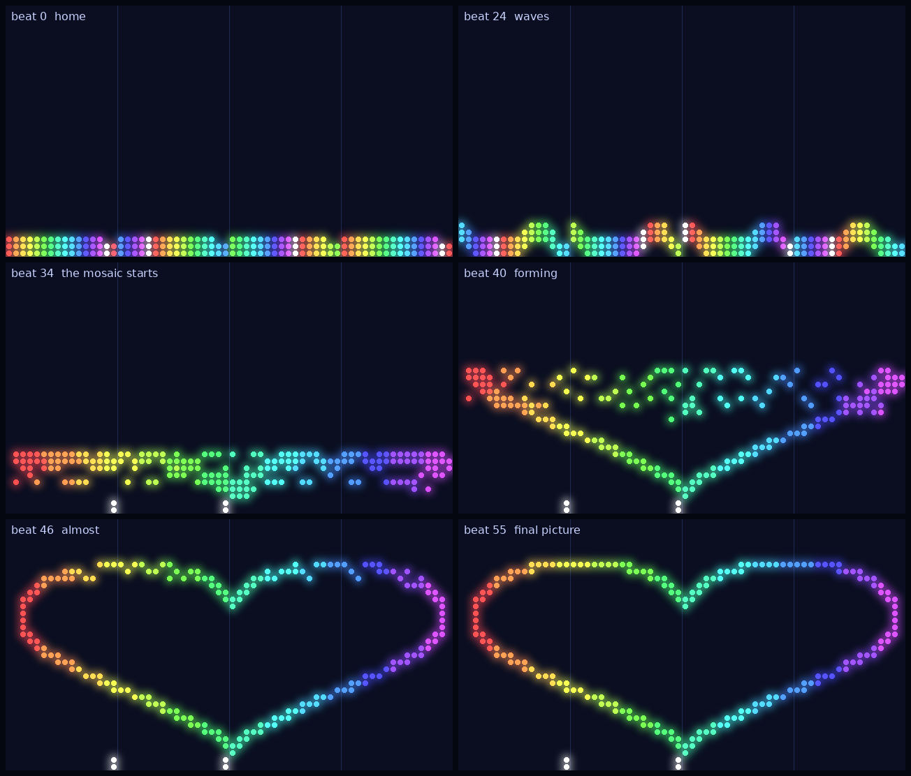
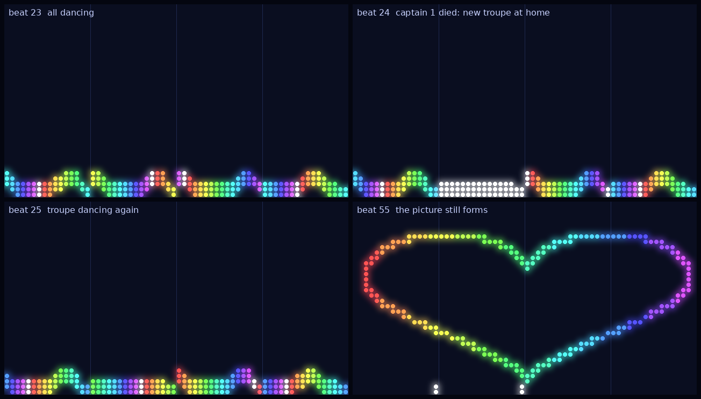

# Swarm Phase 1: Leaders as Processes, Followers as Threads

**BIL 322 System Programming — Final Project, Phase 1**
**Duration:** 1 week
**Project:** [Autonomous Drone Swarm Choreographers](../projects/project3-drone-swarm-choreographers.md)
**Skeleton code:** [`labs/swarm-phase1-skeleton/`](swarm-phase1-skeleton/) (read its `README.md` first)
**Submission:** GitHub Classroom (repository) + Google Classroom link

---

## 🎬 What You Are Building

This is the show your swarm performs at the end of the phase: 4 captains with 46 performers each,
a short intro, a wave section, and then the finale, where every pixel of the target image gets a drone
(`./center --score data/scores/show.score --followers 46 --ascii 1`). Four spare drones stay at home.



([animated version](images/swarm/swarm-show.gif))

These pictures are drawn from the center's ASCII output by `render.py`; in Phase 2
the viewer becomes a real window (SDL, GTK, or Qt) that draws the same thing. In Task 5 you will make
this happen: captain 1 runs out of battery in the middle of the waves, the center notices and restarts
it, its new troupe starts again at home, and the picture still forms.



---

## 🎯 Context

*Rehearsal, one control booth.*

The show has a center (the Artistic Director), leaders (Dance Captains), and followers (Performers). In this phase everything runs on one
machine and the pieces talk the way you have already learned:

- the **center** forks **leader processes** and talks to them over **pipes** (Labs 4 and 5),
- each leader runs **follower threads** that move in lockstep, one **beat** at a time,
- the center's **choreographer** is a thread pool behind a bounded request queue, and
  every request gets memory from your **Lab 6 pool**.

This is the thread-and-synchronization half of the project: queues, locks, condition
variables, semaphores, a barrier, and your first swarm-flavored deadlock.

## 📚 Learning Objectives

1. Build a **bounded, thread-safe queue** with a mutex and condition variables.
2. Run a **thread pool** that consumes the queue and shuts down cleanly.
3. Use a **counting semaphore** to limit concurrent work and a **barrier** to keep threads in lockstep.
4. Compare **one lock** against **per-row locks** on the occupancy grid and measure the difference.
5. Define a **lock ordering** and use it to avoid deadlock.
6. Keep a multi-process, multi-threaded C program clean under Valgrind and ThreadSanitizer.

## 🧰 Prerequisites

- Week 7-8 lectures (threads, mutexes, condition variables, semaphores, barriers, deadlock).
- Lab 4 (`fork`/`exec`/`waitpid`), Lab 5 (pipes), Lab 6 (`kvpool`).

---

## 🏗️ Architecture for This Phase

```text
center (parent process)
 ├─ main thread:   clock loop: THEME, BEAT, waits for READY and ACK, audits the stage
 ├─ reader threads: one per leader, parse that leader's pipe
 ├─ planner pool:  N threads  ◀── bounded request queue (PLAN_REQ)   [Lab 6 pool + arena]
 └─ pipes ──▶ leader 0 (child process: fork + dup2 + exec ./leader)
              ├─ main thread:  protocol with the center
              ├─ thinker:      PLAN_REQ → validate → READY
              ├─ occupancy grid of the zone (one drone per cell)
              └─ follower threads F0..Fk, a barrier per beat
```

The messages are the ones in the project spec (Section 3). It is a **fixed contract**: you
can test a leader by typing these lines into its stdin by hand. The given `line_io.c` sends and
receives lines on **file descriptors**, so in Phase 3 pipes can become sockets.

**One beat, step by step** (this is what you build in Tasks 3 and 5):

1. The center sends `BEAT b` to every leader (never before it has the `ACK` for `b-1`).
2. The leader's main thread publishes `b`; every follower wakes, looks up its target for `b`
   in the stored plan (no plan: it holds its position).
3. **Phase 1:** each follower releases the cell it is in. **Barrier.**
4. **Phase 2:** each follower claims its target cell in the grid. **Barrier.**
5. The one thread that the barrier names as `PTHREAD_BARRIER_SERIAL_THREAD` sends one `POS` line
   per follower and then `ACK b`.
6. The center audits all positions (collisions, speed) and moves on to beat `b+1`.

The grid is **per leader** (a leader's zone is its own): the followers are threads of the
leader, so they can claim cells in it directly. The center does not trust the leaders; it
audits the `POS` reports.

---

## 🗺️ The Source Tree: How the Framework Fits Together

Almost all of the code is given. You write the parts marked TODO in **four files**
(`queue.c`, `grid.c`, `center.c`, `leader.c`), but you must understand the rest, because
your code runs inside it. Read this section once before you open the files, then come back to
it when you are lost.

### The files, layer by layer

```text
                    ┌──────────────────────────────────────────────────┐
 programs           │  center.c (one process)      leader.c (4 processes)│  ← your TODOs
                    └───────┬──────────────────────────────┬───────────┘
                            │ uses                         │ uses
 your modules       queue.c (Task 1)                  queue.c, grid.c (Task 3, 4)
                    kvpool (Lab 6 or stub)
                            │                              │
 given: the show    planner.c   validator.c   metrics.c    │
 given: the wire    protocol.c   line_io.c                 │
 given: basics      swarm.c  (types, score/image, zones)  compat.h (barrier on macOS)
```

| File | What it does | Who |
|---|---|---|
| `include/swarm.h`, `src/swarm.c` | The shared vocabulary: `Zone`, `Pos`, `Keyframe` ("at beat b, follower f is at (x, y) with color c"), `Theme`, `Score`, `Image`; loading score and image files; `zone_split` (cuts the stage into vertical strips, one per leader), `home_position` (where follower *i* starts), `log_msg`. | given |
| `include/protocol.h`, `src/protocol.c` | Turns a text line into a `Msg` (`proto_parse`) and back (`proto_format`); the same for the keyframe lines inside a `PLAN`. The frozen message list from the project spec lives here. It never crashes on a bad line: it returns -1. | given |
| `include/line_io.h`, `src/line_io.c` | Newline-framed I/O on a **file descriptor**: `lr_read_line` (buffered, handles partial reads and too-long lines), `send_line` and `send_all` (loop over short writes and `EINTR`). The only place that calls `read` and `write` on the pipes, so Phase 3 can swap pipes for sockets here. | given |
| `src/planner.c`, `include/planner.h` | The "choreographer": `plan_section` makes a dense plan (one keyframe for every beat and follower) for a theme and a zone. Here it is a deterministic stub that sleeps to simulate a slow model, and `--flaky` makes some plans deliberately unsafe. It is thread-safe. | given |
| `src/validator.c` | `validate_plan` checks a plan before anyone uses it: right count, colors, inside the zone, at most `MAX_SPEED` per beat, no two drones in one cell. | given |
| `src/metrics.c` | The center's audit: `audit_collisions`, `audit_speed`, and `mosaic_accuracy` (how well the final picture matches the target). | given |
| `include/kvpool.h`, `src/kvpool_stub.c` | The Lab 6 pool and arena. The stub exists only so the skeleton builds; if `src/kvpool.c` and `src/arena.c` exist, the Makefile uses yours instead. **Not thread-safe**: the center's workers share it. | stub given, yours optional |
| `include/compat.h` | One line of portability: a barrier that also exists on macOS. | given |
| `src/queue.c` | Bounded thread-safe queue (ring buffer, mutex, condition variables). Used by the center (the request queue) and by every leader (the job queue). | **Task 1** |
| `src/grid.c` | The occupancy grid of one leader's zone: `grid_claim`, `grid_release`, `grid_owner`, `grid_swap`, with one lock or one lock per row. | **Tasks 3 and 4** |
| `src/center.c` | The center process (Artistic Director). | given + **Tasks 2, 5** |
| `src/leader.c` | The leader process (Dance Captain) with its follower threads. | given + **Tasks 2, 3** |
| `tools/swapstress.c`, `tools/gridbench.c` | Stand-alone programs that hammer only `grid.c` (the deadlock demo of Task 4 and the benchmark of Task 3). | given |
| `tests/` | `run_tests.sh` (what `make test` runs), `test_queue.c` (checks your queue alone), `test_protocol.c` and `test_planner.c` (check the given modules). Read `run_tests.sh` to see what is expected of you; add your own tests there (Task 6). | given |
| `data/` | Scores (`short.score` for tests, `show.score` for the full show) and target images (small PGM files). | given |
| `show.sh`, `tools/render.py` | The picture view of a run (see "See your show" below). | given |

### Inside the center (`center.c`)

The center is one process with many threads. Read the file in this order: the **state** block
at the top, then `main`, then `reader_main`, then your TODOs.

| Thread | Does | Shares with the others |
|---|---|---|
| **main** (clock loop) | For every beat: wait until every leader is `READY` for the section, send `BEAT b`, wait for every `ACK`, audit all positions, print the stage. | `st_mu` + `st_cv` |
| **reader** (one per leader) | Reads that leader's pipe in a loop and dispatches each message: `PLAN_REQ` → `handle_plan_req` (**Task 2**), `READY`, `POS`, `ACK` update the shared state and broadcast `st_cv`. At EOF it calls `on_leader_exit` (**Task 5**). | `st_mu` |
| **worker** (the planner pool) | `queue_pop` a `Request`, then `serve_request` (**Task 2**): take a semaphore slot and KV blocks, call the slow `plan_section`, send `PLAN`. | `req_queue`, `pool_mu`, `inflight` |

The locks, and what each one protects:

| Lock | Protects |
|---|---|
| `st_mu` (+ `st_cv`) | all show state: `ready_mask`, `acked`, `spos`/`scol` (positions), `sent_theme`, `leaders[].alive`, `cur_beat`, `shutting_down`. The clock loop waits on `st_cv` for "all ready" and "all acked". |
| `leaders[l].wlock` | writes to leader *l*'s pipe, so lines from different threads never interleave. |
| `pool_mu` | the Lab 6 KV pool (it has no lock of its own). |

**Lock order: `wlock` first, then `st_mu`.** `mark_dead` follows it (the senders take `wlock` alone); so must any code you add that takes both.
The `inc` (incarnation) number on a reader tells it whether it belongs to the current process
of that leader or to a dead one, so a late line from a dead captain cannot corrupt the state of its
replacement.

### Inside a leader (`leader.c`)

A leader is a separate process started by `spawn_leader` (`fork`, `dup2` onto stdin and stdout,
`exec ./leader`). Its main thread reads stdin and creates the other threads when `ASSIGN` arrives.

| Thread | Does | Hands over through |
|---|---|---|
| **main** | Reads the center's lines: `ASSIGN` (create grid, barrier and threads), `THEME` (push onto `job_queue`), `PLAN`/`BUSY` (put into the **mailbox**), `BEAT` (`publish_beat`), `SHUTDOWN`. | `job_queue`, `mailbox`, `beat_mu`/`beat_cv` |
| **thinker** (**Task 2**) | Takes a `Theme` from `job_queue`, sends `PLAN_REQ`, waits in `mailbox_wait` for `PLAN` or `BUSY`, retries with random backoff, validates, calls `plan_store`, sends `READY`. | `job_queue`, `mailbox`, `plan_mu` |
| **followers** (**Task 3**, one per drone) | Wait on `beat_cv` for the next beat, read their target with `plan_lookup`, and do release → barrier → claim → barrier. The one thread that gets `PTHREAD_BARRIER_SERIAL_THREAD` reports `POS` lines and `ACK`. | `beat_mu`/`beat_cv`, `barrier`, `grid`, `plan_mu`, `out_mu` |

The shared pieces, each with its own lock: the **plan store** (`plans[]`, `plan_mu`: the
thinker writes, the followers read), the **mailbox** (one slot, `mailbox.mu` + `cv`: main writes,
the thinker waits), the **beat clock** (`cur_beat`, `beat_mu` + `beat_cv`: main writes, followers wait), the
**grid** (its own locks, inside `grid.c`), and **stdout** (`out_mu`: every thread that sends a
line goes through `send_msg`).

### How a message travels: a plan request, end to end

This is the path of one `PLAN_REQ`, through six files. Trace it once with `--ascii 1` and
the log lines on stderr, and the whole design will make sense.

1. **leader, thinker**: `send_msg` → `proto_format` → `send_line` (`line_io.c`) writes `PLAN_REQ ...` to stdout.
2. **center, reader thread** of that leader: `lr_read_line` → `proto_parse` → `handle_plan_req`
   builds a `Request` and `queue_try_push`es it on `req_queue` (full: `send_busy` instead).
3. **center, a worker**: `queue_pop` → `serve_request`: `sem_wait(&inflight)`, take blocks from the
   KV pool under `pool_mu`, call `plan_section` (`planner.c`), `send_plan` (a `PLAN` header and
   one keyframe line per drone, written under `wlock`).
4. **leader, main thread**: `proto_parse` → `read_plan_body` → `mailbox_put` wakes the thinker.
5. **leader, thinker**: `validate_plan` (`validator.c`) → `plan_store` → `READY`.
6. **center, clock loop**: `all_ready` is true, so it sends `BEAT b`; the followers move, report `POS`
   and `ACK`, and `audit_collisions` / `audit_speed` (`metrics.c`) judge the result.

### The life of a run

1. `main` in `center.c` loads the score and image, creates the pool, the request queue and the
   worker threads, then for each leader: `spawn_leader`, `send_assign`, `send_theme` (first section).
2. Each leader replies `HELLO`, starts its thinker and follower threads, asks for its first plan,
   and sends `READY` when it has one.
3. The clock loop runs the beats (section above). At the first beat of a section, the center sends
   the *next* section's `THEME`, so the thinkers can plan one section ahead while the drones dance.
4. After the last beat the center computes the mosaic accuracy, sends `SHUTDOWN`, joins the readers,
   and prints the `RESULT` line. Nothing may hang here (zero-tolerance list).
5. If a leader dies in the middle (Task 5), its reader sees EOF and `on_leader_exit` runs: reap,
   restart, resume from the next beat.

### Where your tasks plug in

| Task | You write | It is called from | You can test it alone with |
|---|---|---|---|
| 1 | `queue.c` | `center.c` (`req_queue`), `leader.c` (`job_queue`) | `tests/test_queue`, `make tsan` |
| 2 | `handle_plan_req`, `serve_request` (`center.c`); `thinker_main` (`leader.c`) | reader and worker threads; the leader's thinker thread | type `PLAN`/`BUSY` lines into `./leader --id 0` by hand |
| 3 | `grid.c`; `follower_main` (`leader.c`) | `handle_assign` creates the grid and threads | `./gridbench`, `./swapstress` |
| 4 | the lock order in `grid_swap` | `tools/swapstress.c` | `./swapstress row 8 2` |
| 5 | `on_leader_exit` (`center.c`) | the reader thread, at EOF | `./center --battery 1:20` |
| 6 | tests in `tests/run_tests.sh`, `REPORT.md` | `make test` | |

Do not edit the given files to make a test pass. If a given module seems wrong to you, tell us:
the protocol is a contract, and the center audits whatever the leaders report.

---

## 🚀 Getting Started

```bash
cd labs/swarm-phase1-skeleton
make                      # builds; the show cannot run yet, your TODOs are empty
make test                 # PASS/FAIL per check; start with the queue checks
```

**See your show.** Once Tasks 1-3 work together, `./show.sh` runs the show and draws it as `show.png`
and `show.gif` (needs `pip install pillow`; `./show.sh --battery 1:24` shows Task 5). This is only a
simple picture view: it reads the ASCII frames after the run, and it is there so you can see what
you built. In the project you will write your own viewer, with a real window (Qt, GTK, or SDL)
and extra controls such as pause, speed, or choosing a score, as described in the project
writeup. Phase 2 is where that starts.

Suggested order: **queue → grid → center (`serve_request`) → thinker → follower → restart →
deadlock fix**. The full show needs Tasks 1-3 to exist together, so test each piece with its
own tool until then: `tests/test_queue`, `./swapstress` and `./gridbench` for the grid, and typing
protocol lines into `./leader --id 0` by hand.

If your Lab 6 `kvpool.c` and `arena.c` pass, copy them into `src/`; the Makefile then uses them
instead of the stand-in `kvpool_stub.c`.

---

## 🛠️ Task 1: The Bounded Queue (20%)

Implement `src/queue.c` with this interface (given in `queue.h`):

```c
typedef struct queue queue_t;

queue_t *queue_create(size_t capacity, size_t item_size);
int      queue_push(queue_t *q, const void *item);      /* blocks while full  */
int      queue_try_push(queue_t *q, const void *item);  /* 0 ok, -1 if full   */
int      queue_pop(queue_t *q, void *out);              /* blocks while empty */
void     queue_close(queue_t *q);                       /* wake everyone up   */
size_t   queue_size(queue_t *q);
void     queue_destroy(queue_t *q);
```

Rules:

- `while`, not `if`, around every `pthread_cond_wait`.
- After `queue_close`, pops drain the remaining items and then return -1. Pushes return -1
  immediately (also a pusher that was already blocked). Use `pthread_cond_broadcast` there.
- No busy-waiting, no `sleep` for synchronization.

Use it as the center's **request queue** (`queue_try_push` → `BUSY` when full) and as the leader's
queue of themes.

## 🧠 Task 2: The Choreographer and the Captain (25%)

**Center** (`handle_plan_req`, `serve_request` in `center.c`):

- A reader thread must never block on a full queue: `queue_try_push`, and `BUSY <req_id> 50` if it fails.
- A planner thread takes a request, waits on the **semaphore** (`--max-inflight` planner calls at once),
  and takes the request's KV blocks from the Lab 6 pool with `kv_blocks_alloc` (`--pool-blocks` sets the
  pool size). **The Lab 6 pool is not thread-safe**: every alloc and free goes through `pool_mu`.
  If the pool is empty, answer `BUSY` — the pool is a second form of backpressure.
- It plans into the worker's arena with `plan_section` (this sleeps: it is the slow "model"), replies
  with `PLAN`, and gives the blocks back and posts the semaphore. **Every exit path** releases what it took.

**Leader** (`thinker_main` in `leader.c`):

- For each `THEME`, send `PLAN_REQ <req_id> <section> <n_followers> <style_seed>` and wait for the answer.
- After `BUSY`, sleep `retry_ms` plus a **random** extra between 0 and `retry_ms`, and ask again. A fixed
  delay makes every leader retry at the same instant — the livelock slide.
- Run every `PLAN` through `validate_plan` (speed ≤ 2 cells per beat, one drone per cell, inside the zone,
  dense). If it fails, log the reason and ask again with a new `style_seed` (at most 6 attempts).
  `--flaky 50` makes half of the plans wrong on purpose.
- Send `READY` for the section when the plan is stored, **and also if you gave up** (the followers then
  hold their position and the show goes on).

## 🥁 Task 3: Performers in Lockstep and the Occupancy Grid (25%)

- Implement `grid_claim`, `grid_release`, `grid_owner` in `src/grid.c` for **both** modes
  (`--grid global` one mutex, `--grid row` one mutex per row). A reader must lock too — explain why in the report.
- Implement `follower_main` in `leader.c` with the two barriers described above. A failed claim is
  a safety violation: count it, log it, stay where you were. (With a valid plan it must never happen.)
- `make bench` runs `gridbench` for 1, 2, 4 and 8 threads in both modes. Put the table in the
  report and **explain it** (cores, contention, what else could be the bottleneck).
  The Phase 1 show itself at tempo 0 is dominated by the planner's thinking time, not by the grid.

## ⚠️ Task 4: Find the Deadlock (10%)

The given `grid_swap` exchanges the contents of two cells and locks both rows. In per-row mode it can hang:
`./swapstress row 8 2` prints `HANG` (and `./swapstress global 8 2` does not).

1. Reproduce the hang. Show the stuck threads (`gdb -p <pid>` and `thread apply all bt`).
2. Name the Coffman condition you break, and fix `grid_swap` with a lock ordering.
3. Explain in the report why your fix cannot create a *livelock*.

## 🔋 Task 5: Captain Down (10%)

A captain's battery dies mid-show (`./center --battery 1:20` makes leader 1 exit when beat 20 starts,
as if it crashed). The performers are threads inside the captain, so they die with it.

1. The center notices through **EOF on the pipe** (not by polling) and prints `captain 1 went dark at
   beat 20`. It reaps the process with `waitpid` (**no zombie**) and closes both pipe ends.
2. The clock loop must not wait forever for a dead captain: wake `st_cv` waiters.
3. With restart (the default): start a new captain for that zone, re-send `ASSIGN`, send `THEME` for
   the next beat on (the section's `start_beat` is shortened to the resume beat), and set
   `skip_speed` — the new performers start at **home**, a jump the speed audit must forgive once.
   The picture must still form at the end.
4. With `--no-restart` the zone is marked `gone` and the show finishes without it.
5. In the report, say what would be different if the performers were *processes*. (Phase 3
   asks you to build exactly that.)

## 📊 Task 6: Tests and Report (10%)

- `make test` must pass: unit tests, queue tests, the short score with **zero collisions and zero speed
  violations** and a mosaic accuracy of at least 0.95, `BUSY` pressure, a tiny pool, a flaky planner,
  captain down (with and without restart), `swapstress`, and Valgrind.
- `make tsan` runs the whole show under ThreadSanitizer: **no `WARNING`**.
- Add at least **two tests of your own** to `tests/run_tests.sh` (for example `--leaders 8`, a different
  score, killing two captains).
- `REPORT.md`: architecture sketch, what each mutex protects, the lock ordering, the deadlock
  write-up, captain-down handling, the benchmark table, AI assistance (what you asked, what you changed).

---

## 🧯 Hints

- A hang prints `center: TIMEOUT` after `--timeout` seconds. Attach `gdb -p <pid>` and run
  `thread apply all bt`.
- The barrier is shared by *all* follower threads of a leader. If one follower returns early (for
  example, a `continue` between the two barrier waits), the others wait forever.
- Every unlock must happen on every path (early `return`s are the usual leak).
- The center's state (`st_mu`, `st_cv`) and its lock order (`wlock` before `st_mu`) are given and
  commented; read `center.c` once from top to bottom before you write your part.

## 🚀 Bonus (up to +10%)

- B1: A priority request queue (the next section's leader first) that does not starve other leaders.
- B2: Reader-writer lock for the grid, and a viewer thread as the reader.
- B3: A battery counter per follower and a charging-station semaphore.

## ✅ Grader's Checklist

```bash
make && make test
make tsan                                   # no ThreadSanitizer WARNING
make bench                                  # the table in the report matches
valgrind --leak-check=full --error-exitcode=1 ./center --tempo 0 --followers 4 --leaders 2
pgrep -x leader                             # nothing left after the show
```

Zero-tolerance items: busy-waiting, an `if` around `pthread_cond_wait`, an unprotected Lab 6 pool,
zombie processes after a captain dies, a hang on shutdown, a missing report.

## 🔭 Where This Goes Next

Phase 2 moves the stage state into shared memory and the viewer into its own process;
Phase 3 replaces the pipes with sockets. Keep `queue.c`, the protocol code (`line_io.c` is already
written against file descriptors), and the tests clean.
