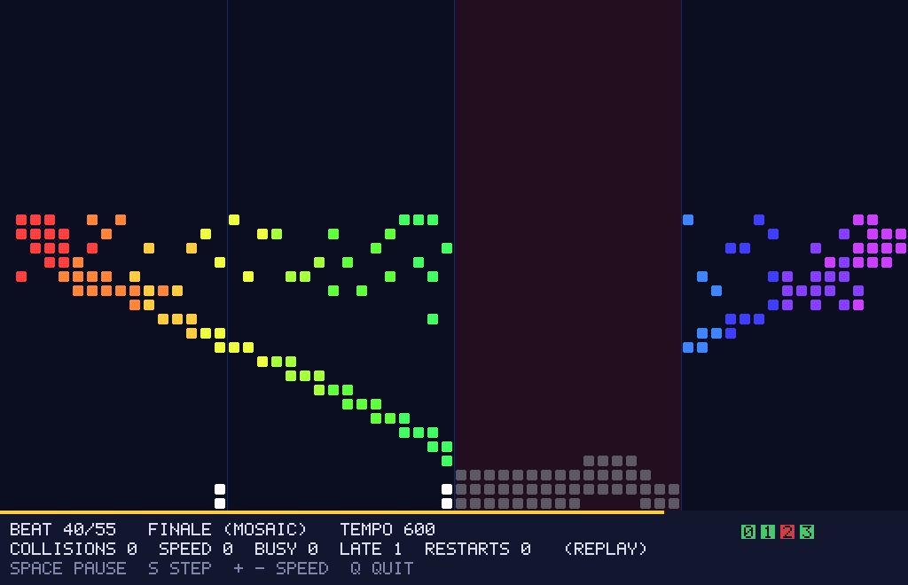
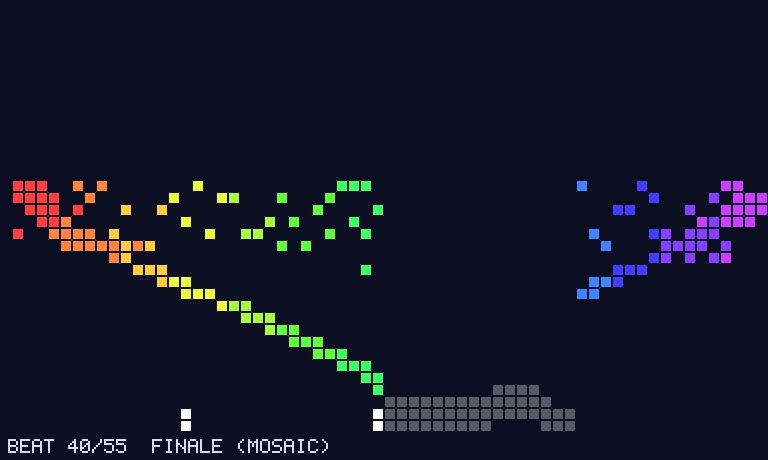

# Swarm Phase 2: One Channel API, a Shared Stage, and an Independent Broadcast Booth

**BIL 322 System Programming — Final Project, Phase 2**
**Duration:** until Thursday 19 November (assigned together with [Phase 3](swarm-phase3-sockets-signals.md), due 3 December, in the same repository)
**Project:** [Autonomous Drone Swarm Choreographers](../projects/project3-drone-swarm-choreographers.md)
**Skeleton code:** [`labs/swarm-phase2-3-skeleton/`](swarm-phase2-3-skeleton/) (read its `README.md` first)
**Submission:** GitHub Classroom (repository) + Google Classroom link
**Platform:** Linux (a lab machine, a Linux VM, or WSL2). macOS lacks two things this phase uses:
unnamed process-shared semaphores and POSIX message queues.

---

## 🎬 What You Are Building

The same show as in Phase 1, now with a **broadcast booth**: a separate program with a window that
watches the show live, lets an operator pause it, change the tempo or kill a captain, and replays a
recording afterwards. The center does not draw anything any more. It publishes the state of the stage
after every beat, and anyone on the machine may watch.

```bash
bin/center --score data/scores/show.score --followers 46 --record show.rec   # terminal 1: the show
bin/viewer --view gui                                                         # terminal 2: your window
bin/swarmctl pause; bin/swarmctl tempo 300; bin/swarmctl resume               # terminal 3: the operator
bin/viewer --replay show.rec --view gui                                       # afterwards: the replay
```


*A finished viewer at the last beat. You start from a basic SDL2 window that is given (below) and make
it yours: the layout and the controls are your choice, and so is the toolkit (Task 2).*



*`--battery 2:30 --no-restart`: from beat 30 on, captain 2's troupe is lost. The status bar shows
which captains are alive; clicking a green square kills that captain (the `KILL` command of Task 3).*

---

## 🎯 Context

*Dress rehearsal: the crowd is watching.*

In Phase 1 the stage lived inside the center, and the only way to see it was ASCII art in the center's
own terminal. The model (the state of the show) and the view (the drawing) were one program. A
slow terminal slowed the show down, and nobody else could watch.

This phase separates them, the way real systems do:

- **The center is the model.** It runs the show as in Phase 1. After every beat it packs the whole
  stage into a fixed-size `Frame` and **publishes** it. It never waits for anyone to read it.
- **Viewers are separate programs.** Any number of them, started and stopped at any time, each
  showing the frames in its own way: a terminal, your GUI, a picture file, a test that checks
  every frame. A viewer that is slow, frozen (`SIGSTOP`) or killed cannot slow the show down.
- **Operators send commands** (`PAUSE`, `RESUME`, `TEMPO`, `KILL`, `STOP`) on a separate control
  channel. A viewer's buttons and the command-line tool `swarmctl` use the same channel.
- **A flight recorder** writes every frame to a file, and the viewer can replay that file.

Every one of these links is a **channel** with the same four functions: `chan_open`, `chan_send`,
`chan_recv`, `chan_close`. What carries the bytes (a pipe, shared memory, a FIFO, a file) is chosen
by the **address** (`"shm:NAME"`, `"fifo:NAME"`, `"file:PATH"`), not by the code that uses it. In
Phase 3 one more transport, `"tcp:HOST:PORT"`, puts the whole show on the network without changing
the center, the captains or the viewer.

The captains (leaders) do not change: they still talk to the center over pipes, now through
`chan_fd`. The stage bus has **exactly one writer, the center**. That is a design decision, not a
shortcut: one writer means no lock between processes on the hot path, a crashed captain cannot leave
the stage half-written, and a reader can never block the writer.

**Modern names for what you build.** The stage bus is a *publish/subscribe* topic with
*latest-value* semantics (like a ROS topic with a queue of one, or a Redis key that viewers poll). Its
consistency trick is a *sequence lock* (seqlock), the same idea the Linux kernel uses to publish the
time to every process. Separating commands (control plane) from state (data plane) is the pattern
behind `kubectl` and Kubernetes, and behind CQRS in web services. The flight recorder is an
append-only log, the core idea of Kafka and of every database's write-ahead log. And `chan_t`, a
struct of function pointers chosen at run time, is how C does *interfaces*: Linux's
`struct file_operations` works the same way.

## 📚 Learning Objectives

1. **Apply** a transport-independent interface in C: a struct of function pointers selected by an
   address, with the same semantics on every transport.
2. **Apply** POSIX shared memory (`shm_open`, `ftruncate`, `mmap`) between unrelated processes, with
   read-only mappings for readers.
3. **Apply** lock-free publication with a sequence lock and C11 atomics, and process-shared
   semaphores for wake-ups; **analyze** why a reader must never be able to block the writer.
4. **Apply** named pipes (or POSIX message queues) for a many-writers, one-reader control channel;
   **explain** `PIPE_BUF` atomicity and the FIFO open/EOF traps.
5. **Apply** memory-mapped files for a crash-tolerant recording that can be read while it is written.
6. **Apply** signal handling with a dedicated `sigwait` thread for a clean `Ctrl-C`.
7. **Design** a GUI that is completely separate from the model: it sees only `Frame`s and sends only
   text commands.

## 🧰 Prerequisites

- Phase 1 complete: your code moves into the new layout first (see Getting Started).
- Week 9-12 lectures: pipes and FIFOs, shared memory, `mmap`, message queues, signals.
- For Task 2: a GUI toolkit with development headers, for example `sudo apt install libsdl2-dev`
  (or raylib, GTK 4, Qt 6).

---

## 🏗️ Architecture for This Phase

```text
                         ┌───────────────── center (the model) ─────────────────┐
  captains  ◀── pipes ──▶│ clock loop · choreographer pool · audit · publish     │
  (leader, unchanged:    │ control thread · signal thread                        │
   chan_fd(0, 1))        └───┬─────────────────────┬────────────────────▲───────┘
                             │ chan_send(bus, …)   │ chan_send(rec, …)  │ chan_recv(ctl, …)
                             ▼                     ▼                    │
                       "shm:NAME"            "file:show.rec"       "fifo:NAME"
                       stage bus (Task 1)    recorder (Task 4)     control (Task 3)
                       newest frame wins     every frame, kept     every command, in order
                        │     │      │             │                 ▲         ▲
                        ▼     ▼      ▼             ▼                 │         │
                     viewer viewer swarmctl   viewer --replay    swarmctl   viewer keys
                     (gui)  (term) status                        pause      and buttons
```

There are two directions, and they never mix:

- **Data plane, center → everyone:** frames. One writer, many readers, newest value wins. A reader
  that falls behind skips frames; the writer never notices.
- **Control plane, everyone → center:** command lines. Many writers, one reader, every command
  delivered in order. A command is checked and may be rejected; it changes the model, and the
  change comes back to every viewer in the next frame.

### One API, many transports

```c
chan_t *chan_open(const char *addr, int mode);              /* CHAN_SEND or CHAN_RECV */
int     chan_send(chan_t *c, const void *msg, size_t len);
ssize_t chan_recv(chan_t *c, void *buf, size_t cap, int timeout_ms);   /* or CHAN_TIMEOUT, CHAN_CLOSED */
void    chan_close(chan_t *c);
chan_t *chan_fd(int in_fd, int out_fd);                      /* a channel over fds you already have */
```

| Address | Transport | Link | Delivery | Built by |
|---|---|---|---|---|
| `chan_fd(i, o)` | two pipes | center ⇄ captain: protocol lines | every line, in order | given |
| `shm:NAME` | shared memory `/dev/shm/NAME` | center → viewers: `Frame`s | newest wins, never blocks | **Task 1** |
| `fifo:NAME` | named pipe `/tmp/NAME.ctl` | operators → center: commands | every line, in order | **Task 3** |
| `mq:NAME` | POSIX message queue | (the same, if you prefer it) | every message, in order | Task 3, optional |
| `file:PATH` | memory-mapped file | center → recording → replay | every frame, kept | **Task 4** |
| `tcp:HOST:PORT` | TCP socket | everything | depends on the link | Phase 3 |

The center publishes with `chan_send(bus, &frame, sizeof frame)`, and a viewer receives with
`chan_recv(src, &frame, sizeof frame, 30)` whether `src` is a live show or a recording. Read
`common/chan.h`: it is short and it is the contract every transport must keep.

**How it works inside.** `chan_t` starts with a pointer to a table of three functions
(`struct chan_ops { send, recv, close }` in `chan_impl.h`). `chan_open` looks at the prefix of the
address and calls `chan_shm_open`, `chan_fifo_open` or `chan_file_open`, which fill in their own
table. `chan_send(c, …)` is just `c->ops->send(c, …)`. Each transport keeps its own data after the
common header (`struct shm_chan { struct chan base; … }`), so its functions cast the pointer back.
`chan.c` contains the dispatcher and the complete fd transport: read it as an example before you
write your own.

### The Frame: the view model

`common/frame.h` defines what a viewer can know about the show: the beat, the section and theme, the
tempo, paused and finished flags, which captains are alive, the safety counters, and one
`DroneView { x, y, color, leader, state }` per drone. It is a fixed-size struct (4184 bytes) with
no pointers, so it can be copied into shared memory, written to a file, and (in Phase 3) sent over
a socket as it is. Its last field is a checksum (`frame_seal`, `frame_intact`): a reader can detect a
torn copy, and the tests use it to check Task 1.

---

## 🗺️ The Source Tree: How the Framework Fits Together

The project is now split into folders, one per program, plus the code they share. **Each program
sees only its own folder and `common/`**: the Makefile gives the viewer `-Icommon -Iviewer` and
nothing else, so the viewer cannot even include the center's headers. That is how the view stays
separate from the model, and the compiler checks it for you.

```text
common/     shared by every program: frames, channels, protocol, queue
center/     the model: clock, choreographer, audit, publishing, operator commands
leader/     a captain and its performer threads (unchanged since Phase 1)
viewer/     the broadcast booth: the viewer loop and its views (your GUI is one of them)
ctl/        swarmctl, the operator's command-line tool
tests/      run_tests.sh (make test), test_chan.c (the channel tests), the Phase 1 tests
tools/      render.py (pictures), swapstress and gridbench (Phase 1)
data/       scores and images
bin/        the programs, after make (bin/center, bin/leader, bin/viewer, bin/swarmctl, ...)
```

### The files

| File | What it does | Who |
|---|---|---|
| `common/chan.h` | The channel API and its contract (read it first). | given |
| `common/chan_impl.h` | What a transport implements: `struct chan_ops`, `struct chan`, the `chan_*_open` functions, `chan_deadline`. | given |
| `common/chan.c` | `chan_open` (picks the transport by prefix), `chan_send/recv/close`, and the fd transport (pipes; `poll` + `LineReader`). | given |
| `common/chan_shm.c` | The stage bus. | **Task 1** |
| `common/chan_fifo.c` | The control channel as a FIFO. | **Task 3** |
| `common/chan_mq.c` | The control channel as a message queue. | Task 3, optional |
| `common/chan_file.c` | The flight recorder and replay. | **Task 4** |
| `common/frame.h`, `frame.c` | The `Frame` (the view model), its checksum, `frame_cells`. | given |
| `common/recording.h` | The recording file's 64-byte header. | given |
| `common/swarm.*`, `protocol.*`, `line_io.*`, `compat.h` | As in Phase 1: types, scores, the protocol parser, line I/O. | given |
| `common/queue.c` | Your Phase 1 bounded queue. | **yours, Phase 1** |
| `center/center.c` | The center. New: `build_frame`, `publish`, the control thread, the signal thread, `--name`, `--record`, `--paused`. | given + **Phase 1 blocks** + **Task 3** |
| `center/planner.*`, `metrics.*`, `kvpool*` | As in Phase 1. Copy your Lab 6 `kvpool.c`/`arena.c` here if you used them. | given / yours |
| `leader/leader.c` | A captain. New: its link to the center is `chan_fd(0, 1)`. | given + **Phase 1 blocks** |
| `leader/grid.c` | Your Phase 1 occupancy grid. | **yours, Phase 1** |
| `leader/validator.*` | As in Phase 1. | given |
| `viewer/viewer.c` | The viewer program: opens the source (`shm:`, `file:` or `--demo`), loops "frame in → `draw`; `input` → command out". | given |
| `viewer/view.h` | **The View interface**: `open`, `draw`, `input`, `close`. Your GUI implements it. | given |
| `viewer/view_term.c` | A complete live view in the terminal (24-bit colors, keyboard): the example for Task 2. | given |
| `viewer/view_ascii.c`, `view_ppm.c`, `view_check.c` | Text frames for `render.py`, the last frame as a PPM picture, and a checker for the tests. | given |
| `viewer/view_gui.c` | Your window. | **Task 2** |
| `viewer/palette.h` | The show's colors (the same as `render.py`). | given |
| `ctl/swarmctl.c` | `pause`, `resume`, `tempo N`, `kill ID`, `stop`, `raw LINE` go to the control channel; `status` and `watch` read the stage bus. | given |
| `tests/test_chan.c` | 41 checks of your three transports, each alone (`tests/test_chan shm`). | given |
| `tests/run_tests.sh` | `make test`: Phase 1 checks, the channel tests, and whole-show tests (live viewer, slow and frozen viewers, commands, recording, `Ctrl-C`, Valgrind). | given |

### A frame's journey, end to end

1. **Center, main thread.** The clock loop finishes beat *b*: every captain has sent its `POS` lines
   and `ACK`, the audit has run. `build_frame` copies the positions, colors and counters into a
   `Frame` and seals it; `publish` calls `chan_send(bus, &frame, sizeof frame)` and
   `chan_send(rec, &frame, sizeof frame)`.
2. **Your transports.** `shm_send` writes the frame into shared memory (sequence number odd, copy,
   sequence number even) and wakes every waiting receiver. `file_send` copies the frame into the
   mapped file and then increments `n_frames`. Neither waits for anybody.
3. **Viewer.** Its loop is in `chan_recv(src, &frame, sizeof frame, 30)`: `shm_recv` sleeps on its
   semaphore, wakes up, copies the newest frame, checks that it was not overwritten during the copy,
   and returns it. The loop calls `view->draw(&frame)`. Your GUI draws it.
4. **The operator presses space.** `view->input` returns the line `"PAUSE"`. `viewer.c` opens
   `fifo:NAME` with `CHAN_SEND`, sends the line and closes it (`swarmctl pause` does exactly the same).
5. **Center, control thread.** It is waiting in `chan_recv(ctl, line, …, 200)`; it gets `"PAUSE"` and
   calls your `apply_command`, which sets `paused` under `st_mu` and signals `st_cv`.
6. **Center, main thread.** Before the next beat it calls your `wait_while_paused`, publishes one frame
   with `paused = 1`, and sleeps on `st_cv`. Every viewer gets that frame and shows "PAUSED". The
   view never changed its own state: the model did, and the view showed it.

### Processes and threads

```text
 center (process)                                   viewer (process, any number)     swarmctl
   main:     clock loop, audit, publish                loop: chan_recv → draw          one command,
   reader i: leader i's lines (as in Phase 1)                input → command line      or status
   workers:  the planner pool (as in Phase 1)
   control:  chan_recv(ctl) → apply_command         leader i (process): unchanged since Phase 1
   signals:  sigwait(SIGINT, SIGTERM) → stop
```

**Ctrl-C.** `main` blocks `SIGINT` and `SIGTERM` before it creates any thread, so every thread
inherits the blocked mask; the signal thread receives them with `sigwait`. There is no signal
handler at all, so the signal thread may lock mutexes and log like any other thread: it calls
`request_stop()`, the clock loop finishes the beat, publishes the final frame, and the show ends
normally (exit status 0, `RESULT` line, nothing left in `/dev/shm` or `/tmp`). The captains ignore
`SIGINT` (the terminal sends it to the whole process group); the center stops them with `SHUTDOWN`.

### Where your tasks plug in

| Task | You write | It is called from | Test it alone with |
|---|---|---|---|
| Phase 1 | `common/queue.c`, `leader/grid.c`, the `PHASE 1` blocks of `center.c` and `leader.c` | as in Phase 1 | `tests/run_tests.sh phase1` |
| 1 | `common/chan_shm.c` | `publish` (center), `viewer.c`, `swarmctl status` | `tests/test_chan shm` |
| 2 | `viewer/view_gui.c` (+ `GUI_PKG` in the Makefile) | `viewer.c` | `bin/viewer --demo --view gui` |
| 3 | `common/chan_fifo.c`; `apply_command`, `wait_while_paused` in `center.c` | `control_main`, the clock loop | `tests/test_chan fifo`, then `bin/swarmctl` |
| 4 | `common/chan_file.c` | `publish`, `viewer --replay` | `tests/test_chan file` |
| 5 | tests, `REPORT.md` | `make test` | |

---

## 🚀 Getting Started

**1. Move your Phase 1 code in** (about 30 minutes). The files kept their names; only the folders
changed.

| Your Phase 1 code | Goes to |
|---|---|
| `src/queue.c` | `common/queue.c` (the whole file) |
| `src/grid.c` | `leader/grid.c` (the whole file) |
| `thinker_main`, `follower_main` bodies (`src/leader.c`) | the `PHASE 1` blocks of `leader/leader.c` |
| `handle_plan_req`, `serve_request`, `on_leader_exit` (`src/center.c`) | the `PHASE 1` blocks of `center/center.c` |
| `src/kvpool.c`, `src/arena.c` (Lab 6, if you used them) | `center/` |

Copy the bodies, not the whole `center.c`/`leader.c` files: the given parts changed. If your code
wrote to a pipe directly (`send_line(1, …)`, `send_all(ld->to_fd, …)`), use the given `send_msg`
(leader) and `leader_send` (center) instead: every link is a channel now. Then:

```bash
cd labs/swarm-phase2-3-skeleton
make
tests/run_tests.sh phase1        # your Phase 1 code, in the new layout: all PASS
```

The show runs without the Phase 2 parts (it says "no stage bus ... Task 1 not done?"), so you can
check the migration before you start.

**2. Look around.** `bin/viewer --demo` plays a made-up show inside the viewer, in the terminal (space
pauses, `+`/`-` change the tempo, `1`-`4` "kill" a captain, `q` quits). It needs none of your code: use
it to start Task 2 at once.

**3. Suggested order.** Task 1 (the bus) → Task 3 (commands) → Task 4 (recorder), with Task 2 (GUI)
in parallel, or split between team members. `tests/test_chan shm|fifo|file` tests each transport
alone, without the show.

**Useful commands.**

```bash
bin/center --name s1 --tempo 240                 # a show called s1 (default name: swarm-<your uid>)
bin/viewer --name s1                             # watch it in the terminal (--view gui: your window)
bin/viewer --name s1 --view check --wait 5       # start first, wait for the show, check every frame
bin/swarmctl --name s1 status                    # the newest frame as one line
bin/swarmctl --name s1 watch                     # one line per frame
bin/center --paused --record show.rec            # waits for: bin/swarmctl resume
bin/viewer --replay show.rec                     # replay (space, s = step, + -, q)
./show.sh                                        # records the heart show, draws show.png and show.gif
make demo                                        # the heart show with a terminal viewer
ls /dev/shm /tmp/*.ctl                           # what is left behind (should be nothing)
```

Two students on one machine do not disturb each other: the default name contains your user id.

---

## 🛠️ Task 1: The Stage Bus (30%)

Implement `common/chan_shm.c`: a channel in shared memory with **one sender and any number of
receivers**, where the newest message wins. The rules (the tests check each one, whatever your
design):

1. `chan_send` never blocks and never waits for a receiver. A receiver that is slow, stopped
   (`SIGSTOP`) or killed (`SIGKILL`) at any moment cannot slow down or freeze the sender.
2. A receiver gets whole messages only: never half old and half new (a *torn* frame).
3. A receiver gets the newest message it has not seen yet; it may skip older ones. A receiver that
   attaches gets the current message at once.
4. A receiver waits without busy-waiting, and never longer than its `timeout_ms`.
5. After the sender's `chan_close`, every receiver gets the last message (if it had not seen it) and
   then `CHAN_CLOSED`. If the sender dies without closing, receivers notice it within about a second
   (`CHAN_CLOSED`), and a new sender with the same name can start.
6. Receivers map the message part **read-only** (`PROT_READ`): a buggy viewer cannot damage the show.
7. After the sender's `chan_close`, nothing is left in `/dev/shm`.

The comment at the top of `chan_shm.c` describes **a design that works**: a control page (receiver
slots with a process-shared semaphore each, the sender's pid, a closed flag) and a message part
protected by a sequence lock, with C11 atomics. You may follow it or choose another one
(two buffers and an index, a ring of the last N frames, `futex`, ...) as long as the rules hold.
Before you choose, think about this: why can the stage bus **not** be protected by a process-shared
mutex that both the sender and the receivers take? (Hint: rule 1, and what `SIGSTOP` does to a
process that holds a lock.)

`tests/test_chan shm` sends 20,000 frames to five receivers (one is stopped, one is killed in the
middle) and checks every frame's checksum and order; it also measures the sender's cost per frame
and the CPU time of a waiting receiver. `make test` adds a live show with a slow viewer
(`--delay-ms 300`) and a frozen one: the show must take as long as without them.

**In the report:** your layout (draw it), why each rule holds, what happens at each point if the
sender is killed in the middle of `chan_send`, and the sender's cost per frame that the test prints.

## 🖥️ Task 2: Your Broadcast Booth (20%)

`viewer/view_gui.c` is given as a **basic SDL2 view**: a window the size of the stage, one square per
drone in its color (grey when its captain is dead), the beat and the section in one status line, and
two keys (space: pause/resume; q, Esc or closing the window: quit). It already implements the View
interface (`view.h`), so it works on a live show, on a replay and on `--demo`. `viewer/font5x7.h`
draws text without a font library. Your task is to turn it into a real broadcast booth.



**The toolkit.** The Makefile uses SDL2 when it is installed (`sudo apt install libsdl2-dev`). You
may stay with SDL2 or move to another toolkit: raylib is close to SDL2, GTK 4 and Qt 6 give you real
buttons and sliders (for Qt, write this one file in C++ as `view_gui.cpp` and adapt the Makefile).
Put the `pkg-config` name in `GUI_PKG` in the Makefile.

**Requirements** (what the given view does not do yet).

- The stage: the zone borders and the zone of a dead captain marked. The window adapts to the
  stage size in the frame (`w`, `h`) and can be resized.
- The status: beat / last beat, section and theme, tempo, paused, finished, which captains are
  alive, collisions, speed violations, restarts.
- Controls (keys, buttons, or both): pause/resume, tempo up/down, kill a captain (live show), step
  (replay), quit. A control only **returns a command line** from `input()`; the viewer sends it. Your
  view never opens a channel and never changes the show itself.
- `draw()` returns quickly and `input()` never blocks longer than `wait_ms`: the window stays
  responsive (move it, resize it, close it) during the whole show, also while the show is paused.
- Closing the window ends the viewer (`input` returns -1), never the show.
- `view_gui.c` includes only `view.h`, `frame.h`, `palette.h` and your toolkit's headers.

**Develop it without the rest:** `bin/viewer --demo --view gui` gives your view a made-up show that
obeys pause, tempo and kill, so you can write Task 2 before Task 1 works, or in parallel with a team
member. Then try it on a live show and on a replay: the same view works for both, because it only
sees frames.

**Make it yours.** Some ideas, none required: trails (fade the last few beats), a timeline you click
to jump in a replay, a tempo slider, a zoom, a heat map of where drones spend time, a screenshot
key, sound on the beat. Show your viewer in the lab (Task 5 demo). Bigger ideas are in the bonus
list: a booth per captain, or the same booth in Qt or GTK.

**In the report:** a screenshot, the toolkit and why, how you keep the window responsive, and how
the view decides which command to send (for example: space sends `PAUSE` or `RESUME` depending on the
`paused` flag in the last frame, not on a variable of the view).

## 🎛️ Task 3: The Control Channel and the Operator (20%)

**The channel.** Implement `common/chan_fifo.c`: `fifo:NAME` is the named pipe `/tmp/NAME.ctl`, many
senders, one receiver (the center), one text line per message. The comment in the file lists the
traps (the blocking `open`, the EOF when the last writer leaves, `O_CLOEXEC`) and one classic way
around each. `chan_send` writes the line and its `'\n'` in **one** `write`: with many senders at the
same time, why does that matter, and up to what length is it guaranteed (`man 7 pipe`, `PIPE_BUF`)?

If you prefer, implement `common/chan_mq.c` (a POSIX message queue) instead and set `CTL_TRANSPORT`
to `"mq"` in `chan.h`; then implement the FIFO too for the bonus, and compare them in the report.

**The commands.** In `center/center.c`, implement `apply_command(line)` and `wait_while_paused()`:

| Command | Effect |
|---|---|
| `PAUSE`, `RESUME` | the clock stops between two beats / goes on |
| `TEMPO <bpm>` | 0 ≤ bpm ≤ 2000; the clock uses it from the next beat (0 = as fast as possible) |
| `KILL <leader_id>` | `SIGKILL` that captain (your Phase 1 restart brings it back) |
| `STOP` | end the show after this beat, cleanly (`request_stop()`, the same as `Ctrl-C`) |

Anything else (unknown words, missing or extra arguments, numbers out of range, `"TEMPO 12abc"`) is
rejected with a log line and changes nothing. A paused center must not use the CPU: the clock waits on
`st_cv`, with no sleep and no polling. The control thread is given; read it.

`tests/test_chan fifo` checks the channel (including 4 senders × 200 commands at once). `make test`
then runs a show with `--paused` and drives it with `swarmctl`: pause, resume, bad commands, a kill,
a tempo change, `STOP`.

**In the report:** how your receiver survives operators that come and go, what happens if two
operators send at the same moment, and the path of a `PAUSE` from the key press to the "PAUSED" on
every screen.

## 📼 Task 4: The Flight Recorder (15%)

Implement `common/chan_file.c`: `file:PATH` writes every frame to a memory-mapped file (a 64-byte
header from `recording.h`, then the frames back to back), and reads it back in order. The comment in
the file gives the steps. The interesting parts:

- The recorder sizes the file once (`ftruncate`) and maps it with `MAP_SHARED`: writing a frame is a
  `memcpy`, and the kernel writes the pages to the file. What would happen if you touched a page past
  the end of the file?
- It copies the frame first and increments `n_frames` after. A replay may read the file **while it is
  being written** (`bin/viewer --replay` during the show follows it to the end): why does the order
  matter?
- On close it sets `complete`, and truncates the file to the frames actually written.
- A replay checks the header (magic, version, frame size, length) and refuses a foreign or truncated
  file with a message, never a crash.

`tests/test_chan file` checks all of this, including a replay that starts while the recording is
going on. `make test` records a show and checks that the file holds exactly every frame.

**In the report:** the file layout, and what a replay sees if the center crashes in the middle of
the show (try it: `kill -9` the center during a recording).

## 📊 Task 5: Tests, Demo and Report (15%)

- `make test` passes: your Phase 1 checks, the channel tests, and the whole-show checks (live viewer,
  slow and frozen viewers, commands, recording, `Ctrl-C` and `SIGTERM`, Valgrind). `make tsan` prints
  no `WARNING`.
- After every test, a normal end and `Ctrl-C`, `ls /dev/shm /tmp/*.ctl` shows nothing of yours.
- Add **two tests of your own** to `tests/run_tests.sh` (for example: three viewers at once, a viewer
  started in the middle of the show, a `KILL` while paused, a replay of a crashed recording).
- **Demo in the lab** (5 minutes): the show in your window, a second viewer in the terminal,
  pause/tempo/kill from your window and from `swarmctl`, `Ctrl-C`, then the replay.
- `REPORT.md`: the answers asked in Tasks 1-4, one race or bug you hit and how you found it, what
  you would change for Phase 3, and the AI assistance you used (what you asked, what you kept, what
  you had to fix).

---

## 🧯 Hints

- `/dev/shm` is a directory you can look at: `ls -l /dev/shm`, `hexdump -C /dev/shm/swarm-1000 | head`.
  A crashed test leaves its objects there; the next sender with the same name must clean them up
  (rule 5).
- `cat /proc/<pid>/maps | grep shm` shows a process's mappings and their permissions (`r--s` is what a
  receiver should have for the message part).
- `strace -f -e trace=openat,mmap,futex bin/viewer --name s1 --view check` shows what your transport
  really does. A receiver that spins shows thousands of calls per second.
- The center forks captains **after** it opens the bus and the control channel: a descriptor without
  `O_CLOEXEC` stays open in every captain. For the FIFO, that means the center never sees EOF and a
  sender never gets `ENXIO`.
- Atomics in shared memory work between processes: `_Atomic uint64_t seq` in the mapped struct,
  `atomic_load_explicit(&p->seq, memory_order_acquire)`. A plain `volatile` is not enough: it does not
  order the `memcpy` against the sequence number.
- `sem_timedwait` takes an **absolute** `CLOCK_REALTIME` time: `chan_deadline` in `chan_impl.h`
  computes it.
- If the tests hang, `tests/test_chan` prints `HANG` with the step it was in; `tests/logs/` keeps
  the output of every check.

## 🚀 Bonus (up to +10%)

- B1: **A booth per captain.** Instead of one viewer for the whole show, `bin/viewer --captain 2`
  opens a window for one captain: its zone only, zoomed in, its own status (alive, restarts, its
  drones' colors), and its own controls (kill this captain). Several of these windows run at the same
  time, next to the main booth, all reading the same bus. (The view still sees only frames: the
  filter is in the view, not in the center.)
- B2: **Another toolkit.** The booth in Qt 6 or GTK 4, with real buttons, a tempo slider and a
  captain list, built with `GUI_PKG`. Keep the SDL2 view working too (`--view sdl` and `--view gui`).
- B3: Both control transports (FIFO and message queue), with a measured comparison.
- B4: "Instant replay": the bus keeps a ring of the last N frames, and a viewer can rewind a few
  seconds of a live show; or a timeline in your GUI for replays that jumps to any beat (the
  recording is a mapped array: why is that easy?).

## ✅ Grader's Checklist

```bash
make && make test                     # ALL CHECKS PASSED
make tsan                             # no WARNING
bin/viewer --demo --view gui                               # your booth
bin/center --record /tmp/g.rec & bin/viewer --view gui      # then pause, tempo, kill, Ctrl-C
bin/viewer --replay /tmp/g.rec --view gui
ls /dev/shm /tmp/*.ctl                # nothing left
```

Zero-tolerance items: a sender that can be blocked by a receiver, busy-waiting (in the bus, the
paused clock or the viewer), a viewer that includes center or leader code, objects left in
`/dev/shm` or `/tmp` after a normal end or `Ctrl-C`, a hang on shutdown, a missing report.

## 🔭 Where This Goes Next

[Phase 3](swarm-phase3-sockets-signals.md) (same repository, due 3 December) adds two transports,
`tcp:HOST:PORT` and `udp:HOST:PORT`, and puts the whole show on the network: captains, viewers and
operators connect to the center over TCP, and every performer becomes a separate process that talks
to its captain over UDP. Nothing from this phase is thrown away: your Phase 2 transports keep working
for local viewers, the recorder is unchanged, and your booth watches a show on another machine with
`--center host:port` without a single change in the view.
