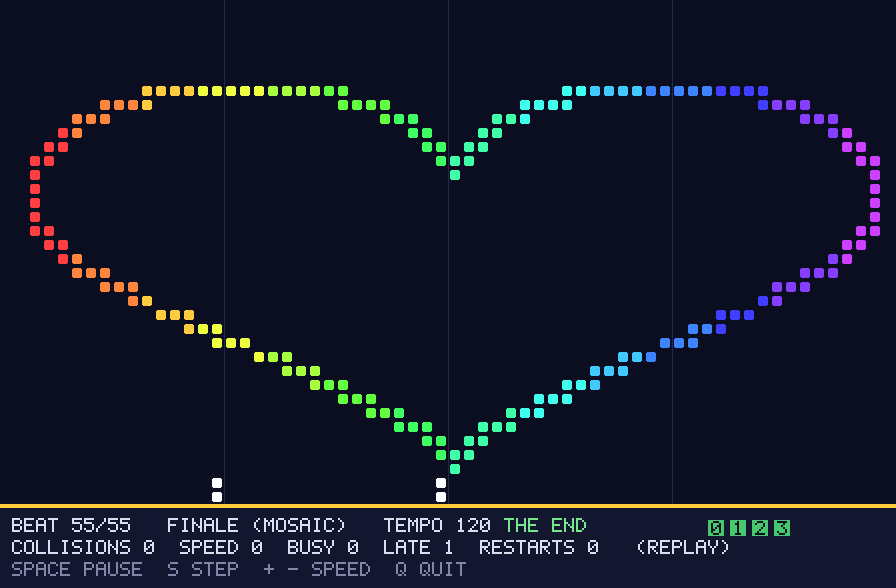

# Swarm Phase 2: Programs That Meet by Address, a Shared Stage, a Flight Recorder

**BIL 322 System Programming — Final Project, Phase 2**
**Duration:** until **Thursday 26 November 2026** (assigned together with [Phase 3](swarm-phase3-sockets-signals.md), due 10 December, in the same repository)
**Project:** [Autonomous Drone Swarm Choreographers](../projects/project3-drone-swarm-choreographers.md)
**Skeleton:** [`labs/swarm-phase2-3-skeleton/`](swarm-phase2-3-skeleton/): read its [`README.md`](swarm-phase2-3-skeleton/README.md) and [`PROTOCOL.md`](swarm-phase2-3-skeleton/PROTOCOL.md) first
**Submission:** GitHub Classroom (repository) + Google Classroom link
**Platform:** Linux (a lab machine, a Linux VM, or WSL2)

---

## 🎬 What You Are Building

The drone show again, but this time **you design it**. The skeleton gives you contracts, not code:
one header with the seven functions of a channel API, one header with the numbers and the `Frame`
layout, a protocol specification, and tests. Every program and every line of C in it is yours.

The show is made of **separate programs that nobody starts for you**. Each one is started on its own,
in its own terminal, and finds the others through one address, the center's:

```bash
bin/center --listen local:/tmp/$USER.sock --score data/scores/show.score --captains 4 --followers 46 \
           --bus shm:$USER-show --record file:/tmp/$USER.rec       # terminal 1: the show
bin/captain --center local:/tmp/$USER.sock                          # terminals 2-5: one per zone
bin/viewer --from shm:$USER-show --gui                              # terminal 6: watch it live
bin/swarmctl --center local:/tmp/$USER.sock pause                   # terminal 7: steer it
bin/viewer --from file:/tmp/$USER.rec --gui                         # afterwards: the replay
```



*An example viewer at the last beat. Yours may look completely different: the drawing, the layout
and the toolkit are your choice. A text viewer is enough for the tests.*

---

## 🎯 Context

*Dress rehearsal: every drone crew is its own team.*

In Phase 1 the center forked its captains, and everything lived in one process tree on one machine.
Real drone shows do not work that way: each drone is a machine, nobody "forks" a captain, and any
of them may be switched on late, crash, or come back. Phase 3 puts the programs on different
machines. Phase 2 gets the design right first, on one machine:

- **Nothing starts anything.** The center listens at an address. A captain connects and says
  `HELLO`; the center gives it a zone. A viewer connects and says `WATCH`; an operator says
  `OPERATE`. A captain that comes when every zone is taken waits as a **standby**, and takes over a
  zone whose captain dies.
- **One API for every link.** Every link is a channel: open it, send, receive, close. The address
  picks what carries the bytes: `local:PATH` (a Unix-domain socket), `shm:NAME` (shared memory),
  `file:PATH` (a file). In Phase 3 `tcp:HOST:PORT` and `udp:HOST:PORT` take over, and **your programs
  do not change**: only the addresses on their command lines do.
- **The center is the model, viewers are views.** After every beat the center packs the stage into
  a fixed-size `Frame` and publishes it on the **stage bus** (shared memory: one writer, any number
  of readers, the newest frame wins) and to the **flight recorder** (a file). A viewer that is slow,
  frozen (`SIGSTOP`) or killed must never slow the show down.
- **The center trusts nobody.** Captains report every drone's cell (`POS`); the center audits every
  beat for collisions and speeding. Its planner may even be wrong on purpose: a captain checks every
  move itself.

**Modern names for what you build.** The center is a *request server* with a bounded work queue and
*backpressure* (`BUSY`), like an inference server in front of a model. The stage bus is a
*publish/subscribe* topic with *latest-value* semantics, kept consistent with a *sequence lock*, the
trick Linux uses to publish the time to every process. Separating commands (`OPERATE`) from state
(frames) is the control-plane/data-plane split behind Kubernetes. The recorder is an *append-only
log*, the core of Kafka and of every database's write-ahead log. And `chan_t`, chosen by an address
at run time, is how C does *interfaces* (Linux's `struct file_operations` works the same way).

## 📚 Learning Objectives

1. **Design** a transport-independent interface in C behind a fixed API: a struct of function
   pointers selected by an address, with the same semantics on every transport.
2. **Apply** Unix-domain stream sockets for many clients and one server: `socket`, `bind`,
   `listen`, `accept`, `connect`, line framing over a byte stream, short reads and writes.
3. **Apply** POSIX shared memory (`shm_open`, `ftruncate`, `mmap`) between unrelated processes,
   with a sequence lock or semaphores; **analyze** why a reader must never be able to block the writer.
4. **Apply** file I/O or a memory-mapped file for a recording that survives a crash of its writer.
5. **Apply** POSIX threads, mutexes and condition variables to a server with many connections and
   to a captain with many drones; **analyze** the races and deadlocks of your own design.
6. **Apply** signal handling for a clean stop on `SIGINT` and `SIGTERM`.

## 🧰 Prerequisites

- Week 9-12 lectures: pipes and sockets, shared memory, `mmap`, signals. Phase 1 (threads, a
  bounded queue, an occupancy grid) helps, but no Phase 1 code is required.
- For a window (optional): `sudo apt install libsdl2-dev`, or any toolkit you like.

---

## 🏗️ Architecture for This Phase

```text
                         ┌──────────────────────────────────────────┐
   bin/captain ──────────┤ local:/tmp/you.sock   bin/center         │
   (HELLO, one per zone, │   zones · planner queue · beat clock ·   ├──► shm:you-show ──► bin/viewer
    plus standbys)       │   audit · frames · operator commands     │      (Frames, newest wins)
   bin/viewer ───────────┤   (WATCH: text frames)                   ├──► file:/tmp/you.rec ──► replay
   bin/swarmctl ─────────┤   (OPERATE: PAUSE, TEMPO, KILL, STOP)    │      (every Frame)
                         └──────────────────────────────────────────┘
```

Every arrow is a channel. Each line of the table is a link you build:

| Link | Address | What travels | Rules (PROTOCOL.md) |
|---|---|---|---|
| captain, viewer, operator → center | `local:PATH` | text lines, both ways | 1.1, 3 |
| center → viewers | `shm:NAME` | one `Frame` per beat, newest wins | 1.3, 6 |
| center → recording → replay | `file:PATH` | every `Frame`, kept | 1.4, 6.3 |

In Phase 2 a captain's drones live **inside the captain**: a thread per drone, a pool, or one thread
that moves them all; your choice, explained in `DESIGN.md`. In Phase 3 every drone becomes a process.

### The seven functions

```c
chan_t *chan_open  (const char *addr, int mode);   /* CHAN_SEND, CHAN_RECV or CHAN_BOTH */
chan_t *chan_listen(const char *addr);             /* a server: local:, tcp:, udp:      */
chan_t *chan_accept(chan_t *server, int timeout_ms);
int     chan_send  (chan_t *c, const void *msg, size_t len);
ssize_t chan_recv  (chan_t *c, void *buf, size_t cap, int timeout_ms);
int     chan_addr  (chan_t *c, int side, char *host, size_t n);
void    chan_close (chan_t *c);
```

That is the whole given API ([`include/chan.h`](swarm-phase2-3-skeleton/include/chan.h)). How
`struct chan` looks, how many files `chan/` has and what helpers you add are yours to decide. Two
rules shape everything: **messages, not bytes** (one `chan_send` arrives as one `chan_recv`; on a
stream a message is a line), and **nothing waits forever unless asked** (every `chan_recv` has a
timeout, which is how every program notices a peer that died).

---

## 🚀 Getting Started

```bash
git clone <your classroom repository> && cd <it>
cat README.md PROTOCOL.md                  # all of it: it is the contract
make test2                                 # fails to link: chan/ is empty. That is your first task.
```

A plan for the ten days (each step ends with something you can run):

| By | Have this working |
|---|---|
| Wed 18 Nov | `local:` passes `bin/test_chan local`; a center that accepts a captain's `HELLO` and answers `ASSIGN` and `PLACE` |
| Fri 20 Nov | the beat clock: `BEAT`, `POS`, `ACK`, the audit and the `RESULT` line, with captains that hold still |
| Sun 22 Nov | plans (`PLAN_REQ`, `PLAN`, `BUSY`), drones that move safely; `shm:` and `file:` pass their tests |
| Tue 24 Nov | viewer and swarmctl; dead captains and standbys; `SIGINT`; `make check2` |
| Thu 26 Nov | your own tests, `DESIGN.md`, `REPORT.md` |

Write `DESIGN.md` **first**, as a sketch, and keep it true as you go: which threads each program
has, which lock protects what, and in which order locks are taken.

---

## 🛠️ Task 1: The Channel API, One Machine (25%)

Write `chan/` so that `make test2` (`bin/test_chan local shm file`) passes.

- **`local:`** — Unix-domain stream sockets. A server removes a stale socket file before `bind` and
  removes its own on close. `chan_recv` keeps a buffer per channel and returns one line at a time:
  one `read` may bring half a line or forty lines. A line longer than the caller's buffer is
  skipped and reported. Sending to a dead peer returns `CHAN_CLOSED`; it never kills the program
  with `SIGPIPE` (`MSG_NOSIGNAL`, or ignore the signal).
- **`shm:`** — the stage bus. The sender never waits for anyone; a receiver returns only a message
  newer than the last it returned, and never a torn one. A sequence counter around the copy (odd
  while writing) is the classic way; sleeping receivers can be woken with process-shared semaphores
  instead of polling. When the sender closes, the object is removed and receivers get `CHAN_CLOSED`
  after the last message. At least 16 receivers.
- **`file:`** — each message as a 4-byte little-endian length and its bytes. A recording cut in the
  middle of a message (the recorder crashed) reads as complete up to that message.

**In `REPORT.md`:** how your bus guarantees "never torn" and "the sender never waits", and what a
receiver that is `SIGSTOP`ped for ten seconds sees when it continues.

## 🎛️ Task 2: The Center (30%)

`bin/center` as PROTOCOL.md Sections 3-5 and 7 describe it. Your design, but these must hold:

- It **opens its address, its bus and its recording at once**, then accepts connections for the
  whole show. The first line of a connection says who is calling (`HELLO`, `WATCH`, `OPERATE`).
- **Zones.** A captain gets the first free zone (`ASSIGN`, `PLACE` lines, every `THEME`). Later ones
  are standbys. The show starts when every zone has a captain, or after `--wait` seconds with at
  least one.
- **The planner** answers `PLAN_REQ` from a bounded queue served by worker threads, and answers
  `BUSY` when the queue is full. The choreography is yours (Section 3.2): formations of your
  choice, and the `mosaic` theme forms the picture. Planning may be slow on purpose.
- **The beat clock** sends `BEAT`, waits for every `ACK` at most one beat period, audits the beat
  (collisions, speed), builds the `Frame` (with its FNV-1a `check`), and publishes it to the bus,
  the recording and every `WATCH` viewer. A slow viewer is dropped, never waited for.
- **Failures.** A captain whose connection closes, or who is silent for a second, is dead: its drones
  hover (`DRONE_LOST`), a standby takes the zone if there is one, and the show goes on. `KILL`
  sends the captain `CRASH`.
- **Operators**: `PAUSE`, `RESUME`, `TEMPO`, `KILL`, `STATUS`, `STOP`, each answered `OK` or `ERR`.
- **The end** (last beat, `STOP`, `SIGINT` or `SIGTERM`): a frame marked finished, `SHUTDOWN` to
  every captain, everything closed and removed, the `RESULT` line, exit status 0 if nothing collided.

**In `REPORT.md`:** your threads and locks, and one race you found in your own center (how you saw
it, how you fixed it).

## 🧭 Task 3: The Captain (20%)

`bin/captain --center ADDR` connects, says `HELLO 0`, and flies whatever zone it is given.

- It asks for a plan of every section (`PLAN_REQ`), and asks again after `BUSY`.
- Each `BEAT`: every drone moves toward its keyframe, at most 2 cells, inside the zone, **never into
  a cell another drone holds or claims**. A plan may be wrong; the captain never trusts it. Then one
  `POS` per drone and `ACK`.
- `HEARTBEAT` every 200 ms, even while it waits as a standby or computes a beat.
- `CRASH`: exit at once. `SHUTDOWN` or a closed center: exit cleanly.

**In `REPORT.md`:** how your drones decide their moves without collisions or deadlock (Phase 1's
occupancy grid is one way), and why a captain cannot trust its plans.

## 🖥️ Task 4: The Viewer and swarmctl (10%)

- `bin/viewer --from ADDR` reads frames from `shm:` (live), `file:` (a replay, paced by the tempo)
  or `local:` (live text frames after `WATCH`), and shows them: `--text` in the terminal, `--gui` in a
  window if you build one, `--check` for the tests (PROTOCOL.md Section 7). The viewer knows
  nothing about captains or plans: only frames.
- `bin/swarmctl --center ADDR <command>` sends one operator command and prints the answer.

## 📊 Task 5: Tests, Design, Report (15%)

- `make test2` and `make check2` pass. After every run, `ls /dev/shm /tmp` shows nothing of yours.
- **Two tests of your own** in `tests/` (for example: twenty viewers at once and the show's speed;
  a viewer frozen with `SIGSTOP`; a `KILL` while paused; a replay of a recording cut by `kill -9`).
- `DESIGN.md` (one page) and `REPORT.md`: the answers asked in Tasks 1-3, what you would change for
  Phase 3, and the AI assistance you used (what you asked, what you kept, what you had to fix).
- **Demo in the lab** (5 minutes): the show in your viewer, a second viewer, pause, tempo and kill
  from `swarmctl`, a standby taking over, `Ctrl-C`, the replay.

---

## 🧯 Hints

- Look at what you create: `ls -l /dev/shm`, `hexdump -C /dev/shm/$USER-show | head`, `ss -xlp` for
  Unix sockets, `cat /proc/<pid>/maps | grep shm` for mappings and their permissions.
- `strace -f -e trace=network,ipc,memory bin/center ...` shows what your code really does. A receiver
  that spins shows thousands of calls per second.
- Atomics in shared memory work between processes: `_Atomic uint64_t seq` in the mapped struct and
  `atomic_load_explicit(&p->seq, memory_order_acquire)`. A plain `volatile` does not order the
  `memcpy` against the counter.
- `sem_timedwait` and `pthread_cond_timedwait` take an **absolute** time on a clock.
- A socket with nobody reading fills up and `send` blocks. `SO_SNDTIMEO`, or a send that gives up,
  keeps one stuck viewer from freezing the center.
- Every wait in your code needs a way out: a timeout, or a flag checked after a timed wait. That is
  how `SIGINT` and a dead peer are noticed. Never `sleep` and check in a tight loop.
- `tests/logs/<scenario>/` keeps every program's output. `bin/framecheck FILE -v` lists every
  violation it finds in a recording.

## 🚀 Bonus (up to +10%)

- B1: **A booth per captain.** `bin/viewer --from shm:... --captain 2` shows one zone, zoomed in, with
  its own status and a button that kills that captain. Several run at once.
- B2: **Another toolkit.** A viewer in Qt 6 or GTK 4 with real buttons, a tempo slider and a captain
  list.
- B3: **`mq:`**, a POSIX message queue scheme of the same API, used by `swarmctl` as a second way
  in, with a measured comparison against `local:`.
- B4: **Instant replay.** A timeline in your viewer that jumps to any beat of a recording, or a live
  viewer that can rewind the last few seconds.

## ✅ Grader's Checklist

```bash
make && make test2 && make check2        # all passed
bin/center --listen local:/tmp/g.sock --score data/scores/show.score --captains 4 --followers 46 \
           --bus shm:g --record file:/tmp/g.rec &
for i in 1 2 3 4 5; do bin/captain --center local:/tmp/g.sock & done      # four zones and a standby
bin/viewer --from shm:g --gui & bin/swarmctl --center local:/tmp/g.sock kill 2
kill -INT %1; sleep 2; ls /dev/shm /tmp; pgrep -fa 'center|captain|viewer'   # nothing left
bin/framecheck /tmp/g.rec && bin/viewer --from file:/tmp/g.rec --gui
```

Zero-tolerance items: a program that starts another one; a center that a viewer, an operator or a
silent captain can block; busy-waiting; objects left in `/dev/shm` or `/tmp`; a collision or a speed
violation; a missing `DESIGN.md` or report.

## 🔭 Where This Goes Next

[Phase 3](swarm-phase3-sockets-signals.md) (same repository, due 10 December) adds two schemes,
`tcp:` and `udp:`, and one program, the performer: every drone becomes a process of its own that
talks to its captain over UDP. Your center, captain and viewer move to the network by changing
their addresses.
