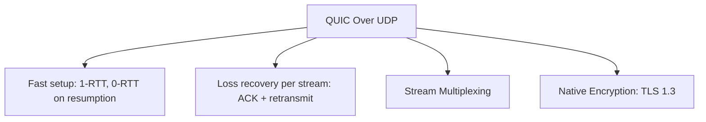
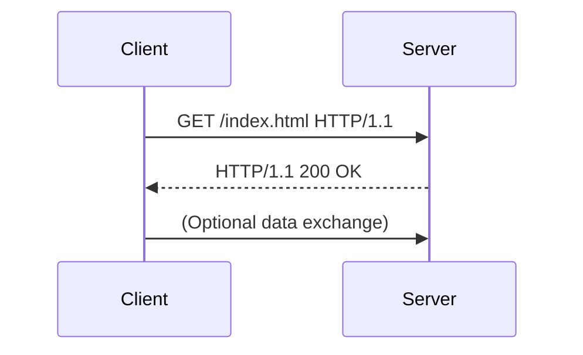
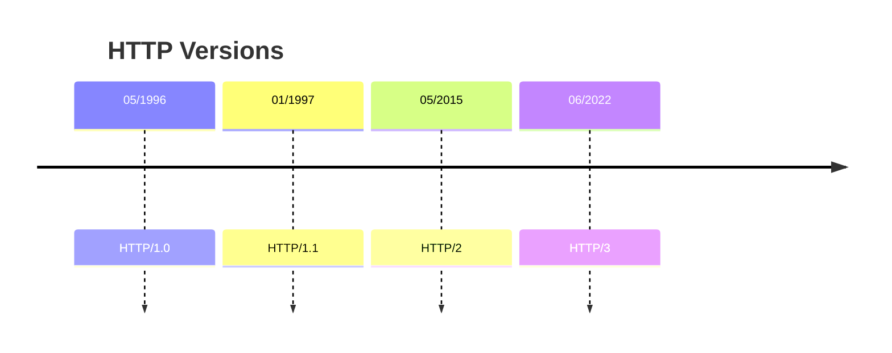

# 🌐 Networking Fundamentals

---
 
## 🕸️ Network


*https://www.oreilly.com/library/view/linux-networking-cookbook/9780596102487/ch01.html* 

---

## 🛠️ Linux Network Commands

```bash
# Check listening ports (ss replaces the deprecated netstat)
ss -tulpn

# Show addresses and routes (replace ifconfig / route)
ip addr
ip route

# Monitor network activity (-i any = all interfaces; -i lo = loopback)
sudo tcpdump -i any port 80

# Query DNS
dig example.com

# Transfer files
curl -O http://example.com/file.txt

# Quick TCP/UDP test tool (netcat)
nc -l 5100          # server
nc 127.0.0.1 5100   # client
```

https://linuxhint.com/basic_linux_network_commands/
https://mindmajix.com/linux-networking-commands-best-examples

---

## 🧑‍🤝‍🧑 Types of computer networking
<table style="width:100%; border-collapse: collapse;">
  <tr>
    <td style="width:50%; padding:10px; vertical-align:top;">
      <h4>P2P Network</h4>
      
      <p>Decentralized architecture with direct peer connections</p>
    </td>
    <td style="width:50%; padding:10px; vertical-align:top;">
      <h4>Client-Server Model</h4>
      
      <p>Centralized architecture with dedicated server infrastructure</p>
    </td>
  </tr>
</table>

## 💬 Communication


---

## 🧅 Conceptual Layering of Network Architecture


*Successful communication requires a protocol(an agreement mechanism) on every layer of the systems*

---

## 📚 TCP/IP model


[OSI model(conceptual not used)](https://en.wikipedia.org/wiki/OSI_model)
[Internet protocol suite](https://en.wikipedia.org/wiki/Internet_protocol_suite)

---

## 📦 Network Packet: Internet protocol suite (TCP/IP model)

<table style="width:100%; border-collapse: collapse; min-width:600px;">
  <tr>
    <td style="width:50%; padding:15px; vertical-align:top;">
      <a href="https://en.wikipedia.org/wiki/Internet_protocol_suite" target="_blank">
        
      </a>
      <p style="margin-top:8px;">TCP/IP protocol suite showing layer interactions</p>
    </td>
    <td style="width:50%; padding:15px; vertical-align:top;">
      <a href="https://en.wikipedia.org/wiki/Internet_protocol_suite" target="_blank">
        
      </a>
      <p style="margin-top:8px;">Data encapsulation process in UDP communication</p>
    </td>
  </tr>
</table>

[Internet protocol suite](https://en.wikipedia.org/wiki/Internet_protocol_suite)

---

## 🧭 Internet Layer: IP (IPv4 vs IPv6)

### Core Functionality
IP handles **end-to-end packet delivery** based on destination IP addresses:
- Packets are routed independently
- No guarantees for order, delivery, or duplication prevention
- IPv4 (32-bit) vs IPv6 (128-bit) addressing
- 🔁 **Loopback**: `127.0.0.1` (IPv6 `::1`); the whole `127.0.0.0/8` block is local, so one machine can play many "hosts"
- 📛 **DNS** maps names to addresses; in C you resolve them with `getaddrinfo` (see 10b)
  
---


---

### IPv4 vs IPv6 Header Comparison
<div style="display:flex; gap:20px;">
  
  
</div>

---

### 📈 Current Trends
1. **IPv6 Adoption**: roughly 40–50% of Google users reach it over IPv6 (see the live chart in the references), with ISPs and mobile networks leading
2. **Tunneling / transition**: dual stack, NAT64 and IPv6-in-IPv4 tunnels for transitional networks
3. **Cloud Infrastructure**: IPv4 addresses are now billed (e.g. AWS public IPv4 since 2024), which pushes IPv6 adoption
4. **IoT Growth**: IPv6 gives every device a unique address

---

## 🚪 Port Numbers

### Key Concepts
- 16-bit unsigned integers (0-65535)
- **Well-known ports**: 0-1023 (HTTP:80, HTTPS:443); binding needs root on Linux
- **Registered ports**: 1024-49151 (your servers: 5100, 8080 ...)
- **Ephemeral ports**: 49152-65535 by IANA (temporary client ports); Linux defaults to 32768-60999, see `/proc/sys/net/ipv4/ip_local_port_range`
- Port **0** in `bind` = "kernel, pick a free port for me" (read it back with `getsockname`)
- A connection is identified by 5 values: *protocol, src IP, src port, dst IP, dst port*

---

### 🔍 Example Output Analysis
```bash
$ lsof -i -P -n
COMMAND   PID       USER   FD   TYPE DEVICE SIZE/OFF NODE NAME
firefox  6636   ad_public  177u  IPv4 170052      0t0  TCP 10.5.1.74:35684->34.120.208.123:443
chrome   8471   ad_public  234u  IPv4  33288      0t0  UDP 224.0.0.251:5353 
$ sudo ss -tulpn          # (older systems: netstat -tulpn)
Netid State  Recv-Q Send-Q Local Address:Port Peer Address:Port Process
tcp   LISTEN 0      151    127.0.0.1:3306     0.0.0.0:*         users:(("mysqld",pid=1531,fd=21))
```
---

## 🚚 Transport Layer: TCP vs UDP vs QUIC

### ⚖️ Protocol Comparison Matrix

| Feature            | TCP                          | UDP                          | QUIC                          |
|--------------------|------------------------------|------------------------------|-------------------------------|
| Connection Type    | Connection-oriented (3-way handshake) | Connectionless | Connection-oriented, runs over UDP (1-RTT, 0-RTT on resumption) |
| Reliability        | Guaranteed, ordered delivery (ACK + retransmit) | Best-effort | Reliable (ACK + retransmit per stream) |
| Congestion Control | Built-in                     | None                         | Built-in (BBR, Cubic)         |
| Security           | TLS over TCP                 | Manual (DTLS)                | TLS 1.3 integrated            |
| Multiplexing       | Single byte stream (head-of-line blocking) | Independent datagrams | Multiple streams, no cross-stream blocking |
| Use Cases          | Web, Email, File Transfer    | Streaming, Gaming            | HTTP/3, Low-latency services  |

---

### ⚡ QUIC Advantages


*QUIC is a good example of building reliability **on top of UDP in user space**: exactly what you would do yourself if you need reliable UDP.*

---

### 🤝 QUIC vs TCP Handshake
<div style="display:flex; gap:20px;">
  
</div>

---

### 📈 Current Trends
1. **HTTP/3 Adoption**: roughly a third of top websites (W3Techs; check the live numbers)
2. **CDN Integration**: Cloudflare, AWS use QUIC for performance
3. **IoT Optimization**: UDP-based protocols for low-power devices
4. **5G Networks**: UDP/IP preferred for latency-sensitive apps

---

## 📨 Application Layer Protocols

**Key Summary on Application Layer**

HTTP, HTTPS and WebSockets all run on top of the transport layer (TCP; HTTP/3 uses QUIC over UDP).

- 🔒 **HTTPS** = HTTP over Transport Layer Security (TLS)
- 🔒 **wss** = "secure" WebSocket = WebSocket over TLS

[Transport Layer Security-Wikipedia](https://en.wikipedia.org/wiki/Transport_Layer_Security)  
[The WebSocket API (WebSockets) - Web APIs | MDN](https://developer.mozilla.org/en-US/docs/Web/API/WebSockets_API#guides)

---


[An overview of HTTP MDN](https://developer.mozilla.org/en-US/docs/Web/HTTP/Guides/Overview)

---

### 🔄 HTTP Request Lifecycle


---
**📤 Client request**
```http
GET / HTTP/1.1
Host: www.example.com
User-Agent: Mozilla/5.0
Accept: text/html,application/xhtml+xml,application/xml;q=0.9,image/avif,image/webp,*/*;q=0.8
Accept-Language: en-GB,en;q=0.5
Accept-Encoding: gzip, deflate, br
Connection: keep-alive
```
---

**📥 Server response**
```http
HTTP/1.1 200 OK
Date: Mon, 23 May 2005 22:38:34 GMT
Content-Type: text/html; charset=UTF-8
Content-Length: 155
Last-Modified: Wed, 08 Jan 2003 23:11:55 GMT
Server: Apache/1.3.3.7 (Unix) (Red-Hat/Linux)
ETag: "3f80f-1b6-3e1cb03b"
Accept-Ranges: bytes
Connection: close

<html>
  <head>
    <title>An Example Page</title>
  </head>
  <body>
    <p>Hello World, this is a very simple HTML document.</p>
  </body>
</html>
```
*Header lines end with `\r\n`; an empty line ends the headers; `Content-Length` says how many body bytes follow. This is **framing** (see 10b).*

---

### 🔌 Websockets
- Work on TCP
- Although it is different from **HTTP**, from [RFC 6455](https://datatracker.ietf.org/doc/html/rfc6455): 
  - WebSocket "is designed to work over HTTP ports 443 and 80 as well as to support HTTP proxies and intermediaries", thus making it compatible with HTTP.

[wikipedia websockets](https://en.wikipedia.org/wiki/WebSocket)

--- 

### 🤝 WebSocket Handshake
```http
GET /chat HTTP/1.1
Upgrade: websocket
Connection: Upgrade
Sec-WebSocket-Key: x3JJHMbDL1EzLkh9GBhXDw==
Sec-WebSocket-Version: 13

HTTP/1.1 101 Switching Protocols
Upgrade: websocket
Connection: Upgrade
Sec-WebSocket-Accept: HSmrc0sMlYUkAGmm5OPpG2HaGWk=
```
Examples
[The WebSocket API (WebSockets) - Web APIs | MDN(Java server, C# server, Javascript](https://developer.mozilla.org/en-US/docs/Web/API/WebSockets_API#guides) 
[how-to-build-websockets-in-go](https://yalantis.com/blog/how-to-build-websockets-in-go/)
[a brief tutorial](https://www.tutorialspoint.com/websockets/websockets_quick_guide.htm)

---

## 🕰️ HTTP Evolution Timeline


---


*source: wikipedia*

---

### 📈 Current Trends
1. **HTTP/3 Deployment**: Major sites like Google, Facebook use QUIC
2. **gRPC**: HTTP/2-based RPC framework for microservices
3. **Edge Computing**: WebSockets for real-time edge-cloud communication
4. **Streaming AI APIs**: LLM and inference services stream tokens over HTTP (Server-Sent Events) or WebSockets: a modern "request server" workload
5. **TLS 1.3**: the majority of TLS connections now use TLS 1.3


---

### 📊 Industry Adoption Trends (approximate, 2023-2024; check live statistics)

| Technology          | Adoption Rate | Key Drivers                     |
|---------------------|---------------|---------------------------------|
| IPv6                | ~40% (Google users) | IoT growth, ISP requirements, IPv4 cost |
| QUIC/HTTP/3         | ~1/4 – 1/3 of top sites | Video streaming, low latency |
| TLS 1.3             | majority of TLS | Security mandates           |
| WebSockets          | common in real-time web apps | Chat, dashboards, live updates |
| UDP-based protocols | gaming, VoIP, DNS, QUIC | Latency-sensitive applications |

*sources: [Cloudflare Radar](https://radar.cloudflare.com/), [Google IPv6 statistics](https://www.google.com/intl/en/ipv6/statistics.html). Numbers change quickly: treat them as orders of magnitude.*

---


## 🧱 Transferring Structured Data

**XML**
```XML
<part number="1976">
 <name>Windscreen Wiper</name>
 <description>The Windscreen wiper
   automatically removes rain
   from your windscreen, if it
   should happen to splash there.
   It has a rubber <ref part="1977">blade</ref>
   which can be ordered separately
   if you need to replace it.
 </description>
</part>
```

[XML Essentials - W3C](https://www.w3.org/standards/xml/core) 

---

**JSON**

```JSON
{"name":"John", "age":30, "car":null}
```

[JSON intro](https://www.json.org/) · [RFC 8259](https://www.rfc-editor.org/rfc/rfc8259)

💡 Text formats (XML, JSON) are easy to debug; **binary** formats (Protocol Buffers, MessagePack, your own `struct` layout with explicit sizes and byte order) are smaller and faster. Either way, the receiver must know where one message ends (framing, see 10b).

---

## 🔐 Security Considerations

- **TLS/SSL**: Encryption at Transport Layer
- **Access Management (authentication and authorization)**
  - [Access Control](https://www.cloudflare.com/learning/access-management/what-is-access-control/): Role-based permissions
    - [Authentication](https://www.cloudflare.com/learning/access-management/what-is-authentication/)
      - [SAML](https://www.cloudflare.com/learning/access-management/what-is-saml/), OpenID connect, [single sign-on(SSO)](https://www.cloudflare.com/learning/access-management/what-is-sso/)
    - [Authorization: OAuth](https://www.cloudflare.com/learning/access-management/what-is-oauth/)

---


### 📖 Further References
- [MDN HTTP Guide](https://developer.mozilla.org/en-US/docs/Web/HTTP/Overview)
- [Wikipedia Transport Layer Security](https://en.wikipedia.org/wiki/Transport_Layer_Security)
- [QUIC Protocol Spec](https://www.rfc-editor.org/rfc/rfc9000)
- [IPv6 Adoption Statistics](https://www.google.com/intl/en/ipv6/statistics.html)
- [Access Management](https://www.cloudflare.com/learning/access-management/what-is-identity-and-access-management/)
- [Beej's Guide to Network Programming](https://beej.us/guide/bgnet/)

---

➡️ **Next:** [10b: socket programming in C](10b-socket-programming.md) and [10c: sockets in other languages (incl. 🦀 Rust)](10c-socket-programming-other-languages.md)