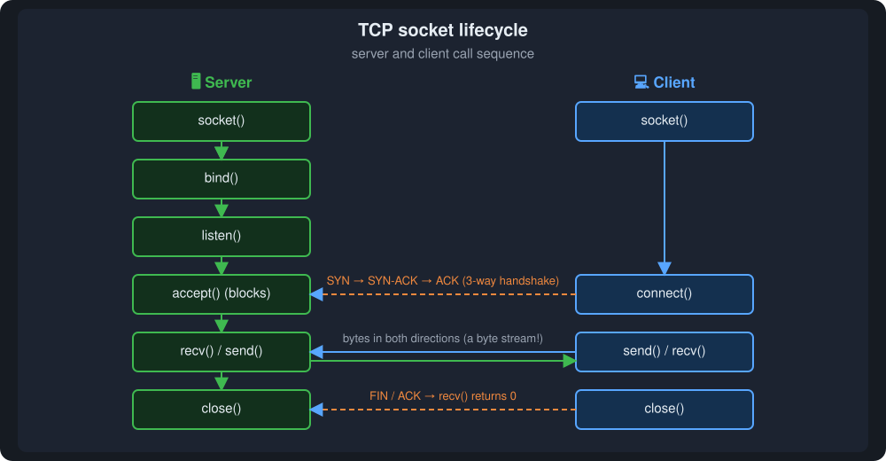
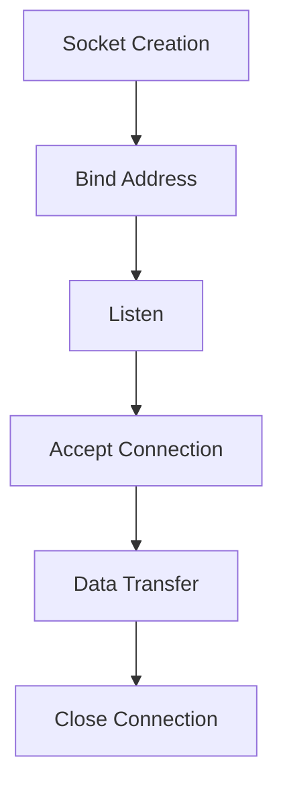
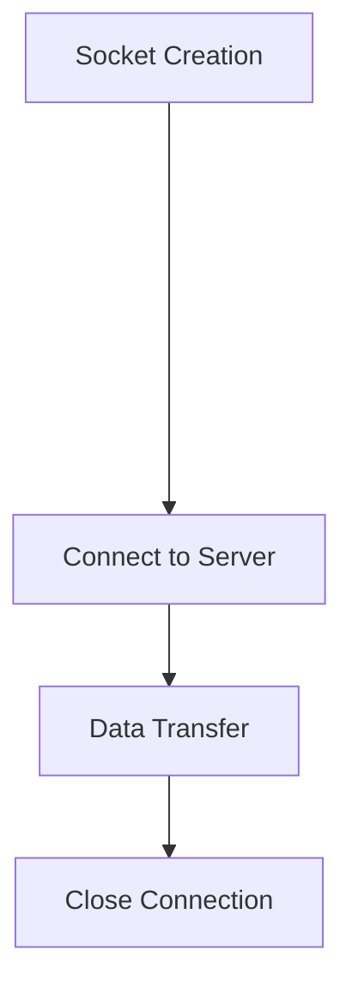
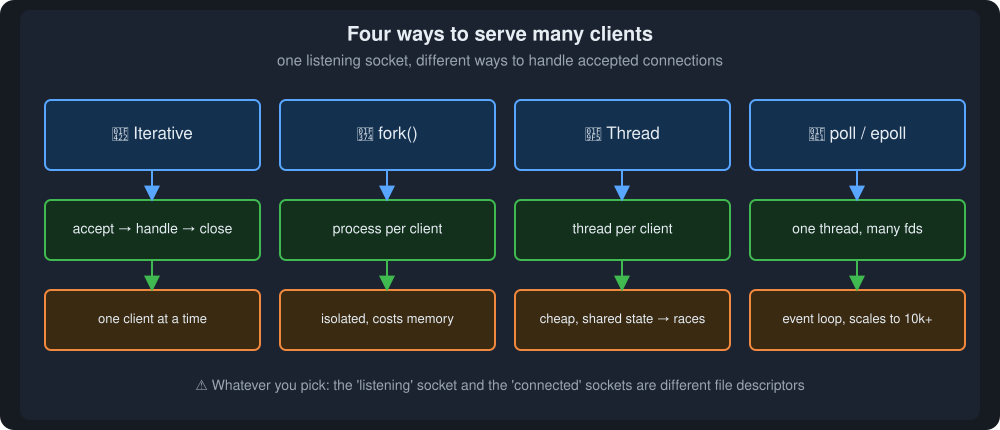
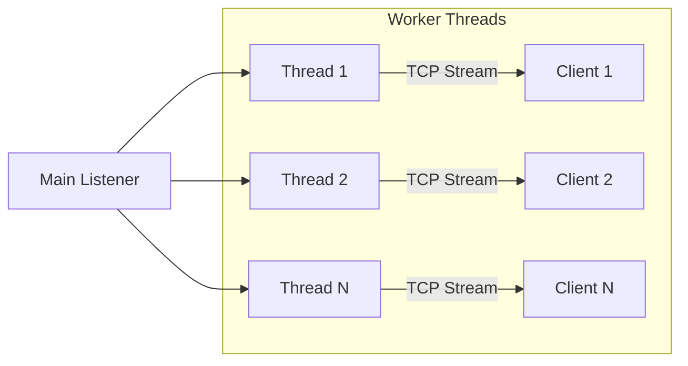
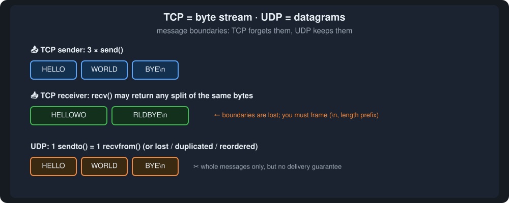

# 🔌 Sockets Programming
Sockets (Berkeley Sockets) are Application Programming Interfaces (API) 
* 🧩 A socket is an API (an *endpoint*), **not a protocol**
1. [Socket API Overview](#socket-api-overview)
  * 📨 That uses UDP
  * 📞 That uses TCP
2. [Concurrency Models](#concurrency-models)
3. [Asynchronous I/O Techniques](#asynchronous-io-techniques)
4. [Code Patterns](#code-patterns)
5. [Robust Socket Programming](#robust-socket-programming)

---

### 🧰 Socket API Overview
```c
#include <sys/socket.h>
int socket(int domain, int type, int protocol);
```
- `domain`: `AF_INET` (IPv4), `AF_INET6` (IPv6), `AF_UNIX` (local)
- `type`: `SOCK_STREAM` (TCP, byte stream), `SOCK_DGRAM` (UDP, datagrams)
- returns a **file descriptor** (or `-1`): `read`, `write`, `close` work on it too

---

#### 🏠 Socket Structures
```c
// IPv4 Socket Address Structure
struct sockaddr_in {
    sa_family_t     sin_family;     /* AF_INET */
    in_port_t       sin_port;       /* Port number (network byte order) */
    struct in_addr  sin_addr;       /* IPv4 address */
    /* + padding (sin_zero): memset the struct to 0 before filling it */
};
```

---

```c
// UNIX Domain Socket Structure
struct sockaddr_un {
    sa_family_t     sun_family;     /* AF_UNIX */
    char            sun_path[108];  /* Socket pathname */
};
```

---



---

<table>
<tr>
<th>🖥️ Server Workflow</th>
<th>💻 Client Workflow</th>
</tr>
<tr>
<td width="20%">


</td>

<td width="20%">


</td>
</tr>
</table>

---

### 🖥️ Server Code Breakdown
1. **Create & Configure Socket** Create an end point.
```c
int sfd = socket(AF_INET, SOCK_STREAM, IPPROTO_TCP);

struct sockaddr_in addr = {
  .sin_family = AF_INET,
  .sin_port = htons(5100),
  .sin_addr.s_addr = htonl(INADDR_ANY)
};
```

---

2. **Bind & Listen** Associate address and listen
```c
bind(sfd, (struct sockaddr*)&addr, sizeof(addr));
listen(sfd, 10);
```

---

**💻 Client Side Socket**

1. **Create Socket**
```c
int sfd = socket(AF_INET, SOCK_STREAM, IPPROTO_TCP);
```

2. **Connect**
```c
struct sockaddr_in srv_addr = {
  .sin_family = AF_INET,
  .sin_port = htons(5100), //server port
};
inet_pton(AF_INET, "127.0.0.1", &srv_addr.sin_addr); //server address
connect(sfd, (struct sockaddr*)&srv_addr, sizeof(srv_addr));
```

---

3. **🖥️ Server: Accept Connection**
```c
int client_fd = accept(sfd, NULL, NULL);
```
`accept` returns a **new** fd for this client; `sfd` keeps listening.

---

4. **🖥️ Server: Data Exchange**
```c
ssize_t n = recv(client_fd, buffer, sizeof(buffer) - 1, 0);
if (n > 0) { buffer[n] = '\0'; }
send(client_fd, "Response", 8, 0);
```


5. **💻 Client: Data Exchange**
```c
send(sfd, "Hello", 5, 0);
ssize_t n = recv(sfd, buffer, sizeof(buffer) - 1, 0);
```

---

6. **🔚 Terminate**
```c
close(client_fd);//in server: one per accepted client
close(sfd);
```


---

### 🖥️ Server Implementation
```c
#include <arpa/inet.h>
#include <netinet/in.h>
#include <stdio.h>
#include <sys/socket.h>
#include <unistd.h>
#define PORT 5100
int main() {
    struct sockaddr_in server_addr = {0};
    server_addr.sin_family = AF_INET;
    server_addr.sin_port = htons(PORT);
    server_addr.sin_addr.s_addr = htonl(INADDR_ANY);

    int sfd = socket(AF_INET, SOCK_STREAM, 0);

    bind(sfd, (struct sockaddr *)&server_addr, sizeof(server_addr));

    listen(sfd, 10);

    int client_fd = accept(sfd, NULL, NULL);
    char buffer[256] = {0};

    ssize_t n = read(client_fd, buffer, sizeof(buffer) - 1); // keep room for '\0'
    if (n > 0) printf("Received: %s\n", buffer);
    send(client_fd, "Hello from server", 17, 0);
    close(client_fd);
    close(sfd);
}
```
*for full implementation (with error checks) see [server.c](10-networking/server.c)*

---

### 💻 Client Implementation 
```c
#include <arpa/inet.h>
#include <netinet/in.h>
#include <stdio.h>
#include <sys/socket.h>
#include <unistd.h>
#define PORT 5100
int main() {
    struct sockaddr_in server_addr = {0};
    server_addr.sin_family = AF_INET;
    server_addr.sin_port = htons(PORT);
    inet_pton(AF_INET, "127.0.0.1", &server_addr.sin_addr);

    int sfd = socket(AF_INET, SOCK_STREAM, 0);
    connect(sfd, (struct sockaddr *)&server_addr, sizeof(server_addr));
    send(sfd, "Hello from client", 17, 0);
    
    char buffer[256] = {0};
    ssize_t n = read(sfd, buffer, sizeof(buffer) - 1);
    if (n > 0) printf("Response: %s\n", buffer);
    close(sfd);
}
```
*for full implementation see [client.c](10-networking/client.c)*

---

# 🦀 Rust Callout: the same server and client

```rust
use std::io::{Read, Write};
use std::net::{TcpListener, TcpStream};

fn server() -> std::io::Result<()> {
    let listener = TcpListener::bind("0.0.0.0:5100")?;   // socket + bind + listen
    let (mut conn, peer) = listener.accept()?;           // accept
    let mut buf = [0u8; 256];
    let n = conn.read(&mut buf)?;                        // recv
    println!("{peer}: {}", String::from_utf8_lossy(&buf[..n]));
    conn.write_all(b"Hello from server")?;               // send
    Ok(())                                               // conn, listener closed (Drop)
}

fn client() -> std::io::Result<()> {
    let mut s = TcpStream::connect("127.0.0.1:5100")?;   // socket + connect
    s.write_all(b"Hello from client")?;
    let mut buf = [0u8; 256];
    let n = s.read(&mut buf)?;
    println!("Response: {}", String::from_utf8_lossy(&buf[..n]));
    Ok(())
}
```

- Every call returns `Result`: forgetting error checks does not compile quietly (`?` propagates the error).
- `close()` is automatic: the fd is closed when the value is dropped, so no fd leaks.
- Underneath: the same `socket`/`bind`/`listen`/`accept` syscalls (try `strace`).

*(🦀 boxes are pattern-recognition only. You don't need to write Rust.)*

---


### 🤝 Communication Flow
```
Client           Server
  |                 |
  |--- SYN -------->|
  |<-- SYN-ACK -----|
  |--- ACK -------->|   connect() returns / accept() returns
  |                 |
  |--- Data ------->|   recv()
  |<-- ACK ---------|
  |<-- Data --------|   send()
  |--- ACK -------->|
  |                 |
  |--- FIN -------->|   close()  (recv() returns 0 on the other side)
  |<-- ACK / FIN ---|
  |--- ACK -------->|
```

---

## 🌐 Application Layer Protocols

*(HTTP, WebSocket, JSON/XML and security are covered in [10a](10a-intro-to-network.md); here we only need the idea.)*

An application protocol is **bytes + rules** on top of a socket. HTTP is just text over TCP:

```http
GET / HTTP/1.1
Host: www.example.com
User-Agent: Mozilla/5.0
```

```http
HTTP/1.1 200 OK
Content-Type: text/html
Content-Length: 27

<html><body>Hi</body></html>
```

*⚠️ Each header line ends with `\r\n` and a blank line ends the headers: this is framing (see below).*

---

### 🧪 Try it: a hand-made HTTP client
```bash
printf 'GET / HTTP/1.0\r\nHost: example.com\r\n\r\n' | nc example.com 80
```
or `curl -v http://example.com/` to see the same exchange.

---

## 🔐 Security Considerations
- **TLS/SSL**: Encryption at Transport Layer (sockets give you plaintext bytes; use OpenSSL/`rustls` etc.)
  - https://www.kernel.org/doc/html/latest/networking/tls.html (kernel TLS offload)
- **Access Control**: OAuth, SAML, OpenID (see 10a)
- 🧨 Never trust data from the network: check lengths before copying (buffer overflows!)

---

# 🔬 Socket Programming Deep Dive

## 📚 Table of Contents
2. [Concurrency Models](#concurrency-models)
3. [Asynchronous I/O Techniques](#asynchronous-io-techniques)
4. [Code Patterns](#code-patterns)
5. [Robust Socket Programming](#robust-socket-programming)

---



---

## 🧵 Concurrency Models

### Multithreaded Server Architecture


---

**Implementation Example:**
```c
void *client_handler(void *arg) {
    int client_fd = *(int *)arg;
    free(arg);                      // we own our private copy
    char buffer[256];
    recv(client_fd, buffer, sizeof(buffer), 0);
    // Process request...
    close(client_fd);
    return NULL;
}

// In main loop:
int *fdp = malloc(sizeof(int));     // NOT &client_fd: the next accept() overwrites it!
*fdp = accept(sfd, NULL, NULL);
pthread_t thread_id;
pthread_create(&thread_id, NULL, client_handler, fdp);
pthread_detach(thread_id);          // nobody will join: free resources on exit
```

⚠️ Passing `&client_fd` of a loop variable is a **data race** (see 7a/7b).

---

### 🍴 Process-based Approach
```c
signal(SIGCHLD, SIG_IGN);  // once, before the loop: children are reaped automatically (no zombies)

if(fork() == 0) {  // Child process
    close(sfd);        // child does not need the listening socket
    handle_client(client_fd);
    close(client_fd);
    exit(0);       // Terminate child
}
close(client_fd);  // Parent closes copy
```

---

# 🦀 Rust Callout: thread per client

```rust
use std::net::TcpListener;
use std::thread;

let listener = TcpListener::bind("0.0.0.0:8080")?;
for stream in listener.incoming() {
    let stream = stream?;                       // each client = its own TcpStream value
    thread::spawn(move || {                     // `move`: the thread OWNS this stream
        let _ = handle_client(stream);          // dropped (closed) when the thread ends
    });
}
```

- No `&client_fd` race: the compiler **rejects** sharing the variable, so the C bug above cannot be written.
- No `pthread_detach`/`free` to forget: ownership does the cleanup.

*(🦀 boxes are pattern-recognition only.)*

---

## ⚡ Asynchronous I/O Techniques

### 🚦 Non-blocking Socket Setup
```c
// Method 1: Flag at creation (Linux)
int sockfd = socket(AF_INET, SOCK_STREAM | SOCK_NONBLOCK, 0);

// Method 2: fcntl modification
int flags = fcntl(sockfd, F_GETFL, 0);
fcntl(sockfd, F_SETFL, flags | O_NONBLOCK);
```
A non-blocking `recv`/`accept` with nothing ready returns `-1` with `errno == EAGAIN` / `EWOULDBLOCK`.

---

### 🔀 I/O Multiplexing with `select()`
```c
fd_set read_fds;
struct timeval timeout = {.tv_sec = 5, .tv_usec = 0};

FD_ZERO(&read_fds);            // rebuild the set before EVERY call:
FD_SET(sockfd, &read_fds);     // select() modifies it

if (select(sockfd + 1, &read_fds, NULL, NULL, &timeout) > 0) {
    if (FD_ISSET(sockfd, &read_fds)) {
        // Handle incoming connection
    }
}
```
`select` is limited to `FD_SETSIZE` (1024) descriptors.

---

### 🗳️ I/O Multiplexing with `poll()`
```c
struct pollfd fds[2] = {
    { .fd = listen_fd, .events = POLLIN },
    { .fd = client_fd, .events = POLLIN },
};
int ready = poll(fds, 2, 1000 /* ms, -1 = forever */);
if (ready > 0) {
    if (fds[0].revents & POLLIN) { /* new connection: accept() */ }
    if (fds[1].revents & (POLLIN | POLLHUP)) { /* data or peer closed: recv() */ }
}
```
No fd-number limit, no set to rebuild: the portable, simple choice.

---

### 🚀 Event-driven with `epoll` (Linux)
```c
#define MAX_EVENTS 64
int epfd = epoll_create1(0);
struct epoll_event event, events[MAX_EVENTS];

event.events = EPOLLIN;          // level-triggered: simplest and safest
event.data.fd = sockfd;
epoll_ctl(epfd, EPOLL_CTL_ADD, sockfd, &event);

while(1) {
    int nfds = epoll_wait(epfd, events, MAX_EVENTS, -1);
    for(int i=0; i < nfds; i++) {
        if(events[i].data.fd == sockfd) {
            // Handle new connection
        }
    }
}
```
`EPOLLET` (edge-triggered) needs non-blocking fds and a read-until-`EAGAIN` loop, otherwise you can hang.

---

### 📣 Signal-Driven I/O
```c
// Signal handler implementation (defined first)
void sigio_handler(int signo) {
    // Process I/O event (async-signal-safe calls only!)
}

// Enable SIGIO generation
fcntl(sockfd, F_SETOWN, getpid());
int flags = fcntl(sockfd, F_GETFL);
fcntl(sockfd, F_SETFL, flags | O_ASYNC);

// Signal handler registration
struct sigaction sa = {.sa_handler = sigio_handler};
sigemptyset(&sa.sa_mask);
sigaction(SIGIO, &sa, NULL);
```
Rare for sockets in practice: `poll`/`epoll` are preferred (see signals lecture).

---

# 🦀 Rust Callout: async I/O with `tokio`

```rust
// Cargo.toml: tokio = { version = "1", features = ["full"] }
use tokio::io::{AsyncReadExt, AsyncWriteExt};
use tokio::net::TcpListener;

#[tokio::main]
async fn main() -> std::io::Result<()> {
    let listener = TcpListener::bind("0.0.0.0:8080").await?;
    loop {
        let (mut sock, _) = listener.accept().await?;
        tokio::spawn(async move {                    // a task, not a thread
            let mut buf = [0u8; 1024];
            while let Ok(n) = sock.read(&mut buf).await {
                if n == 0 || sock.write_all(&buf[..n]).await.is_err() { break; }
            }
        });
    }
}
```

- `.await` = "this would block: let another task run": under the hood `tokio` uses **`epoll`** (Linux) / `kqueue` (macOS).
- Thousands of connections on a few OS threads: the event-driven row of the comparison matrix, with the compiler's safety checks.

---

## 🧩 Code Patterns

### 📣 TCP Echo Server Skeleton
```c
#include <signal.h>
#include <stdio.h>
#include <stdlib.h>
#include <sys/socket.h>
#include <netinet/in.h>
#include <unistd.h>

#define PORT 8080

int main() {
    signal(SIGCHLD, SIG_IGN);                       // reap children automatically
    int sockfd = socket(AF_INET, SOCK_STREAM, 0);
    int opt = 1;
    setsockopt(sockfd, SOL_SOCKET, SO_REUSEADDR, &opt, sizeof(opt));
    struct sockaddr_in addr = {
        .sin_family = AF_INET,
        .sin_port = htons(PORT),
        .sin_addr.s_addr = htonl(INADDR_ANY)
    };

    if (bind(sockfd, (struct sockaddr *)&addr, sizeof(addr)) == -1) { perror("bind"); exit(1); }
    if (listen(sockfd, 5) == -1) { perror("listen"); exit(1); }

    while(1) {
        int client_fd = accept(sockfd, NULL, NULL);
        if (client_fd == -1) continue;
        if(fork() == 0) {
            close(sockfd);
            char buffer[1024];
            ssize_t bytes;
            while ((bytes = recv(client_fd, buffer, sizeof(buffer), 0)) > 0)
                send(client_fd, buffer, bytes, 0);  // echo until the client closes (recv == 0)
            close(client_fd);
            exit(0);
        }
        close(client_fd);
    }
}
```
---

### 📨 UDP Datagram Server
```c
int sockfd = socket(AF_INET, SOCK_DGRAM, 0);
struct sockaddr_in server_addr = {
    .sin_family = AF_INET,
    .sin_port = htons(PORT),
    .sin_addr.s_addr = htonl(INADDR_ANY)
};

bind(sockfd, (struct sockaddr *)&server_addr, sizeof(server_addr));

char buffer[1024];
struct sockaddr_in client_addr;

while(1) {
    socklen_t len = sizeof(client_addr);   // value-result: reset before EVERY call
    ssize_t n = recvfrom(sockfd, buffer, sizeof(buffer), 0, 
                    (struct sockaddr *)&client_addr, &len);
    if (n < 0) continue;
    sendto(sockfd, buffer, n, 0, 
          (struct sockaddr *)&client_addr, len);
}
```
No `listen`/`accept`/`connect`: one `recvfrom` = one whole datagram, and it tells you who sent it.

---

# 🦀 Rust Callout: UDP echo

```rust
use std::net::UdpSocket;

let sock = UdpSocket::bind("0.0.0.0:8080")?;
let mut buf = [0u8; 1024];
loop {
    let (n, peer) = sock.recv_from(&mut buf)?;   // recvfrom: n bytes + sender address
    sock.send_to(&buf[..n], peer)?;              // sendto the sender
}
```
`SocketAddr` is a type that holds IPv4 *or* IPv6: no `sockaddr_in` vs `sockaddr_in6` casts.

---

## 📊 Comparison Matrix

| Technique        | Throughput | Scalability | Complexity | Use Case               |
|------------------|-----------|-------------|------------|------------------------|
| 🐢 Blocking (iterative) | Low       | Low         | Simple     | Simple services, tests |
| 🍴 Process per client   | Medium    | Medium      | Moderate   | Isolation, untrusted handlers |
| 🧵 Thread per client    | Medium    | Medium      | Moderate   | Many short/blocking handlers |
| 🧵🧵 Thread pool        | High      | High        | Moderate   | Bounded resources, CPU + I/O mix |
| 🗳️ `poll` / async I/O   | High      | High        | Complex    | Many mostly-idle connections |
| 🚀 `epoll` event-driven | Very High | Very High   | Advanced   | Web servers, proxies   |

---

# 🛡️ Robust Socket Programming

*Everything on the previous slides works on a good day. Real networks are not that kind.*

---

## 🧱 TCP is a byte stream, not messages



- One `send` of 100 bytes may arrive as `recv` of 40 + 60 bytes (or 100 + the next message).
- `send`/`recv` may transfer **fewer bytes than asked** (partial read/write).
- `recv` returns **0** when the peer closed, **-1** on error.

---

### ✅ Send everything
```c
int send_all(int fd, const void *buf, size_t len) {
    const char *p = buf;
    while (len > 0) {
        ssize_t n = send(fd, p, len, MSG_NOSIGNAL);   // no SIGPIPE, returns EPIPE instead
        if (n < 0) {
            if (errno == EINTR) continue;             // interrupted by a signal: retry
            return -1;
        }
        p += n;
        len -= n;
    }
    return 0;
}
```

---

### ✂️ Framing: where does a message end?
Two classic answers:
1. **Delimiter**: e.g. a line ends with `\n` (HTTP headers, SMTP, Redis protocol)
2. **Length prefix**: 4 bytes (in network byte order!) then that many bytes (binary protocols)

```c
// length-prefixed receive (sketch)
uint32_t netlen;
if (recv_exact(fd, &netlen, 4) < 0) return -1;
uint32_t len = ntohl(netlen);
if (len > MAX_MSG) return -1;          // never trust a length from the network
recv_exact(fd, buf, len);
```

`recv_exact` = a loop like `send_all` that stops on `0` (closed) or `-1`.

---

## 🌍 `getaddrinfo`: names and IPv4/IPv6 in one call
```c
struct addrinfo hints = {0}, *res, *p;
hints.ai_family   = AF_UNSPEC;       // IPv4 or IPv6
hints.ai_socktype = SOCK_STREAM;     // SOCK_DGRAM for UDP
if (getaddrinfo("example.com", "80", &hints, &res) != 0) { /* gai_strerror() */ }

int fd = -1;
for (p = res; p; p = p->ai_next) {   // try each address until one works
    fd = socket(p->ai_family, p->ai_socktype, p->ai_protocol);
    if (fd == -1) continue;
    if (connect(fd, p->ai_addr, p->ai_addrlen) == 0) break;
    close(fd); fd = -1;
}
freeaddrinfo(res);
```
Server side: pass `NULL` host and `hints.ai_flags = AI_PASSIVE`.
Print addresses with `inet_ntop` (not `inet_ntoa`: not thread-safe, IPv4 only).

---

## ⏱️ Timeouts and failures
```c
// receive timeout: recv() fails with EAGAIN/EWOULDBLOCK after 5 s
struct timeval tv = {.tv_sec = 5};
setsockopt(fd, SOL_SOCKET, SO_RCVTIMEO, &tv, sizeof(tv));

// ignore SIGPIPE globally: writes to a closed peer fail with EPIPE instead of killing you
signal(SIGPIPE, SIG_IGN);
```
- `connect()` timeout: make the socket non-blocking, `connect`, then `poll(POLLOUT)` and check `SO_ERROR`.
- Learn the port the kernel chose: bind to port `0`, then
  `getsockname(fd, (struct sockaddr *)&a, &len)`.
- Half-close: `shutdown(fd, SHUT_WR)` says "I'm done sending" but still lets you read.
- Common errors: `ECONNREFUSED` (nobody listening), `ECONNRESET` (peer crashed/reset), `EPIPE`, `EINTR`.

---

## 📨 UDP: what you must handle yourself
- ✅ Message boundaries are kept (one `sendto` = one `recvfrom`)
- ❌ Datagrams can be **lost, duplicated, reordered**
- Keep datagrams small (≤ ~1400 bytes avoids IP fragmentation)
- Need reliability? Add *sequence numbers + ACK + retransmit timer* yourself (QUIC does exactly this on top of UDP)
- `connect()` on a UDP socket only remembers the peer address (no handshake): then `send`/`recv` work

---

## ✔️ Best Practices
1. Always check return values:
```c
if (bind(sockfd, ...) == -1) {
    perror("Bind failed");
    exit(EXIT_FAILURE);
}
```

2. Use `htons()`/`htonl()` (host→network) and `ntohs()`/`ntohl()` (network→host) for network byte order
3. In signal handlers use only async-signal-safe calls (`write`, `_exit`, set a flag)
4. `listen(fd, backlog)`: backlog is the queue of completed connections waiting for `accept`, not a limit on concurrent clients (limit those yourself)
5. Clean up resources with `close()`
6. Use `SO_REUSEADDR` for quick port reuse (restarting a server otherwise fails with "Address already in use"):
```c
int opt = 1;
setsockopt(sockfd, SOL_SOCKET, SO_REUSEADDR, &opt, sizeof(opt));
```

---

**⭐ Current Best Practices:**
1. Use non-blocking sockets with `epoll`/`kqueue` for high-performance servers
2. Implement proper error handling and timeout mechanisms
3. Use asynchronous I/O for scalable network applications
4. Prefer IPv6-ready implementations with IPv4 fallback (`getaddrinfo`)
5. Integrate TLS 1.3 for secure communications
6. Implement connection pooling for frequent client interactions
7. Define a clear message format (framing) and validate every length and field

---

## 🧪 Debug your sockets
```bash
nc -l 5100                 # quick test server (netcat)
nc 127.0.0.1 5100          # quick test client
ss -tlnp                   # who listens on which port (replaces netstat)
strace -f -e trace=network ./server   # see socket/bind/listen/accept calls
tcpdump -i lo port 5100 -A # watch the bytes on loopback
```

---

## 🧭 Where this shows up
Request servers, worker pools and AI-serving back ends are all "accept connections, frame requests, hand them to workers": the same patterns as here. You will use TCP/UDP again in the course project (see the project description for details).

---

📖 [Complete Tutorial PDF](https://www.csd.uoc.gr/~hy556/material/tutorials/cs556-3rd-tutorial.pdf)  
📖 [Beej's Guide to Network Programming](https://beej.us/guide/bgnet/)  
📖 `man 7 socket`, `man 7 tcp`, `man 7 udp`, `man 3 getaddrinfo`  
📖 [Kernel TLS documentation](https://www.kernel.org/doc/html/latest/networking/tls.html)
