# Memory Management
## Copy-on-Write, the Heap, Building an Allocator, and the KV Cache

---

# 🧭 Today

Weeks 4–5 gave us the orchestrator: `fork`, `exec`, `wait`, `dup2`, `pipe`. Now we open the memory box:

1. **What exactly did `fork()` copy?** Surely not gigabytes, instantly?
2. **What does `malloc()` really do?** And `free()` returns memory... *to whom?*
3. Allocator ideas, ending with the workload your projects will meet: the **KV cache**.

---

# 🎬 Cold Open: The $10,000 Question

Your orchestrator has loaded a 2 GB model file, a 500 MB embedding index and a 300 MB log cache.
It calls `fork()` 8 times to launch 8 worker agents.

- 🤔 Memory needed: 2.8 GB + 8 × 2.8 GB ≈ **25 GB**?

Yet `top` barely moves. Why?

---

# 🧠 The Answer is **copy-on-write (COW)**

`fork()` does not copy your memory. It *promises* to copy your memory.

- Parent and child get the same **virtual** address space.
- Bytes are duplicated only when somebody **writes**.

> This is why `fork()` + `exec()` is cheap enough to power every Unix shell, CI system, and agent orchestrator.

---

# 🎭 Act 1: Let's prove what `fork()` Actually Copies

```c
#include <stdio.h>
#include <unistd.h>
#include <sys/wait.h>

int main(void) {
    int x = 10;
    pid_t pid = fork();
    if (pid == 0) {                 /* child */
        x = 42;
        printf("child:  x = %d at %p\n", x, (void *)&x);
        _exit(0);
    }
    wait(NULL);
    printf("parent: x = %d at %p\n", x, (void *)&x);
    return 0;
}
```

🤔 What does the parent see for `x`? And look closely at the addresses too...

---

# 🔮 Act 1: Same Address, Different Value

```
child:  x = 42 at 0x7ffd3c2a1b4c
parent: x = 10 at 0x7ffd3c2a1b4c
```

🤯 The **same virtual address** holds **two different values** — one per process.

🤔 In one sentence: what must the kernel be doing?

---

# 🧠 Act 1: What the Kernel Did

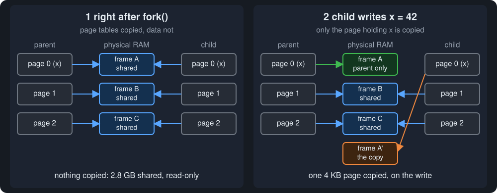

**The write is the bill collector.** Same virtual addresses, physical bytes shared until a write.

---

# 🔍 Act 1: One More Weird One

```c
fork();
int *p = malloc(100);
printf("pid %d got %p\n", getpid(), (void *)p);
```

🤔 Both processes call `malloc(100)` independently. Same address or different?

---

# 🔍 Act 1: The Answer — Same Map, Different Territory

**Same virtual address**: identical heaps with identical allocator state hand out the same pointer.
Behind it, two separate physical pages.

The allocator's bookkeeping (free lists, headers, the break) was copied too. Allocator state is just memory.

---

# 📚 Act 1: The Buffer That Printed Twice

Week 4's `_exit(127)` mystery. Predict:

```c
#include <stdio.h>
#include <unistd.h>

int main(void) {
    printf("launched agent");      /* no \n — stays in the stdio buffer */
    fork();
    return 0;                      /* exit() flushes the buffer... */
}
```

🤔 What appears on stdout?

---

# 💥 Act 1: `launched agentlaunched agent`

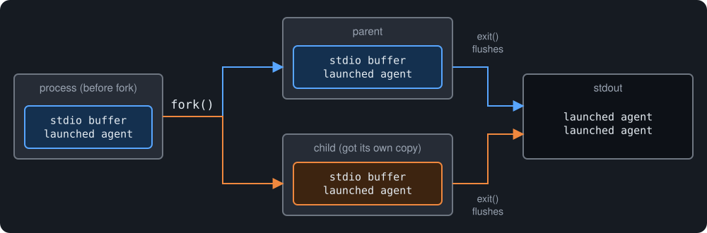

- A failed-exec child calls `_exit(127)`, not `exit(127)`, or it flushes the inherited buffer.
- Long-running agents `fflush(stdout)`, or the log looks empty.

**Memory state is process state.** `fork()` inherits all of it.

---

# 🦀 Rust Callout: No Fork in Safe Rust

A forked child inherits mutex states, allocator state, open fds: a minefield safe Rust cannot audit. So:

```rust
Command::new("worker").spawn()?;   // fork+exec, hidden and controlled
```

Raw `fork` exists only as `libc::fork()` behind `unsafe`.
(🦀 boxes are for pattern recognition only; you won't write Rust here.)

---

# 🗺️ Act 2: The Address Space, Revisited

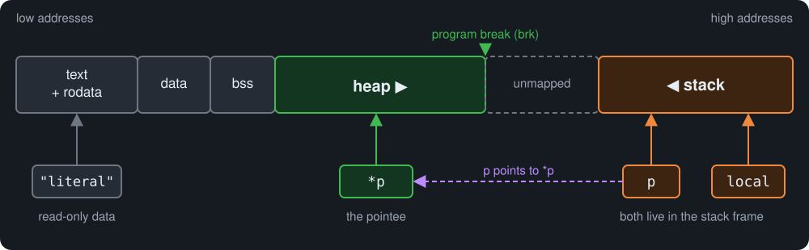

The heap grows toward the **program break**. `malloc` is the manager of that green region.

🤔 Week 2 check: where do `local`, `p`, `*p` and `"literal"` live? (Full table: FM 10.)

<!-- Ask first, then reveal: cover the bottom half of the figure. -->

---

# 🎛️ Act 3: Asking the Kernel for More Heap — `brk`/`sbrk`

```c
int   brk(void *addr);               /* set the program break */
void *sbrk(intptr_t increment);      /* move it by a delta; returns old break */
```

```c
void *top_of_heap  = sbrk(0);        /* where is the break now? */
sbrk(1024);                          /* grow by 1 KiB */
malloc(16384);                       /* malloc may grow it further */
void *top_of_heap2 = sbrk(0);
printf("Heap grew from %p to %p\n", top_of_heap, top_of_heap2);
```

Fresh pages from the kernel are zeroed; memory an allocator reuses is not. Applications use `malloc`, not `sbrk`.

---

# 🧱 Act 3: The World's Dumbest `malloc`

```c
void *malloc(size_t size) {
    void *p = sbrk(size);
    if (p == (void *)-1)   /* no memory */
        return NULL;
    return p;
}

void free(void *p) {
    /* Does nothing. */
}
```

It works! So why does libc ship a 10,000-line allocator?

🤔 Name as many problems as you can: what breaks, and when? (Pair exercise, 60–90 s.)

---

# 💸 Act 3: The Bill for the Dumb Allocator

1. **Every `malloc` is a system call.** Millions of small allocations, millions of traps.
2. **`free` does nothing.** An alloc/free loop grows until the OOM killer arrives.
3. **The break only really grows.** `sbrk` memory rarely goes back to the OS.

---

# 🗃️ Act 3: The Fix — Remember What Was Freed

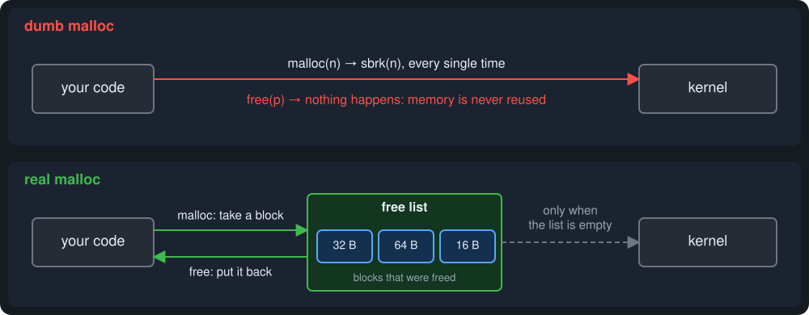

Keep freed memory in a **free list** and hand it out again. The kernel is asked only when the list runs dry.

---

# 🪦 Act 4: What `free()` Actually Does

- Usually it puts the block on `malloc`'s internal **free list** for a later `malloc` to reuse.
- Rarely it returns memory to the OS (when, in Act 7).
- **Using a pointer to freed space is undefined behavior.**

```c
int *ptr = malloc(sizeof(*ptr));
do_something(ptr);
free(ptr);
ptr = NULL;        /* habit: a freed pointer should become a dead pointer */
```

`free(p)` does not erase your pointer. It erases your *right to dereference it*.

---

# 🔗 Act 4: Freeing Structures — Order Matters

```c
struct chain {
    struct chain *next;
    char *name;
};

void free_chain(struct chain *head) {
    while (head) {
        struct chain *temp = head;
        head = head->next;
        free(temp->name);   /* free contained data first */
        free(temp);
    }
}
```

🔁 **Free children before the parent.** Orchestrator version: a Task's log path, command line and buffers, then the Task, then its table slot.

---

# 🧱 Act 4: Inside `malloc` — The Heap Is a List of Blocks

```
[ header | payload bytes ........................ ]
[ header | payload ... ]
[ header | payload .............................. ]
   ↑ size + flags       ↑ what malloc returns (16-byte aligned)
```

🤔 `malloc` returns a pointer to the payload. `free(p)` gets only `p`.
Where is the block's size stored?

<!-- Pause ~10 seconds. -->

---

# 🧱 Act 4: The Size Lives in a Header

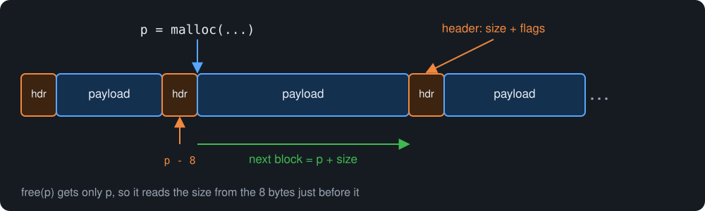

```c
typedef struct {
    size_t size;          /* payload size; low bits store flags (ALLOC/FREE) */
    char   data[];        /* flexible array member — the payload (Week 2!) */
} block;
```

Flags fit in the low bits because sizes are multiples of 16. Same shape as `Tag` + `Block` in our in-class `mymalloc`.

---

# 🕵️ Act 4: The Implicit Free List

Walk **every** block in address order using the size field:

```c
block *heap_start;                    /* first block, from sbrk/mmap */

static block *next_block(block *b) {
    return (block *)(b->data + SIZE(b));   /* step over payload */
}

static block *find_fit(size_t size) {
    for (block *b = heap_start; b < heap_end; b = next_block(b))
        if (!IS_ALLOC(b) && SIZE(b) >= size)
            return b;                      /* first fit! */
    return NULL;                           /* time to grow the heap */
}
```

`malloc` = find a free block that fits (+ split it). `free` = clear the ALLOC bit (+ merge neighbors).

---

# ✂️ Act 4: Splitting — Don't Waste the Tail

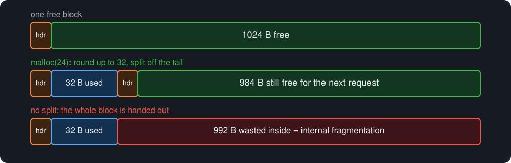

```c
static void split(block *b, size_t size) {   /* size: multiple of 16 */
    if (SIZE(b) < size + MIN_BLOCK) return;        /* remainder too small */
    block *rest = (block *)(b->data + size);
    rest->size  = SIZE(b) - size - sizeof(block);  /* new free block */
    b->size     = size | ALLOC_FLAG;
}
```

---

# 🧲 Act 4: Coalescing — Holes Want to Merge

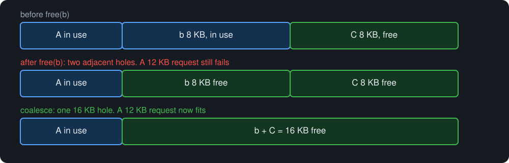

**Next** block? Step forward by size. **Previous** block? Step *backward*... by what?

🤔 Hint: the answer can live inside the blocks. What could you duplicate, and where?

<!-- Pause ~30 seconds. -->

---

# 🏷️ Act 4: Boundary Tags — Headers at Both Ends

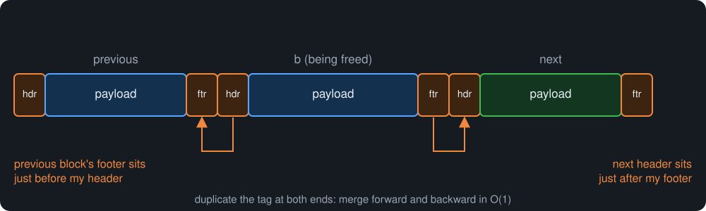

```c
typedef struct { size_t size_flags; } btag;

#define FOOTER(b)   ((btag *)((char *)(b) + sizeof(btag) + SIZE(b)))
#define PREV_TAG(b) ((btag *)(b) - 1)     /* previous block's footer */
```

On `free(b)`: next header is `FOOTER(b) + 1`, previous footer is `PREV_TAG(b)`. Merge either side if free.

---

# 🗃️ Act 4: Explicit Free Lists — Skip the Busy Blocks

`find_fit` walks allocated blocks too. 🤔 How would you skip them?

Keep a linked list of **only free blocks**:

```c
struct block {
    size_t info;              /* e.g. size in 16-byte units, low bits = flags */
    struct block *next;       /* next FREE block (lives inside the payload!) */
    char data[];
};
```

A free block's payload is unused, so `next` costs **zero extra memory**.
`malloc` searches only the free list; `free` inserts (at head = O(1); in address order = easy coalescing).

---

# 🎯 Act 5: Where Does a Block Go? Placement Strategies

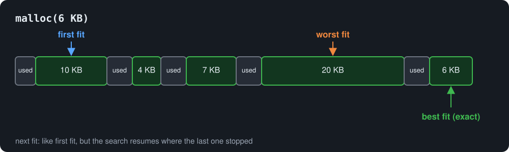

First fit: simple, fast enough. Best fit: tight, but leaves dust. Worst fit: sounds smart, isn't.
🤔 Vote: which would you ship?

**Optimal allocation is a knapsack problem, NP-hard.** Real allocators are heuristics tuned for a *workload*. (Cheat sheet: FM 5.)

---

# 🕳️ Act 6: Fragmentation — Predict

The heap contains, in address order:

```
[ free 8KB ][ used 4KB ][ free 8KB ]
```

Your program calls `malloc(12KB)`.

🤔 16 KB is free in total. Does the request succeed? If not, why not?

---

# 🕳️ Act 6: Two Ways to Waste Memory

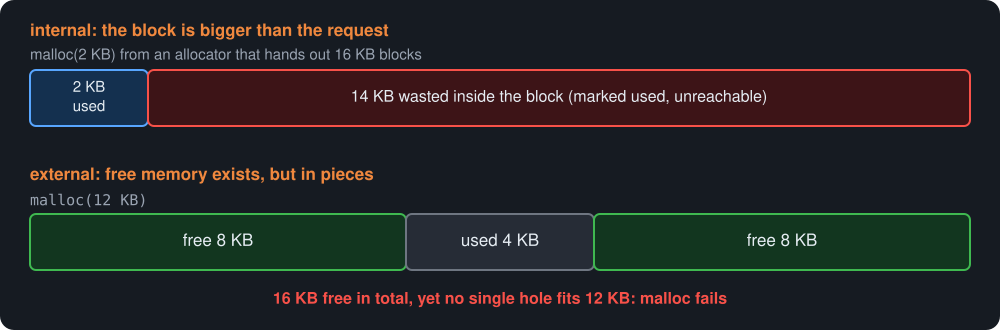

The "50% rule" intuition: first fit leaves splinters after each split, and they multiply until `malloc` fails while `top` shows free memory.
Internal fragmentation is the price of fixed block sizes. It comes back with the KV pool.

---

# 🧠 Act 6: Predict the Failure

A worker agent runs for three days. It allocates and frees constantly:

```c
while (running) {
    char *msg  = malloc(random_size());   /* 16 B .. 4 KB */
    process(msg);
    free(msg);
}
```

RSS (resident memory) climbs slowly forever. No leak: every `malloc` is freed.

🤔 What is happening?

---

# 🧠 Act 6: The Diagnosis

**External fragmentation**: the free holes don't fit incoming sizes, so the allocator grows the heap instead.
RSS climbs without a single leaked byte.

That is why long-lived servers care about allocator design (or restart periodically).

---

# 🛠️ Act 6: The Professional Countermeasures

**Segregated (size-class) lists**: one free list per size class. Search is nearly O(1), same-sized holes reuse each other.

```
16B | 32B | 64B | 128B | 256B | ...
```

**Buddy allocator**: split in powers of two; a block's buddy is found by XOR, so coalescing is instant.

```
1024 → 512 + 512 → 256 + 256 + 512
```

**Slab**: caches of fixed-size objects (the kernel's trick for `task_struct`).
**Arena**: one region, bump pointer, free everything at once (Act 9).
**Memory tagging** (e.g. ARM MTE): hardware tags catch use-after-free at runtime.

---

# 📐 Act 7: `realloc` — the Three Outcomes

```c
void *realloc(void *ptr, size_t newsize);
```

1. **Same place**: grows in place (next block is free). Pointer unchanged.
2. **New place**: bigger block elsewhere; data copied; old block freed.
3. **NULL**: failure. **The old block is still alive and still yours.**

---

# 💣 Act 7: The One-Line Memory Leak

Looks fine. It is not.

```c
int *array = malloc(2 * sizeof(int));
array[0] = 10; array[1] = 20;

array = realloc(array, 3 * sizeof(int));   /* 🤔 what if this returns NULL? */
array[2] = 30;
```

🤔 If the heap is exhausted, what does `realloc` return, and what happens to our only pointer to the original block?

---

# 📐 Act 7: The Fix — Stage Through a Temporary

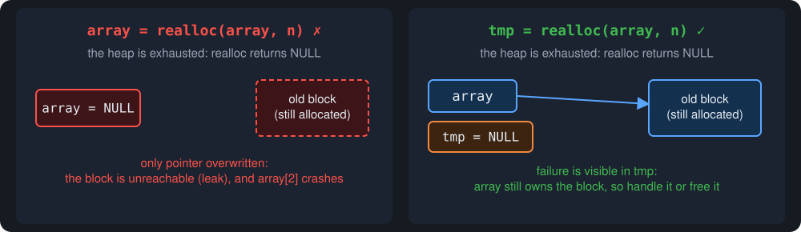

```c
void *tmp = realloc(array, 3 * sizeof(int));
if (tmp == NULL) { /* handle failure; array is still valid! */ }
else             { array = tmp; array[2] = 30; }
```

---

# 🗺️ Act 7: Growing Up — `sbrk` vs `mmap`

| `sbrk` | `mmap` |
| --- | --- |
| No longer POSIX-standard | POSIX-compliant |
| Easy to expand the heap | Handles large blocks efficiently |
| Cannot really return memory to the OS | `munmap` returns memory to the OS cleanly |

Modern allocators use both: small requests from the `sbrk` heap with free lists; large ones
(glibc default: **128 KB**) from private `mmap` regions, handed straight back on `free`.
That is how `free` "rarely" returns memory to the OS.

---

# 🧟 Act 8: The Heap Failure Taxonomy

Week 2's bug list, now with the machinery they break:

| Bug | Mechanism | Symptom |
| --- | --- | --- |
| Memory leak | `free` never called; block unreachable | RSS climbs forever |
| Use-after-free | pointer used after `free` | garbage, crashes, **exploits** |
| Double free | same pointer freed twice | allocator metadata corrupted |
| Heap overflow | write past the payload | clobbers the *next block's header* |

Heap bugs are security bugs: overflow a payload, rewrite the next header, and `malloc` trusts attacker-controlled sizes.
Defenses: `free(p); p = NULL;`, bounds checks, Valgrind, ASan (FM 7).

---

# 🕵️ Act 8: Valgrind Reads the Allocator's Diary

```c
int *p = malloc(10 * sizeof(int));
p[10] = 42;              /* one past the end */
free(p);
p[0] = 1;                /* use after free */
```

```
$ valgrind --leak-check=full ./a.out
==3131== Invalid write of size 4
==3131==    at 0x1091A2: main (buggy.c:4)
==3131==  Address 0x4a5a048 is 0 bytes after a block of size 40 alloc'd
==3131== Invalid write of size 4            ← use after free
==3131==  40 bytes in 1 blocks are definitely lost   ← if we'd skipped free()
```

Compile with `-g` for source lines. Faster alternative: `gcc -fsanitize=address` (ASan).

---

# 🤖 Act 9: Memory Management for Agents

One of eight workers leaks, and its RSS climbs on *your* machine.
🤔 Using Week 4's fork/exec gap, what can the orchestrator do *before* the leak starts?

**1. Isolation is a feature.** Each worker has its own address space; a leaking agent dies alone.

**2. Set limits between fork and exec:**

```c
#include <sys/resource.h>
struct rlimit r = { 256*1024*1024, 256*1024*1024 };
setrlimit(RLIMIT_AS, &r);        /* cap this agent's address space at 256 MB */
execvp(program, argv);
```

A leaking agent gets `ENOMEM` instead of taking the machine down.
**3. OOM is real:** if the fleet exceeds RAM, the kernel's OOM killer picks a victim by score.

---

# 🏟️ Act 9: The Request Allocation Pattern

One agent task makes dozens of small allocations, all dead the moment the task ends:

```c
char *prompt  = ...;
char *tokens  = ...;
char *scratch = ...;   /* ...and 40 more */
/* task ends: none of these are needed anymore */
```

🤔 How many `free()` calls should a whole task need? How would you exploit this?

---

# 🏟️ Act 9: Arena Allocators — the Agent Pattern

```
buf:  [ prompt | tokens | scratch |            free            ]
      0                           ↑ used  →                  cap
```

```c
typedef struct { char *buf; size_t used, cap; } Arena;

void *arena_alloc(Arena *a, size_t n) {
    n = (n + 15) & ~(size_t)15;              /* align to 16 */
    if (a->used + n > a->cap) return NULL;   /* or grow the arena */
    void *p = a->buf + a->used;
    a->used += n;
    return p;
}
```

Task ends → `free(a->buf)`. **One free.** Leaks are structurally impossible.
The pattern of inference engines, game engines and request servers, and the core of this week's lab.

---

# 🤖 Act 10: The Ultimate Agent Workload — the KV Cache

In transformer inference, each active request keeps state for the tokens processed so far: the **KV cache**.

We don't care how it is computed. Systems view only:

- a **large** memory region (often gigabytes),
- that **grows** as the sequence grows,
- made of many **blocks**,
- may be **shared** between requests,
- and must be **freed** when the request ends.

That is *this lecture*: allocation, reuse, sharing, fragmentation, cleanup.

---

# 🧮 Act 10: How Big Is "Big"?

```
KV bytes ≈ 2 × layers × kv_heads × head_dim × seq_len × dtype × batch
```

Rough 7B-class numbers:

```
layers = 32     kv_heads = 32     head_dim = 128
seq_len = 4096  dtype = 2 bytes   batch = 1

2 × 32 × 32 × 128 × 4096 × 2 ≈ 2 GiB  — per single request
```

Batch of 8 → **≈ 16 GiB**.

🤔 Redo the calculation, then vary one knob (e.g. batch = 32). Memory like this cannot be managed casually.

<!-- ~60 seconds. -->

---

# 🧱 Act 10: KV Blocks Are Allocator Blocks

Real serving engines manage KV memory in **fixed-size blocks**:

```c
typedef struct {
    uint32_t request_id, layer_id;
    uint32_t token_start, token_count;
    uint16_t refcount, flags;
    size_t   size;              /* payload bytes */
} KVHeader;

typedef struct {
    KVHeader hdr;
    char     data[];            /* flexible array member — Week 2! */
} KVBlock;
```

🤔 Week 2 quiz: where is the padding in `KVHeader`?

---

# 🧱 Act 10: The Padding — and the Same Old Arithmetic

```
 0         4         8         12        16  18  20        24        32
 [ req_id ][layer_id][tok_beg ][tok_cnt ][rc][fl][  pad   ][  size  ]
                                                     ↑ 4 pad bytes
```

`size_t` needs 8-byte alignment, so `KVHeader` is 32 bytes, not 28. Our `mymalloc` `Tag` + `Block`, in an inference costume:

```c
/* header from payload */
KVBlock *b = (KVBlock *)((char *)payload - offsetof(KVBlock, data));
/* next block */
KVBlock *next = (KVBlock *)((char *)b + offsetof(KVBlock, data) + b->hdr.size);
```

Avoid `(KVBlock *)payload - 1`: it breaks silently when someone adds a header field. `offsetof` doesn't.

---

# ❓ Act 10: So... Just `malloc` It?

The naive design:

```c
char *kv = malloc(huge_size);
/* sequence grows... */
kv = realloc(kv, bigger);
```

🤔 What breaks **first** in a long-running server with many concurrent requests?

---

# ❓ Act 10: What Breaks First — the Answers

- size changes → repeated `realloc` → copies + failure paths (Act 7!)
- thousands of fragments → external fragmentation (Act 6!)
- shared prefixes impossible: `malloc` doesn't know "shared"
- error/timeout paths leak: who frees 40 half-built caches?

Better tools, already in this lecture: **pools** and **arenas**.

---

# 🗃️ Act 10: The Fixed-Size KV Pool — One Region

If every KV block is the same size (say 16 KB), **external fragmentation vanishes**: any free block serves any request.

```c
typedef struct {
    size_t   block_size;   /* payload bytes per block (e.g. 16384) */
    size_t   nblocks;
    uint32_t free_head;    /* first free block; UINT32_MAX = none  */
    char     data[];       /* everything lives here                */
} KVPool;
```

- Struct + heap in **one `mmap`**, cleaned up by **one `munmap`**. No `char *base`, no separate arrays.
- The flexible array member must be **last**; members are ordered largest alignment first, so no padding between them.
- The free list is an array of **indices**, not pointers: Act 4's explicit free list without alignment trouble.

---

# 🗺️ Act 10: Inside `data[]`

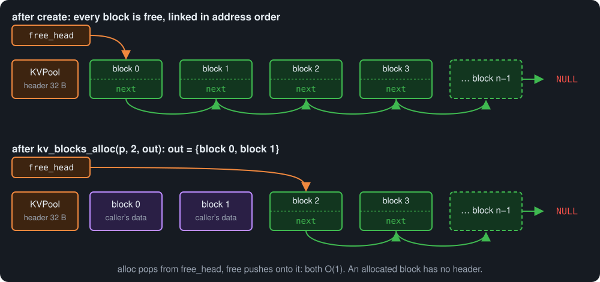

---

# 🧰 Act 10: The Three Layout Helpers

Everything else in the pool falls out of these:

```c
static uint32_t *pool_next_free(KVPool *p) { return (uint32_t *)p->data; }
static uint16_t *pool_refcount(KVPool *p) {
    return (uint16_t *)(p->data + p->nblocks * sizeof(uint32_t));
}
static char *pool_blocks(KVPool *p) {
    char *m = p->data + p->nblocks * (sizeof(uint32_t) + sizeof(uint16_t));
    return (char *)(((uintptr_t)m + 15) & ~(uintptr_t)15);  /* absolute! */
}
```

`offsetof(KVPool, data)` is **20** (8 + 8 + 4), while `sizeof(KVPool)` is **24** (tail padding). Don't mix them up.

---

# ✏️ Act 10: Paper Exercise — Size the mmap

On paper, the exact computation the lab needs. `block_size = 16384`, `nblocks = 512`.

1. How many bytes do the `next_free` and `refcount` arrays occupy together?
2. `data[]` starts at offset `offsetof(KVPool, data)` = 20. After the metadata arrays, what must happen before block 0 can start?
3. Write one expression for the total bytes `mmap` must request.

🤔 Do you round the offset or the absolute address? Why does it matter?

<!-- Pair exercise, ~3 minutes.
Answers: 512 * 6 = 3072; 20 + 3072 = 3092 -> round up to 3104; total = 3104 + 512 * 16384 = 8,391,712.
mmap's base is page-aligned, so rounding the offset and rounding the absolute address agree HERE;
pool_blocks() rounds the absolute address so it stays correct for any base.
create and destroy must use the same total: munmap(p, total) with a different length can leave a page mapped. -->

---

# ⚙️ Act 10: Building the Pool

```c
KVPool *kv_pool_create(size_t block_size, size_t nblocks) {
    size_t meta  = nblocks * (sizeof(uint32_t) + sizeof(uint16_t));
    size_t first = (offsetof(KVPool, data) + meta + 15) & ~(size_t)15;
    size_t total = first + nblocks * block_size;   /* destroy: same value */

    KVPool *p = mmap(NULL, total, PROT_READ | PROT_WRITE,
                     MAP_PRIVATE | MAP_ANONYMOUS, -1, 0);
    if (p == MAP_FAILED) return NULL;
    p->block_size = block_size;  p->nblocks = nblocks;  p->free_head = 0;

    uint32_t *nf = pool_next_free(p);
    for (size_t i = 0; i + 1 < nblocks; i++) nf[i] = i + 1;  /* 0→1→2→… */
    nf[nblocks - 1] = UINT32_MAX;                            /* …→END   */
    memset(pool_refcount(p), 0, nblocks * sizeof(uint16_t));
    return p;
}
```

One region. `kv_pool_destroy` recomputes the same `total` for its one `munmap`.

<!-- Lab adds: reject nblocks == 0 / block_size == 0, round block_size up to 16.
destroy: total = (pool_blocks(p) - (char *)p) + nblocks * block_size. -->

---

# ⚡ Act 10: O(1) Alloc and Free

```c
void *kv_block_alloc(KVPool *p) {
    if (p->free_head == UINT32_MAX) return NULL;     /* pool exhausted */
    uint32_t i = p->free_head;
    p->free_head = pool_next_free(p)[i];             /* pop */
    pool_refcount(p)[i] = 1;
    return pool_blocks(p) + (size_t)i * p->block_size;
}

void kv_block_free(KVPool *p, void *ptr) {           /* validation: next slide */
    uint32_t i = ((char *)ptr - pool_blocks(p)) / p->block_size;
    uint16_t *rc = pool_refcount(p);
    if (rc[i] > 1) { rc[i]--; return; }              /* still shared */
    rc[i] = 0;
    pool_next_free(p)[i] = p->free_head;             /* push */
    p->free_head = i;
}
```

No splitting. No coalescing. No searching. Fixed sizes bought us all three.

---

# 🛡️ Act 10: Defensive Allocators — Trust No Pointer

`kv_block_free` gets a raw pointer: a stack address? the middle of a block? another pool's?
🤔 Which checks, in what order?

```c
void kv_block_free(KVPool *p, void *ptr) {
    char *base = pool_blocks(p);
    char *end  = base + p->nblocks * p->block_size;
    /* 1. inside the block region at all?          */
    if ((char *)ptr < base || (char *)ptr >= end) {
        fprintf(stderr, "kv_block_free: pointer outside pool\n"); return;
    }
    /* 2. exactly on a block boundary?             */
    if (((char *)ptr - base) % p->block_size != 0) {
        fprintf(stderr, "kv_block_free: misaligned pointer\n"); return;
    }
    /* 3. only now compute the index and proceed   */
    ...
}
```

The lab grader feeds bad pointers on purpose.

---

# 🤝 Act 10: Shared Prefixes — Predict

Two agents, same system prompt → same KV prefix.

🤔 Allocate it twice? (Recall Act 1: what did the kernel do with the read-only gigabytes?)

---

# 🤝 Act 10: Refcounts — Share First, Copy on Mutation

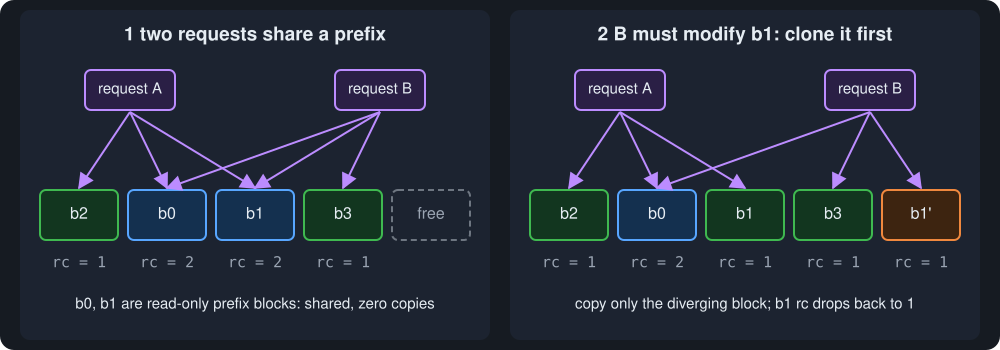

```c
void kv_block_share(KVPool *p, void *ptr) {
    pool_refcount(p)[block_index(p, ptr)]++;
}
```

**Share the immutable, copy on mutation.** (`block_index` is the pointer → index line from `kv_block_free`.)

---

# 🔁 Act 10: The COW Rhyme — Same Idea, Two Layers

|  | Pages (Act 1) | KV blocks (Act 10) |
| --- | --- | --- |
| Shared until... | a write to a page | a mutation of a block |
| Mechanism | page table + fault | refcount + clone |
| Cost of sharing | ~zero | ~zero |
| Cost of the copy | one page, on first write | one block, on first mutation |

Copy-on-write is a **design pattern**, not kernel trivia: share what is immutable, duplicate lazily on divergence.

---

# 🏟️ Act 10: The Full Request Lifetime

```
request starts →  arena_create()             (variable-size metadata)
                  kv_block_alloc() × N        (fixed-size KV blocks)
request runs   →  arena_alloc() bumps along; blocks fill up
request ends   →  arena_destroy()             — one free, metadata gone
                  kv_block_free() × N          — blocks return to the pool
```

Metadata leaks are impossible (arena). KV memory never touches `malloc` (pool). Timeout/crash cleanup is the same two lines in a loop.
The shape of real serving engines, and this week's lab: the first brick of your final project.

---

# ⚖️ Act 10: What the Pool Costs Us

| `malloc`-per-fragment | Fixed KV pool |
| --- | --- |
| any size, any time | one size per pool |
| pays per allocation (search, syscall risk) | O(1) pop/push |
| external fragmentation | none between blocks; internal if blocks oversized |
| no sharing | refcounted sharing |
| cleanup scattered | one `munmap` |

Real engines run **several** pools (size classes, Act 6) and fall back to `mmap` for odd sizes.

---

# 🦀 Rust Callout: Shared Blocks, Atomically

```rust
use std::sync::Arc;
let prefix: Arc<KVBlock> = Arc::new(compute_prefix());
let r1 = prefix.clone();   // refcount++ — cheap
let r2 = prefix.clone();   // refcount++ — cheap
// last Arc dropped → memory freed automatically
```

`Arc` = **atomic** reference counting = a thread-safe `refcount`. Rust inference engines share prefixes this way; you build the C version in the lab.

---

# 🦀 Rust Corner: Allocation With Guardrails

```rust
let p: Box<i32> = Box::new(42);      // malloc + initialize...
drop(p);                             // ...and free, automatic at scope end
// double free / use after free: not expressible in safe Rust

let mut v: Vec<u8> = Vec::new();
v.push(1);                           // grows by doubling — realloc underneath
```

| C | Rust |
| --- | --- |
| `malloc` returns `NULL` on failure | allocation failure **aborts** by default |
| `free(p); /* p still usable */` | `drop` at scope end; no manual call |
| realloc dance with `tmp` | `Vec`/`String` handle growth internally |

Underneath, Rust calls the system's `malloc` by default (jemalloc was the default until Rust 1.32, 2019; it is now an opt-in global allocator). Same heap, different contract.

---

# 🧪 Lab 6: Build the KV Cache Memory Pool (1-Week Lab)

Take-home mini-project and **Part 1 of the final project's memory subsystem**. Full spec: `lab6-kv-cache.md`.

```c
KVPool *kv_pool_create(size_t block_size, size_t nblocks);
void   *kv_block_alloc(KVPool *pool);          /* NULL when exhausted */
void    kv_block_free(KVPool *pool, void *ptr);
void    kv_block_share(KVPool *pool, void *ptr);
void    kv_pool_destroy(KVPool *pool);          /* exactly one munmap */

Arena *arena_create(size_t cap);
void  *arena_alloc(Arena *a, size_t size);      /* 16-byte aligned */
void   arena_reset(Arena *a);
void   arena_destroy(Arena *a);
```

The code from Acts 9–10, written, tested and benchmarked by you. No new ideas needed.

---

# 🧪 Lab 6: Rules of the Game

- pool internals: **exactly one `mmap`**, zero `malloc` calls in `kvpool.c`;
- O(1) alloc/free; 16-byte aligned blocks; Valgrind-clean test suite;
- benchmark against libc `malloc` (time + peak RSS) and write it up;
- bonus: double-free detection, COW-style cloning, `pthread_mutex_t` teaser.

The grader's first commands:

```bash
grep -n "malloc\|calloc\|realloc\|free(" kvpool.c   # must find nothing
valgrind --leak-check=full ./test_kvpool            # must be silent
```

---

# 🏁 Summary I: The Allocator's Story

| Mystery / breakage | Fix | Lesson |
| --- | --- | --- |
| `fork()` of a huge process is instant | copy-on-write | pages copy only on write |
| `printf` before fork prints twice | flush / `_exit` | stdio buffers are memory; fork copies them |
| `sbrk` on every allocation | free list | reuse beats syscalls |
| freed space unusable by big requests | splitting + coalescing | merge holes, split tails |
| heap full, yet `malloc` fails | fragmentation | size classes, arenas, better placement |
| `realloc` overwrites my only pointer | temp pointer + NULL check | the old block survives failure |
| agents eat all RAM | `setrlimit` in the fork/exec gap | limits are part of supervision |

---

# 🏁 Summary II: The Agents' Story

| Mystery / breakage | Fix | Lesson |
| --- | --- | --- |
| generic `malloc` crumbles under KV workloads | fixed-size pool | one size kills external fragmentation |
| two requests, one prompt | refcounted shared blocks | share immutable, copy on mutation |
| request metadata leaks everywhere | arena | many allocations, one free |
| bad pointers from callers | validate before trusting | defensive allocator boundaries |

Next week: **threads** — one address space, many actors. Bring your mutexes.

---

# 📖 Field Manual (Reference Appendix)

Reference for labs, homework, and exams. Not covered in class.

---

# 📎 FM 1: The Allocation API

```c
#include <stdlib.h>
void *malloc(size_t size);
void *calloc(size_t nmemb, size_t size);
void *realloc(void *ptr, size_t size);
void  free(void *ptr);

/* aligned variants */
void *aligned_alloc(size_t alignment, size_t size);        /* C11 */
int   posix_memalign(void **memptr, size_t align, size_t size);
```

| Rule | Detail |
| --- | --- |
| `malloc` | uninitialized; may return `NULL` (always check) |
| `calloc` | zeroed; checks `nmemb*size` overflow |
| `realloc(NULL, n)` | same as `malloc(n)` |
| `realloc(p, 0)` | implementation-defined; avoid |
| `free(NULL)` | safely does nothing |
| payload alignment | at least 16 bytes on modern glibc |

---

# 📎 FM 2: `brk` / `sbrk`

```c
#include <unistd.h>
int   brk(void *addr);              /* set program break */
void *sbrk(intptr_t increment);     /* returns OLD break; (void*)-1 on error */
```

- `sbrk(0)` reports the current break without moving it.
- Growing past the break asks the kernel to extend the data segment.
- Not POSIX anymore; allocators use it internally, applications shouldn't.

---

# 📎 FM 3: `mmap` for Anonymous Memory

```c
#include <sys/mman.h>
void *mmap(NULL, length, PROT_READ | PROT_WRITE,
           MAP_PRIVATE | MAP_ANONYMOUS, -1, 0);
int   munmap(void *addr, size_t length);   /* really returns memory */
```

| Flag | Meaning |
| --- | --- |
| `MAP_ANONYMOUS` | not backed by a file; fresh zero pages |
| `MAP_PRIVATE` | copy-on-write semantics |
| `PROT_READ/WRITE` | page permissions |

Also the basis of shared-memory IPC (`MAP_SHARED`, Week 12) and memory-mapped files.

---

# 📎 FM 4: Alignment Rules (Recap from Week 2)

| Type | Typical alignment |
| --- | --- |
| `char` | any address |
| `short` | even (2) |
| `int`, `float` | 4 |
| `long`, `double`, pointers | 8 |
| malloc payloads | 16 (glibc) |

Allocator consequences:

- block sizes are kept in 16-byte units → low bits free for flags;
- splitting must preserve payload alignment;
- `#define ALIGN16(n) (((n) + 15) & ~(size_t)15)` is your friend.

---

# 📎 FM 5: Placement Strategy Cheat Sheet

| Strategy | Rule | Search | Fragmentation profile |
| --- | --- | --- | --- |
| First fit | first hole big enough | O(n) from start | front-loaded fragmentation |
| Next fit | like first fit, resume where the last search ended | O(1)* | spread fragmentation |
| Best fit | smallest hole that fits | O(n)** | dust of tiny holes |
| Worst fit | largest hole available | O(n)** | large survivors, rarely best |

\* amortized by remembering position. ** improvable with a min/max heap or size-indexed lists.
Optimal offline allocation = knapsack = NP-hard.

---

# 📎 FM 6: Fragmentation Glossary

| Term | Meaning |
| --- | --- |
| Internal fragmentation | allocated block larger than request |
| External fragmentation | free memory exists but is non-contiguous |
| Blowup | worst-case growth due to fragmentation |
| Splitting | dividing an oversized free block |
| Coalescing | merging adjacent free blocks |
| Program break | end of the `sbrk`-managed heap |
| Copy-on-write | pages duplicated only on first write |
| Arena | bulk-alloc region freed in one shot |

---

# 📎 FM 7: Heap Debugging Toolkit

| Tool | Command | Finds |
| --- | --- | --- |
| Valgrind | `valgrind --leak-check=full ./prog` | leaks, invalid r/w, use-after-free |
| ASan | `gcc -fsanitize=address -g` | same classes, ~2× faster runs |
| glibc checks | `MALLOC_CHECK_=3 ./prog` | some heap corruption, loudly |
| GDB | `break malloc` / `watch *p` | allocation flow inspection |

Always compile with `-g` when debugging.

---

# 📎 FM 8: Tuning Knobs (glibc)

| Knob | Effect |
| --- | --- |
| `mallopt(M_MMAP_THRESHOLD, n)` | size above which allocations use `mmap` |
| `mallopt(M_TRIM_THRESHOLD, n)` | when to try returning heap to OS |
| `mallopt(M_ARENA_MAX, n)` | cap allocator arenas (threads!) |
| `malloc_trim(0)` | explicitly ask for memory return |

Environment equivalents: `MALLOC_MMAP_THRESHOLD_`, `MALLOC_ARENA_MAX`, etc.
Rarely needed, but server memory mysteries often end here.

---

# 📎 FM 9: Memory Limits for Agents

```c
#include <sys/resource.h>
struct rlimit rl = { .rlim_cur = limit, .rlim_max = limit };
setrlimit(RLIMIT_AS, &rl);      /* address space cap — set before exec */
```

| Limit | Caps |
| --- | --- |
| `RLIMIT_AS` | total virtual address space |
| `RLIMIT_DATA` | data segment (heap-ish) |
| `RLIMIT_STACK` | stack size |

Shell side: `ulimit -v 262144` (KiB). Container side: cgroups v2 `memory.max`.
When memory runs out, the OOM killer picks by score (tune via `/proc/<pid>/oom_score_adj`).

---

# 📎 FM 10: Where Things Live (Master Table)

| Item | Region |
| --- | --- |
| machine code | text |
| initialized globals/statics | data |
| zero-initialized globals/statics | bss |
| string literals | rodata |
| local variables, frames | stack |
| `malloc`/`calloc` blocks | heap (or `mmap`) |
| the pointer variable itself | stack (or wherever declared) |
| `FILE` buffers | heap (inside the `FILE` struct's buffer) |

`fork()` copies all of it — lazily. `exec()` replaces all of it — except fds.

---

# 📎 FM 11: The Single-Region Pool Pattern (Lab 6 Reference)

```c
typedef struct {
    size_t   block_size;
    size_t   nblocks;
    uint32_t free_head;
    char     data[];   /* [ next_free[] ][ refcount[] ][ pad ][ blocks... ] */
} KVPool;
```

| Quantity | Formula |
| --- | --- |
| `offsetof(KVPool, data)` | 20 on x86-64 (`sizeof(KVPool)` is 24: don't confuse them) |
| free list offset | `p->data` |
| refcount offset | `p->data + nblocks * sizeof(uint32_t)` |
| first block | align up to 16: `(addr + 15) & ~15` (absolute address!) |
| block `i` | `pool_blocks(p) + i * block_size` |
| index from pointer | `(ptr - pool_blocks(p)) / block_size` |
| total for `mmap` / `munmap` | `(pool_blocks(p) - (char *)p) + nblocks * block_size` |

Rules: flexible array member last; one `mmap`/one `munmap` with the **same** length; `UINT32_MAX` = end
of free list; refcount `> 1` means "free just decrements" (COW sharing).
