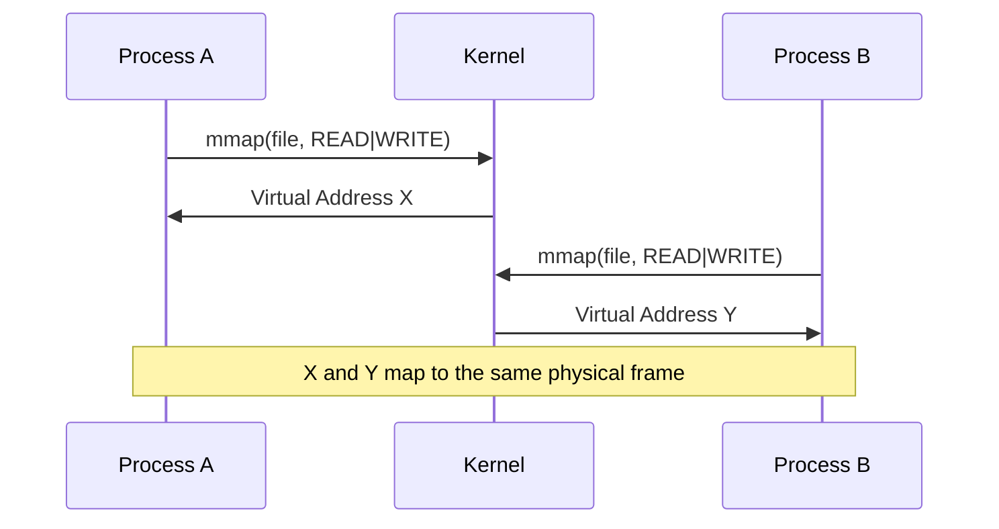
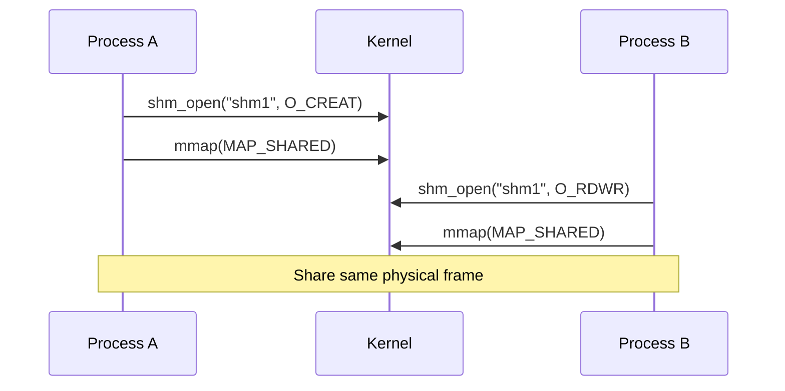
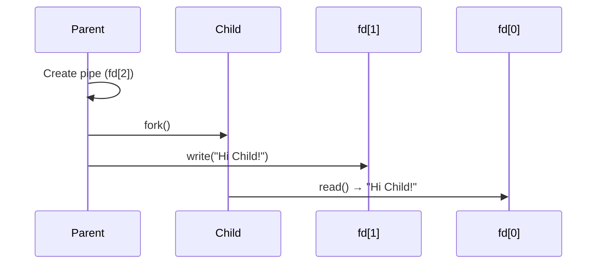
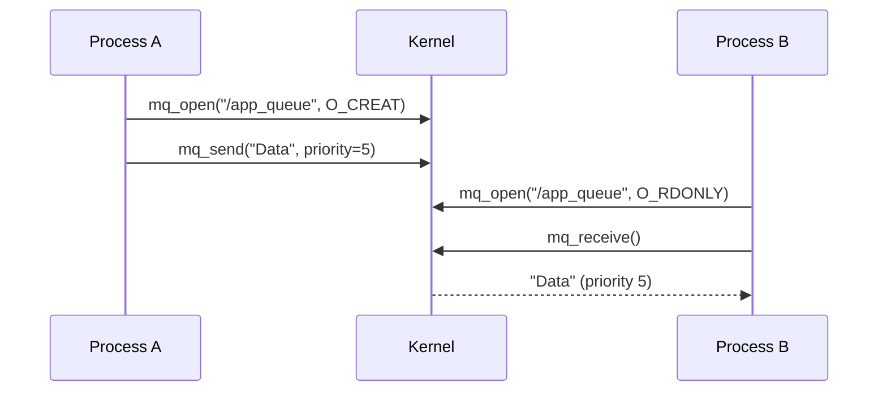
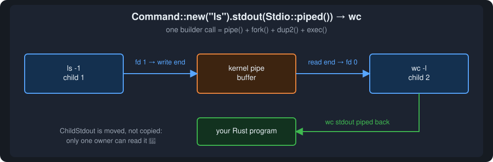
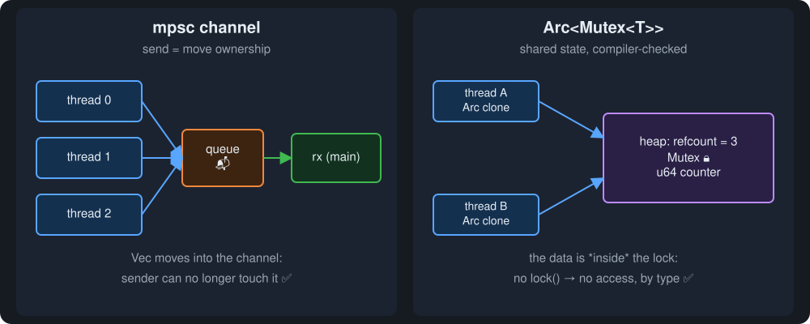
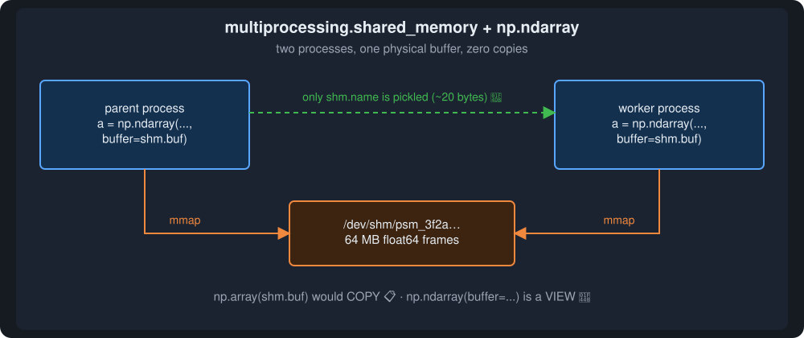

# Virtual Memory & IPC

[Virtual Memory Overview](#virtual-memory-overview)
[Virtual Memory and IPC](#virtual-memory--ipc)
[IPC with Shared Memory: mmap()](#ipc-with-mmap--shared-memory)
[IPC with Pipes](#ipc-with-pipes)
[IPC with POSIX Message Queues](#ipc-with-posix-message-queues)
[IPC in Modern Languages: Rust & NumPy](#ipc-in-modern-languages-rust--numpy)
*Edited based on last year lecture slides by using DeepSeek-R1*

---

## Virtual Memory Overview
- **Early Systems**: Direct memory access (e.g., IBM 709). Processes used physical addresses like "Address 1234".
- **Modern Systems**: Use **address translation** via the **Memory Management Unit (MMU)**.
- **Key Concept**: Virtual memory abstracts physical memory, allowing isolation and efficient resource use.

---

## Address Translation
### MMU & TLB Workflow


---

### Steps in Address Translation
1. **TLB Check**: Hardware checks Translation Lookaside Buffer (TLB) for cached address.
2. **Page Table Lookup**: If TLB miss, MMU consults page table(s).
3. **Physical Address**: MMU converts virtual to physical address using page number + offset.
4. **Permission Check**: Validate read/write/execute permissions.
5. **Operation**: Perform memory access and cache result in TLB.

---

## Pages & Frames
- **Page**: Block of **virtual memory** (e.g., 4 KiB on Linux).
- **Frame**: Block of **physical memory** (same size as a page).
- **Offset**: Last 12 bits of a 32-bit address (for 4 KiB pages).

### Page Table Structure
- **32-bit System**: 
  - Total pages = \(2^{32} / 2^{12} = 2^{20}\) (1 million pages).
  - Page table size = \(2^{20} \times 4\ \text{B} = 4\ \text{MB}\).
- **64-bit System**: 
  - Total pages = \(2^{52}\) (huge! Requires multi-level tables).

---

## Multi-Level Page Tables
- **Purpose**: Reduce page table size by only allocating entries for used memory regions.
- **Trade-off**: Increased memory accesses (3 for 2-level tables vs. 2 for single-level).

---

## Translation Lookaside Buffer (TLB)
- **Role**: Cache recent virtual-to-physical page translations.
- **TLB Hit**: Fast access (1 cycle).
- **TLB Miss**: Slow path (page table walk + TLB update).

---

## MMU Algorithm (Simplified)
```python
def mmu_translate(virtual_addr):
    if tlb_hit(virtual_addr):
        physical_addr = tlb_lookup(virtual_addr)
        return physical_addr
    else:
        page_num, offset = split_address(virtual_addr)
        if page_not_in_memory(page_num):
            raise PageFault()
        if permission_denied(page_num, operation):
            raise SIGSEGV()
        physical_frame = page_table_lookup(page_num)
        tlb_update(page_num, physical_frame)
        return physical_frame + offset
```

---

## Page Faults
1. **Minor Fault**: 
   - Page not loaded but valid (e.g., `sbrk`-allocated memory). OS allocates a zero-filled page.
2. **Major Fault**: 
   - Page swapped to disk. OS retrieves it (causes thrashing if frequent).
3. **Invalid Fault**: 
   - Access to non-readable/writable memory → `SIGSEGV`.

---

## Relation to IPC
### Breaking Memory Isolation
- **Kernel-Mediated IPC**: 
  - Pipes, sockets, signals (kernel handles synchronization).
- **Shared Memory**: 
  - `mmap` maps the same physical frame to multiple processes' virtual spaces.
  - Requires explicit synchronization (e.g., semaphores).

---



---

### Key Takeaway
IPC mechanisms rely on bypassing virtual memory isolation, either via kernel APIs or shared memory mappings.

---

**Note for Students**:  
- Virtual memory concepts are foundational for understanding process isolation and IPC.  
- You’ll explore advanced topics (e.g., page replacement algorithms) in **BIL 301 OS**.  
- Experiment with `mmap` and pipes in labs to see these concepts in action! 🔍💻

---

# IPC with mmap & Shared Memory

## Breaking Memory Isolation for IPC
Two primary methods for inter-process communication (IPC):
1. **Kernel-Mediated IPC**: Pipes, sockets, signals (managed by OS).
2. **Shared Memory**: Map same physical frame to multiple processes' virtual spaces using `mmap`.

---

## What is `mmap`?
- **Memory-mapped I/O**: Map files/devices directly into virtual memory.
- **Advantages**:
  - Bypass kernel buffer for direct file access.
  - Lazy allocation: Pages loaded on-demand via page faults.
  - Efficient sharing between processes.

### Standard I/O vs. `mmap`
```c
// Standard File I/O
char buf[100] = "merhaba";
int fd = open("hello.txt", O_WRONLY);
write(fd, buf, strlen(buf));
close(fd);

// Using mmap
char *addr = mmap(NULL, 100, PROT_WRITE, MAP_SHARED, fd, 0);
addr[0] = 'A';  // Directly modifies the file!
munmap(addr, 100);
```

---

## `mmap` Function Deep Dive
```c
#include <sys/mman.h>
void *mmap(void *addr, size_t length, int prot, int flags, int fd, off_t offset);
```

---

### Key Parameters:
| Parameter | Description |
|-----------|-------------|
| `addr`    | Start address (use `NULL` for kernel choice) |
| `length`  | Mapping size (bytes) |
| `prot`    | Access permissions: `PROT_READ`, `PROT_WRITE`, `PROT_EXEC` |
| `flags`   | `MAP_SHARED` (sync to file) or `MAP_PRIVATE` (process-local) |
| `fd`      | File descriptor (use `-1` for anonymous memory) |
| `offset`  | Page-aligned offset (multiple of `sysconf(_SC_PAGE_SIZE)`) |

---

## Shared Memory Between Processes

### 1. Parent-Child Process (Anonymous Mapping)
```c
int size = 100 * sizeof(int);
int *shared = mmap(0, size, PROT_READ | PROT_WRITE, MAP_SHARED | MAP_ANONYMOUS, -1, 0);

pid_t child = fork();
if (child > 0) {
    shared[0] = 10;  // Parent writes
} else {
    printf("%d\n", shared[0]);  // Child reads
}
munmap(shared, size);
```

---

### 2. Unrelated Processes (`shm_open`)


---
```
Physical Memory
+-------------------+
| Frame 42: "AB"    |  ← Shared by both processes
+-------------------+

Process A Virtual Space       Process B Virtual Space
+-------------------+        +-------------------+
| X: 0x1000 → Frame 42 |     | Y: 0x3000 → Frame 42 |
+-------------------+        +-------------------+
```

---

#### Example Workflow with Semaphores:
```c
// Structure for shared memory
struct shmbuf {
    sem_t sem1, sem2;
    char buf[BUF_SIZE];
    size_t cnt;
};
```

---

```c
// Process 1 (Writer)
shmp->cnt = len;
memcpy(shmp->buf, string, len);
sem_post(&shmp->sem1);  // Signal data ready

```
---

```c
// Process 2 (Reader)
sem_wait(&shmp->sem1);  // Wait for data
process_data(shmp->buf);
sem_post(&shmp->sem2);  // Signal completion
```

---

## Critical Considerations
1. **Synchronization**: Use semaphores/mutexes to prevent data races.
2. **Page Alignment**:
   ```c
   off_t offset = atoi(argv[2]);
   off_t pa_offset = offset & ~(sysconf(_SC_PAGE_SIZE) - 1);  // Align to page
   ```
3. **Cleanup**:
   - Always `munmap` and `close(fd)`.
   - Remove shared objects with `shm_unlink()`.

---

## Pros & Cons of Shared Memory
| **Pros**                          | **Cons**                          |
|-----------------------------------|-----------------------------------|
| Zero-copy (maximum speed)         | Risk of data races                |
| No disk I/O overhead              | Requires explicit synchronization|
| Flexible for large data transfers | Complex setup with `shm_open`     |

---

**Lab Tip**:  
Experiment with `mmap` to implement a producer-consumer system. Use semaphores for thread-safe operations! 🚀

---

# IPC with Pipes

## Pipes Overview
- **Purpose**: Stream-based IPC for unidirectional byte flow (e.g., `ls | grep "txt"`).
- **Types**:
  - **Anonymous Pipes**: Short-lived, process hierarchy required (created via `pipe()`).
  - **Named Pipes (FIFOs)**: Persistent, filesystem-based (created via `mkfifo`).

---

## POSIX `pipe()` System Call
```c
#include <unistd.h>
int pipe(int pipefd[2]);  // Returns 0 on success, -1 on error
```

### Key Behavior:
- Creates two file descriptors:
  - `pipefd[0]`: Read end.
  - `pipefd[1]`: Write end.
- **Unidirectional**: Data flows from write-end to read-end.
- **Blocking**: `read()` blocks until data is available; `write()` blocks if buffer is full.

---

## Basic Pipe Workflow (Parent-Child)


---

### Example Code:
```c
#include <unistd.h>
#include <stdio.h>

int main() {
    int fd[2];
    pipe(fd);  // Create pipe
    
    pid_t child = fork();
    if (child > 0) {       // Parent
        write(fd[1], "Hi Child!", 9);
        close(fd[1]);      // Close write end
        wait(NULL);
    } else {               // Child
        close(fd[1]);      // Close unused write end
        char buf;
        while (read(fd[0], &buf, 1) > 0) {
            putchar(buf);
        }
    }
    return 0;
}
```

---

## Critical Pipe Management
### 1. Avoiding Infinite Blocks
- **Close Unused Ends**: Always close unused pipe ends to prevent hangs.
- **SIGPIPE Handling**:
  ```c
  #include <signal.h>
  void sigpipe_handler(int sig) {
      write(1, "No readers!\n", 12);
  }
  signal(SIGPIPE, sigpipe_handler);  // Handle broken pipes
  ```

---

### 2. File Descriptor Redirection with `dup2`
```c
#include <unistd.h>
dup2(oldfd, newfd);  // Redirects newfd to oldfd

// Example: Redirect stdout to pipe write-end
dup2(pipefd[1], STDOUT_FILENO);
close(pipefd[1]);
execlp("ls", "ls", "-1", NULL);  // ls output goes to pipe
```

---

## Shell-like Piping Implementation


---

### Code: Implementing `ls | cut` with `dup2`
```c
#define _GNU_SOURCE
#include <unistd.h>
#include <fcntl.h>

int main() {
    int pipe_fds[2];
    pipe(pipe_fds);
    
    if (!fork()) {          // Child (ls)
        dup2(pipe_fds[1], STDOUT_FILENO);  // Redirect stdout to pipe
        close(pipe_fds[0]);
        execlp("ls", "ls", "-1", NULL);
    } else {                // Parent (cut)
        dup2(pipe_fds[0], STDIN_FILENO);   // Redirect stdin to pipe
        close(pipe_fds[1]);
        execlp("cut", "cut", "-f1", "-d.", NULL);
    }
    return 0;
}
```

---

## Named Pipes (FIFOs)
```c
#include <sys/stat.h>
int mkfifo(const char *pathname, mode_t mode);  // e.g., mkfifo("/tmp/myfifo", 0666);
```

### Usage:
1. **Create FIFO**:
   ```bash
   $ mkfifo /tmp/myfifo
   ```
2. **Process A (Writer)**:
   ```bash
   $ echo "Hello" > /tmp/myfifo
   ```
3. **Process B (Reader)**:
   ```bash
   $ cat < /tmp/myfifo
   ```

---

## Advanced Topics
### Non-Blocking Pipes
```c
fcntl(pipefd[0], F_SETFL, O_NONBLOCK);  // Set read-end as non-blocking
```

### Pipe Flags
```c
pipe2(pipefd, O_CLOEXEC);  // Auto-close pipe on exec
```

---

## Common Pitfalls & Solutions
| **Issue**               | **Solution**                          |
|-------------------------|---------------------------------------|
| Infinite `read()` block | Close unused write ends               |
| `SIGPIPE` crashes       | Register signal handler               |
| Data corruption         | Use synchronization (e.g., mutexes)   |

---

**Lab Challenge**:  
Implement a 3-stage pipeline (`ls → grep → wc`) using `pipe()` and `dup2`. Measure performance against shell pipelines! ⏱️🔧


---

# IPC with POSIX Message Queues
[from GNU](https://www.gnu.org/software/gnulib/manual/html_node/mqueue_002eh.html)
mqueue.h is not supported by: macOS 14, FreeBSD 6.0, NetBSD 3.0, OpenBSD 7.5, Minix 3.1.8, Cygwin 1.5.x, mingw, MSVC 14, Android 9.0.
[POSIX specification](https://pubs.opengroup.org/onlinepubs/9799919799/basedefs/mqueue.h.html)
 
Real time extension of POSIX standards, it is highly used in Linux-based systems.

---

## Overview & Key Concepts  
- **Kernel-Managed IPC (and synchronization)**: Messages are stored in a kernel-managed queue.  
- **Structured Communication**: Preserves message boundaries (unlike pipes).  
- **Features**:  
  - Messages have **priorities** (higher priority messages are read first).  
  - Named queues (`/name` format) for unrelated processes.  
  - Persistent until explicitly removed or system reboot.  

---

## Core Functions  
```c  
#include <mqueue.h>  
// Open/create a queue  
mqd_t mq_open(const char *name, int oflag, mode_t mode, struct mq_attr *attr);  
// Send/receive messages  
int mq_send(mqd_t mqdes, const char *msg_ptr, size_t msg_len, unsigned int msg_prio);  
ssize_t mq_receive(mqd_t mqdes, char *msg_ptr, size_t msg_len, unsigned int *msg_prio);  
// Close/unlink queue  
int mq_close(mqd_t mqdes);  
int mq_unlink(const char *name);  
```  

---

## Queue Attributes  
Configured via `struct mq_attr`:  
```c  
struct mq_attr {  
    long mq_flags;    // Flags (0 or O_NONBLOCK)  
    long mq_maxmsg;   // Max messages in queue  
    long mq_msgsize;  // Max size per message (bytes)  
    long mq_curmsgs;  // Current messages in queue (read-only)  
};  
```  

---

## Example: Sender & Receiver  
**Sender Code** (compile with `-lrt`):  
```c  
#include <mqueue.h>  
#include <stdio.h>  

int main() {  
    mqd_t mq = mq_open("/my_queue", O_CREAT | O_WRONLY, 0644, NULL);  
    mq_send(mq, "Hello from sender!", 19, 0);  
    mq_close(mq);  
    return 0;  
}  
```  

**Receiver Code**:  
```c  
#include <mqueue.h>  
#include <stdio.h>  

int main() {  
    mqd_t mq = mq_open("/my_queue", O_RDONLY);  
    char buf[1024];  
    mq_receive(mq, buf, 1024, NULL);  
    printf("Received: %s\n", buf);  
    mq_close(mq);  
    mq_unlink("/my_queue");  
    return 0;  
}  
```  

---

## Workflow Diagram  


---

## Pros & Cons  
| **Pros**                          | **Cons**                          |  
|-----------------------------------|-----------------------------------|  
| Structured messages with priority | Kernel overhead                   |  
| Asynchronous communication        | Message size limits               |  
| Persistence across process exits  | Requires explicit unlinking       |  

---

## Lab Challenge  
Implement a **task scheduler** where multiple clients send tasks (with priorities) to a server via a message queue. The server executes tasks in priority order! 🚀  

**Tip**: Use `mq_getattr` to monitor queue status and `fork()` for concurrent task processing.  

---

# IPC in Modern Languages: Rust & NumPy

Same kernel objects (pipes, `mmap`, shared memory), friendlier and safer wrappers.
- **Rust** 🦀: the *compiler* checks who owns a pipe end, a buffer, or a lock.
- **Python + NumPy** 🐍: `mmap`/`shm_open` behind an `ndarray`, used for zero-copy data in ML/data pipelines.

---

## Rust: Pipes with `std::process::Command`



---

```rust
use std::io::Read;
use std::process::{Command, Stdio};

fn main() -> std::io::Result<()> {
    // 🔧 pipe() + fork() + dup2() + exec() — all in one builder
    let ls = Command::new("ls")
        .arg("-1")
        .stdout(Stdio::piped())          // 🚰 stdout -> write end of a pipe
        .spawn()?;                       // 🐣 fork + exec

    let mut wc = Command::new("wc")
        .arg("-l")
        .stdin(ls.stdout.unwrap())       // 🔗 read end becomes wc's stdin (ownership moves!)
        .stdout(Stdio::piped())
        .spawn()?;

    let mut out = String::new();
    wc.stdout.take().unwrap().read_to_string(&mut out)?; // 📥 read until EOF
    wc.wait()?;                          // 🧹 reap the child (no zombies)
    println!("entries: {}", out.trim());
    Ok(())                               // ✅ every fd is closed by Drop
}
```
- Compare with the C `ls | cut` example: no forgotten `close()`, so no "reader never sees EOF" hang. 🎯

---

## Rust: Channels (`mpsc`) — Message Passing Between Threads



---

```rust
use std::sync::mpsc;
use std::thread;

fn main() {
    let (tx, rx) = mpsc::channel::<Vec<u32>>();   // 📬 sender / receiver pair

    for id in 0..3 {
        let tx = tx.clone();                       // 📮 each producer gets its own Sender
        thread::spawn(move || {                    // 🚚 `move`: thread owns tx
            let batch = vec![id; 4];
            tx.send(batch).unwrap();               // 📦 ownership of the Vec moves into the channel
            // println!("{:?}", batch);            // ❌ compile error: value moved
        });
    }
    drop(tx);                                      // 🔚 drop the original so rx sees "closed"

    for batch in rx {                              // 📥 blocks like read(); ends when all senders dropped
        println!("got {:?}", batch);
    }
}
```
- Like a **message queue** (boundaries kept, blocking receive), but inside one process.
- Closing works like a pipe: all `Sender`s dropped → receiver gets end-of-stream.

---

## Rust: `Arc<Mutex<T>>` — Shared State Without Data Races

```rust
use std::sync::{Arc, Mutex};
use std::thread;

fn main() {
    let counter = Arc::new(Mutex::new(0u64));      // 🔒 data lives *inside* the lock
    let mut handles = Vec::new();

    for _ in 0..4 {
        let c = Arc::clone(&counter);              // 🔢 ref-count++, same heap object
        handles.push(thread::spawn(move || {
            for _ in 0..100_000 {
                *c.lock().unwrap() += 1;           // 🔑 lock() -> guard; unlocks at end of statement
            }
        }));
    }
    for h in handles { h.join().unwrap(); }        // 🤝 like pthread_join
    println!("total = {}", *counter.lock().unwrap()); // ✅ always 400000
}
```
- In C, `pthread_mutex_t` and the counter are separate: nothing stops you from forgetting the lock.
- In Rust, the only way to reach the `u64` is through `lock()`. 🛡️

---

## `Send` & `Sync`: Races Become Compile Errors

| Trait | Meaning | Example ✅ | Example ❌ |
|-------|---------|-----------|-----------|
| `Send` | value may **move** to another thread | `Vec<T>`, `Arc<T>`, `Sender<T>` | `Rc<T>` (non-atomic refcount) |
| `Sync` | `&T` may be **shared** between threads | `Mutex<T>`, `AtomicU64` | `Cell<T>`, `RefCell<T>` |

```rust
let mut counter = 0;
thread::spawn(|| counter += 1);      // ❌ E0373: closure may outlive the current
                                     //    function, but it borrows `counter`
let shared = Rc::new(vec![1, 2, 3]);
thread::spawn(move || println!("{:?}", shared));
                                     // ❌ E0277: `Rc<Vec<i32>>` cannot be sent
                                     //    between threads safely
```
- ⚠️ Rust prevents **data races**, not every race: deadlocks and wrong lock order are still possible (Lecture 8).

---

## Rust: `mmap` with the `memmap2` crate

```rust
// Cargo.toml: memmap2 = "0.9"
use memmap2::MmapMut;
use std::fs::OpenOptions;

fn main() -> std::io::Result<()> {
    let file = OpenOptions::new()
        .read(true).write(true).create(true).truncate(false)
        .open("shared.bin")?;
    file.set_len(4096)?;                           // 📏 like ftruncate(fd, 4096)

    // ⚠️ unsafe: another process may change the file under us
    let mut map = unsafe { MmapMut::map_mut(&file)? }; // 🗺️ mmap(PROT_READ|PROT_WRITE, MAP_SHARED)

    map[0] += 1;                                   // ✍️ plain slice write -> page cache -> file
    map.flush()?;                                  // 💾 msync()
    println!("run #{}", map[0]);                   // 🔁 run it twice: the value survives
    Ok(())                                         // 🧹 munmap + close via Drop
}
```
- Why `unsafe`? The borrow checker sees **one process**. Another process writing the same pages is outside its view, so *you* must synchronize (as in C). 🤔

---

## Python NumPy: `np.memmap` — a File as an Array

```python
import numpy as np

# 🗺️ mmap() a 1M-float file as an ndarray (mode "w+" = create, read/write)
a = np.memmap("data.f32", dtype=np.float32, mode="w+", shape=(1_000_000,))
a[:] = np.arange(a.size)          # ✍️ writes go to the page cache, not a Python copy
a.flush()                          # 💾 msync()
del a                              # 🧹 munmap()

# 📖 later / another process: map read-only, nothing is read yet (lazy!)
b = np.memmap("data.f32", dtype=np.float32, mode="r", shape=(1_000_000,))
print(b[999_999])                  # 📄 page fault loads only that one page
print(b[::100_000].sum())          # 🔍 touches ~10 pages, not the whole 4 MB
```
- Modes: `"r"` → `PROT_READ`, `"r+"`/`"w+"` → `MAP_SHARED`, `"c"` → `MAP_PRIVATE` (copy-on-write).
- Used for datasets bigger than RAM: the OS pages data in and out for you (demand paging). 💡

---

## NumPy + `multiprocessing.shared_memory`



---

```python
import numpy as np
from multiprocessing import Process, shared_memory

N, WORKERS = 8_000_000, 4

def work(name, lo, hi):
    shm = shared_memory.SharedMemory(name=name)      # 🔗 attach: shm_open + mmap
    a = np.ndarray((N,), dtype=np.float64, buffer=shm.buf)  # 👀 a *view*, zero-copy
    a[lo:hi] = np.sqrt(np.arange(lo, hi))            # ✍️ each worker owns its slice -> no race
    del a                                            # 🧹 drop the view before close()
    shm.close()                                      # 🚪 munmap (segment still exists)

if __name__ == "__main__":
    shm = shared_memory.SharedMemory(create=True, size=N * 8)  # 🏗️ /dev/shm/psm_xxxx
    a = np.ndarray((N,), dtype=np.float64, buffer=shm.buf)
    step = N // WORKERS
    ps = [Process(target=work, args=(shm.name, i * step, (i + 1) * step))
          for i in range(WORKERS)]                   # 📛 only the *name* is sent, not 64 MB
    for p in ps: p.start()
    for p in ps: p.join()
    print(a[[0, 1, 4, N - 1]])                       # ✅ parent sees the workers' writes
    del a
    shm.close()
    shm.unlink()                                     # 🗑️ shm_unlink(): free the segment
```

---

## NumPy Shared Memory: Pitfalls

```python
view = np.frombuffer(shm.buf, dtype=np.float64)   # 👀 view: shares the frames
copy = np.array(shm.buf).view(np.float64)         # 📋 copy: private, changes not shared
view[0] = 42
print(view[0], copy[0], np.shares_memory(view, copy))   # 42.0 0.0 False
```
| Pitfall | What happens | Fix |
|---------|--------------|-----|
| `Queue.put(big_array)` | array is **pickled** and copied through a pipe 🐢 | send `shm.name`, attach a view |
| `a[i] += 1` from many processes | read-modify-write **race** (no GIL across processes) | disjoint slices, or `multiprocessing.Lock` |
| forgot `unlink()` | `/dev/shm` segment leaks until reboot 🗑️ | owner calls `unlink()` once |
| `close()` while a view is alive | page is unmapped; next `a[0] = 1` → **SIGSEGV** 💥 (Python 3.13) | `del` the ndarray first |

---

## Same Idea, Three Languages

| Concept | C (POSIX) | Rust 🦀 | Python / NumPy 🐍 |
|---------|-----------|---------|-------------------|
| Pipe to a child | `pipe` + `fork` + `dup2` + `exec` | `Command` + `Stdio::piped()` | `subprocess.Popen(stdout=PIPE)` |
| Message passing | `mq_send` / `mq_receive` | `mpsc::channel` (threads) | `multiprocessing.Queue` |
| File mapping | `mmap(fd, MAP_SHARED)` | `memmap2::MmapMut` | `np.memmap` |
| Named shared memory | `shm_open` + `mmap` | `shared_memory` / `memmap2` crates | `shared_memory.SharedMemory` |
| Who prevents data races? | you 😬 | the compiler (`Send`/`Sync`) | you (locks, disjoint slices) |

**Modern domains** 🤖: PyTorch `DataLoader` workers, Ray's object store and model servers all pass tensors through shared memory exactly like this: send a *name*, map a *view*.

---

## Lab Challenge (Modern IPC)
1. 🦀 Rewrite the `ls → grep → wc` pipeline with `std::process::Command`. Count the `close()` calls you no longer need.
2. 🐍 Fill a 100M-element array with 4 processes via `shared_memory`, then repeat with `Queue.put(array)`. Time both and explain the difference.

---

**Next Lecture**: Signals and their role in IPC!