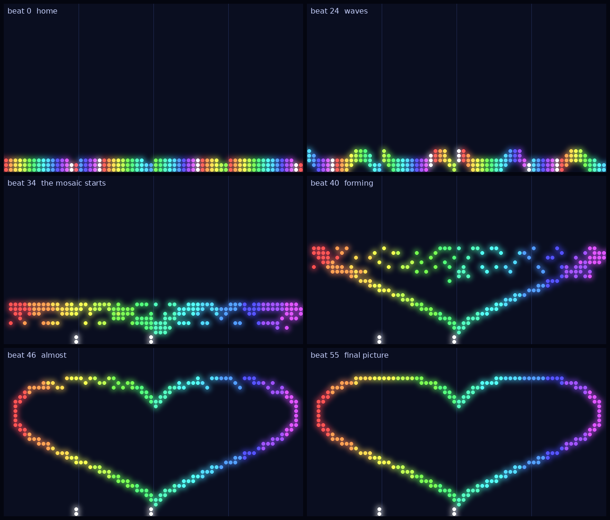

# Final Project: Autonomous Drone Swarm Choreographers

**Course:** BIL 322 System Programming
**Topic:** Processes, threads, synchronization, IPC, shared memory, sockets, signals — all in one system
**Mode:** Pairs (individual allowed; expectations are the same)
**Duration:** 3 phases: Phase 1 (1 week); Phases 2 and 3 assigned together in one skeleton, due Thursday 19 November and Thursday 3 December 2026
**AI use:** Allowed, but must be disclosed and you must be able to explain all code

> **Status: final.** Phase 1's skeleton is in [`labs/swarm-phase1-skeleton/`](../labs/swarm-phase1-skeleton/);
> Phases 2 and 3 share one skeleton, [`labs/swarm-phase2-3-skeleton/`](../labs/swarm-phase2-3-skeleton/).
> The protocol of Section 3 is frozen; Phase 3 only adds the messages marked "Phase 3".

---

## 1. Story

**Every year, the stadium fills with color.**

At the big stadium festival, students pack the stands and perform mass choreographies:
hundreds of them raise colored cards in perfect timing to paint giant mosaics on the
field — a flag, a logo, a word — all synchronized to music.

This year, the engineering faculty is taking the tradition into the air. Above the
stadium, a swarm of small LED drones will perform alongside the students: a living
mosaic of glowing drones that moves to the music, flows from one formation to the next,
and in the finale assembles a picture in the sky. Your team is building the swarm.

- **The Orchestrator Center — the Artistic Director.** It reads the **score** (the
  music's sections and moods) and holds the **target image** the finale must form. It
  decides the *coarse* theme of every section, splits the stage into zones, and assigns
  each troupe its part. It also hosts the **choreographer**: a slow, busy thinker that
  turns a theme into detailed movements. In a real production the choreographer would be
  an LLM; in this course it is a stub with simulated latency behind a small interface,
  because nobody needs a GPU to learn what it feels like to wait on a model that is slow,
  busy, or wrong.
- **The Leader drones — the Dance Captains.** Each captain owns one zone — one troupe.
  The center sets the theme; the captain drives the performance. A leader commissions
  the detailed choreography for its zone from the choreographer (each captain with its
  own *style*, so two troupes given the same theme dance differently but compatibly),
  checks it, and directs its performers through it. Troupes are semi-independent: each
  is its own small show inside the whole.
- **The Follower drones — the Performers.** Cheap, numerous, glowing. Each flies to a
  position, lights its color, and radios its captain: *"Next."* Performers don't
  choreograph. They dance.
- **The Viewer — the Broadcast Booth.** An independent GUI that shows the sky for the
  crowd on the stadium screens. It must never make a performer hesitate: if the
  broadcast lags, it drops frames — never the swarm.

**Why agents and not one central script?** The choreography is too large and too fast
for a single director to micromanage a hundred drones, and deciding what dozens of
drones should do from a mood and a zone, under speed and collision limits, is an
open-ended planning problem. The show only works if it is split into semi-independent
troupes that manage their own corner, react in real time, and keep dancing even when the
director is busy. That is exactly the leader/follower architecture — and exactly why
this course is about processes, threads, queues, and fault tolerance.

**Why the protocol is fixed and human-readable:** every message is one plain-text line,
so that not only the agents, but also the student operators in the control booth, can
watch the rehearsal scroll by, follow the swarm's reasoning, and step in when a troupe
goes off-script. A student can type a message with `nc` to test a captain by hand, and
an LLM can be given the protocol text as its instructions. A protocol only machines can
read is a protocol you can't debug on show night.



*A Phase 1 run, drawn from the center's ASCII output: 4 captains with 46 performers each. The
Phase 2 viewer draws the same thing in a real window.*

You have one swarm, one battery budget, and the length of one song. The picture either
forms by the final note, or it doesn't.

**The question threaded through every phase:** when a captain's battery dies
mid-performance, its troupe is suddenly *orphaned* — still flying, still glowing, still
asking *"Next?"* of a captain that will never answer. Who notices? Who takes over the
troupe? That question is the heart of this project, and it gets harder every phase.

### Why this project

| Course topic | Where it appears |
|---|---|
| fork / exec / wait, orphans (Weeks 4-5) | Center launches captains; a dead captain must be noticed and its troupe rescued |
| Pipes (Week 5) | Phase 1 links |
| Memory pools (Week 6, Lab 6) | The choreographer gives every planning request its KV blocks from the pool and an arena |
| Threads, mutexes, condition variables, semaphores, barriers | Performers in lockstep, task and request queues, thread pool |
| Deadlock, livelock, starvation | Two performers swapping places, full queues, retry storms |
| Shared memory, `mmap`, FIFOs, message queues (Week 12) | The stage bus to the broadcast booth (a separate process), the operator's control channel, the flight recorder |
| Sockets (Week 13) | Every link in the final phase |
| Signals (Week 14) | Graceful shutdown, dead-captain detection |

---

## 2. The Big Picture

```text
                     ┌───────────────────────────────────────┐
                     │      ORCHESTRATOR CENTER (Director)    │
                     │  score · target image · beat clock     │
                     │  choreographer: request queue →        │
                     │  planner pool (KV arena per request)   │
                     └───────┬───────────────────┬───────────┘
        THEME, BEAT, PLAN    │                   │ stage state
                             ▼                   ▼
                ┌─────────────────┐        ┌──────────┐
                │  LEADER drone   │  ...   │ BROADCAST│  (separate GUI,
                │  (captain, zone)│        │ BOOTH    │   read-only)
                └───┬───────┬─────┘        └──────────┘
        keyframes   │       │
              ┌─────▼──┐ ┌──▼─────┐
              │performer│ │performer│ ...  (cheap light points)
              └────────┘ └────────┘
```

### The stage, the clock, and the score

- The sky is a top-down grid (64 × 36 cells in the given scores). Every drone occupies one cell and
  shows one color (0-15). **Each drone is a pixel**; in the finale the swarm is the picture.
- Time is counted in **beats**. A **score** file (given) lists the sections:

```text
stage 64 36
tempo 120                                # beats per minute (tests run at tempo 0)
image data/images/wave64x36.pgm          # the target picture of the finale
section intro   0  15 dawn   calm        # section NAME START_BEAT END_BEAT THEME MOOD
section march  16  31 waves  energetic
section finale 32  55 mosaic triumphant
```

  The theme `mosaic` means "form the target image" (each zone forms its part of it); it is
  always the **last** section. The other themes (`dawn`, `waves`, `hold`, ...) are movement
  formations. Every formation starts and ends in the **home formation** of its zone, so
  sections chain.
- Between beats a performer may move **at most 2 cells**. No two drones may be in the same
  cell on the same beat. Both rules are checked by a given validator; a captain must not
  send a plan that breaks them.
- The beat clock runs at the tempo in the score header. Tests run at "tempo 0" (as fast as
  the system can go), so the logic must be correct, not just timed right.
- **Batteries:** every captain has a battery budget in beats (`--battery`). When it reaches
  zero the captain goes dark, in the middle of the show.

### One protocol, one channel API, three phases of transports

The same messages travel over *pipes* in Phase 1 and over *TCP sockets* in Phase 3. Phase 2
puts every link behind **one channel API** (`chan_open`, `chan_send`, `chan_recv`, `chan_close`;
the transport is chosen by an address such as `"shm:NAME"`, `"fifo:NAME"`, `"file:PATH"` or, in
Phase 3, `"tcp:HOST:PORT"` and `"udp:HOST:PORT"`) and adds three links: a **stage bus** in shared
memory that carries a `Frame` to every viewer after each beat, a **control channel** for operator
commands, and a **flight recorder** file. Because protocol parsing is separate from the transport,
Phase 3 adds two transports and a server, not a rewrite.

| | Phase 1: rehearsal | Phase 2: dress rehearsal | Phase 3: show night |
|---|---|---|---|
| Center | parent process | parent process | server process |
| Leader | child process (`fork`/`exec`) | child process | client process (own socket) |
| Follower | **thread** inside its captain | thread inside its captain | **separate process** (`bin/performer`), UDP datagrams to its captain; the captain's follower threads still plan and claim cells |
| Viewer | the stage drawn as ASCII in the center's terminal (`--ascii`) | **separate program** that receives a `Frame` per beat from the stage bus (shared memory, written only by the center); a basic SDL2 window is given, yours can use any toolkit | the same program over TCP (`--center HOST:PORT`, the `FRAME` text message); the views do not change |
| Center ↔ leader | pipes | pipes, through the channel API (`chan_fd`) | TCP (`chan_fd` on a socket); the captain connects back to the center, from any machine |
| Operator commands | — | `PAUSE`/`RESUME`/`TEMPO`/`KILL`/`STOP` over a FIFO, from `swarmctl` or the viewer | the same lines over TCP (`OPERATE`), each answered `OK` or `ERR` |
| Recording | — | every frame to a memory-mapped file; the viewer replays it | unchanged |
| A captain dies... | its threads die with it; the center restarts the captain (its performers start again at home) | same; the booth shows it, and an operator can kill a captain from the booth | **its performer processes survive as orphans**, ask the center for help, and are adopted by the replacement captain |
| A captain hangs... | the show waits | the show waits | no `HEARTBEAT` for 3 s: the center declares it dead |

In Phase 3 *everything communicates through sockets*: TCP between the center and everyone else,
UDP between a captain and its performers (one datagram per message; a lost datagram is resent, not
fatal). Performers become processes in Phase 3 precisely so that a captain's death leaves a real
orphaned troupe behind (Week 4: when a parent dies, its children keep running).

---

## 3. The Protocol (Frozen)

One message per line, fields separated by single spaces, `\n` terminated, maximum 256
bytes per line (over UDP: one message per datagram, no `\n`, at most 512 bytes). Unknown messages are ignored and logged, never fatal. A *malformed* known
message (wrong field count, not a number, out of range) is rejected, logged, and never crashes
the receiver; the given `protocol.c` already does this for you.

### Center → Leader

```text
ASSIGN <leader_id> <x0> <y0> <x1> <y1> <n_followers>   your zone (inclusive corners)
THEME <section> <start_beat> <end_beat> <theme> <mood> coarse direction for a section
PLAN <req_id> <n>                                      followed by n keyframe lines
BUSY <req_id> <retry_ms>                               the choreographer's queue is full
ADOPT <follower_id>                                    take over an orphaned performer (Phase 3)
BEAT <n>                                               the clock: "start beat n" (all phases)
SHUTDOWN
```

### Leader → Center

```text
HELLO <leader_id> <n_followers> [<udp_port>]            Phase 3: the first line, with n 0 and the
                                                        captain's radio port; again after ASSIGN
PLAN_REQ <req_id> <section> <n_followers> <style_seed>  commission detailed choreography
READY <leader_id> <section>                             positions for this section are loaded
POS <leader_id> <beat> <follower> <x> <y> <color>       where a performer is after this beat
ACK <leader_id> <beat>                                  all POS lines of this beat were sent
HEARTBEAT <leader_id>                                   (Phase 3)
DONE <leader_id> <section>
```

`POS` and `ACK` let the center see the stage and **audit** it (collisions, speed) without
trusting the captains; the center never sends `BEAT n+1` before it has the `ACK` for beat `n`.

### Keyframe line (inside `PLAN`, and also what a captain stores)

```text
<beat> <follower_idx> <x> <y> <color>
```

"At `beat`, performer `follower_idx` is at `(x, y)` showing `color`."

A plan is **dense**: it has exactly one keyframe for every beat of the section and every
performer (`n_followers × (end − start + 1)` lines), in beat order. The validator checks this.

### Leader ↔ Performer: the radio (Phase 3, UDP; in Phases 1-2 these are function calls and a barrier)

```text
NEXT <follower_id> <beat>                    performer: ready for this beat (also: "are you there?")
GOTO <follower_id> <beat> <x> <y> <color>    captain: be there on this beat (resent until AT comes)
AT <follower_id> <beat> <x> <y>              performer: I am there
WAIT <follower_id> <beat>                    captain: alive, that beat has not started yet
LAND <follower_id>                           captain or center: the show is over for you, exit
```

Every message carries the beat, so a duplicate or a late datagram is recognized and ignored. A
performer that hears nothing from its captain for about 1.5 s (or whose datagrams come back as
"port unreachable") is an **orphan**.

### Orphan rescue (Phase 3, TCP)

```text
ORPHANED <follower_id> <old_leader_id> <last_beat>     performer → center (its own short connection)
REHOME <follower_id> <leader_host> <udp_port>          center → performer: your new captain's radio
LAND <follower_id>                                     center → performer: nobody will adopt you
```

Before it answers `REHOME`, the center sends `ADOPT <follower_id>` to the adopting captain (the
replacement of the dead one), so that the captain expects the performer.

### The first line of a TCP connection to the center (Phase 3)

```text
HELLO ...        a captain (above)
WATCH            a viewer: FRAME messages follow, newest frame wins
OPERATE          an operator: one command per line follows; each is answered OK or ERR <reason>
ORPHANED ...     an orphaned performer (above)
```

### Operator → Center (Phase 2 and 3)

```text
PAUSE | RESUME | TEMPO <bpm> | KILL <leader_id> | STOP
```

Sent by `swarmctl` and by the viewer's controls on the control channel. A bad command is
rejected and logged; it never changes the show.

### Center → Broadcast Booth (Phases 2 and 3)

In Phase 2 the center publishes a `Frame` (`common/frame.h`: beat, section, tempo, flags,
captains alive, counters, and one `x y color leader state` entry per drone) on the stage bus
in shared memory. In Phase 3 the same frame travels over TCP as text, so it can be watched with `nc`:

```text
FRAME <beat> <last_beat> <w> <h> <tempo> <paused> <finished> <section> <section_name> <theme>
      <alive_mask> <collisions> <speed_violations> <busy> <late> <restarts> <n_leaders>
      <n_followers> <n>                   (one line)
D <x> <y> <color> <leader> <state>       n lines, one per drone, after the FRAME line
```

The booth only needs to *eventually* show the latest state. If it is slow, it misses
frames. It must never block the center.

---

## 4. Phases

### Phase 1 — Rehearsal, One Control Booth

**After:** Week 7-8 lectures (threads, synchronization)
**Details:** [`labs/swarm-phase1-threads-sync.md`](../labs/swarm-phase1-threads-sync.md)

The center forks one captain per zone over pipes (your Lab 4 code, reused). Performers
are threads inside their captain, moving in lockstep one beat at a time. The center's
choreographer is a thread pool behind a bounded request queue, with Lab 6 KV blocks and an
arena per request. Each captain keeps an **occupancy grid** for its zone and its performers
must claim a cell before they move into it; the center audits the whole stage from the
captains' `POS` reports. Your job: get a hundred dancers moving without two colliding or a
whole troupe freezing (deadlock), and make the center notice and restart a dead captain.
The skeleton gives you the protocol, planner, validator, clock loop and tests; you build the
queue, the planner pipeline, the grid, the performers and the restart.

### Phase 2 — Dress Rehearsal, a Shared Stage and a Broadcast Booth

**After:** Week 12 (virtual memory and IPC)
**Details:** [`labs/swarm-phase2-ipc-shared-stage.md`](../labs/swarm-phase2-ipc-shared-stage.md)

The model and the view are separated. The center publishes the whole stage as a `Frame` after
every beat on a **stage bus** in shared memory (one writer, any number of readers, the newest
frame wins, a sequence lock instead of a lock between processes), and the broadcast booth becomes
a **separate program** with your own GUI. A slow, frozen or killed viewer must never slow the
show down. Operators pause, change the tempo, kill a captain or stop the show through a
**control channel** (a FIFO), from the command line or from the booth's buttons, and a
**flight recorder** keeps every frame in a memory-mapped file for replays. All links, including
the captains' pipes, go through one channel API, so Phase 3 only adds a TCP transport.

### Phase 3 — Show Night, Everything Wireless

**After:** Week 13-14 (sockets, signals)
**Details:** [`labs/swarm-phase3-sockets-signals.md`](../labs/swarm-phase3-sockets-signals.md)

Every link is a socket. The center is a TCP server on one port: captains connect back to it
(from the same machine or another one), viewers watch the show with `WATCH`, operators send
commands with `OPERATE`. Performers are separate processes that talk to their captain over UDP,
so datagrams get lost and must be resent. Drones die: dead batteries, `SIGKILL`, a captain frozen
with `SIGSTOP`. The center notices a silent captain (heartbeats), the orphaned performers find
the replacement captain through the center, and the picture still forms. `Ctrl-C` ends everything,
on every machine, within 2 seconds. A load test measures where the system runs out of breath. A
**local fallback routine** for a captain that cannot reach the choreographer is a bonus.

---

## 5. The Choreographer Interface (the "LLM")

Captains do their thinking through the center's choreographer. It calls one function, so
a real model can be plugged in as a bonus:

```c
/* planner.h — given. Do not change the signature. */
typedef struct {
    int beat;
    int follower;       /* index within the leader */
    int x, y;
    unsigned char color;
} Keyframe;

/* Fill out[] with the keyframes that make n_followers drones perform
 * `theme` in `mood` inside `zone` from start_beat to end_beat: one per beat per drone
 * (dense plan, beat-major). For theme "mosaic" the drones move onto the pixels of the target
 * image inside the zone. style_seed makes different captains produce different (but valid)
 * variations. Returns the number of keyframes written, or -1.
 * The default implementation sleeps for a simulated "thinking time" that grows with the
 * zone and section length, then returns a formation sequence chosen by theme and mood. */
int plan_section(const Theme *theme, const Zone *zone, const Image *target,
                 int n_followers, unsigned style_seed, Keyframe *out, int max);
```

The simulated latency is what makes queueing, thread pools, `BUSY` responses and timeouts
matter. **Captains must check every plan with the given validator** (speed, collisions,
zone) and ask again — or repair it — if it fails: a real model would sometimes get it
wrong. Bonus: replace the stub with an HTTP call to a local or remote model behind the same
function, or write a plan by hand and feed it through the protocol.

---

## 6. Constraints

- C only (the booth may use SDL2, raylib, GTK, or Qt; Qt code may be C++ in its one view file).
- Follow the [secure C rules](../labs/secure-c-programming-rules-for-assignments.md).
- No busy-waiting. Use condition variables, semaphores, barriers, or blocking I/O.
- Valgrind (and ThreadSanitizer for Phases 1-2) must be clean on the headless test mode
  (`make test`, `make test3`, `make tsan`). Every program must run without a display (Phase 2: the viewer's
  `check`, `ascii` and `ppm` views).
- Every protocol parser must reject malformed and over-long lines without crashing.

---

## 7. Grading

| Phase | Weight |
|---|---|
| Phase 1: threads, queues, barrier, occupancy grid, captain restart, report | 30% |
| Phase 2: shared-memory stage bus, your GUI booth, control channel, flight recorder, tests | 30% |
| Phase 3: TCP and UDP transports, the TCP server, performer processes, heartbeats and orphan rescue, load test | 30% |
| Final demo and report | 10% |
| Bonus (real model behind the choreographer, new themes, nicer visuals) | up to +15% |

The **performance score** (fraction of keyframes reached on their beat, the mosaic accuracy
in the finale, and the number of safety violations, which must be zero) is reported in each
phase; correctness of the concurrency and fault handling is what is graded.

---

## 8. What We Provide vs. What You Build

| Provided (per phase, with the skeleton code) | You build |
|---|---|
| Score and image loaders, `planner.h`, the stub choreographer | Transport layer, queues, stage, drones |
| The plan validator (speed, collision, zone) | Captain and performer logic |
| The channel API with the pipe transport, the viewer program with terminal/text/picture/test views and a basic SDL2 window, `swarmctl` (Phase 2); the socket API additions, the `FRAME` text format, the captains' TCP connection and failover, the load-test script (Phase 3) | The shared-memory, FIFO and file transports and your GUI view (Phase 2); the TCP and UDP transports, the center's TCP server, the captain's radio, the performer program, heartbeats and orphan rescue (Phase 3) |
| Test scores and a headless test harness | Your own tests and the report |

You may reuse your Lab 4 orchestrator, Lab 5 pipes, and Lab 6 pool. Earlier years' drone
simulator (`2025-bil222/projects/emergency-drone-coordination-system`) has a thread-safe
list and an SDL view you may study; it is a different architecture, so do not copy it
wholesale.

---

## 9. Report Requirements

Each phase: a short `REPORT.md` with the architecture sketch, the locking scheme (what each
mutex protects and the lock ordering), one race or deadlock you hit and how you found it,
**what happens when a captain dies and how your system notices**, and the AI assistance you
used.
